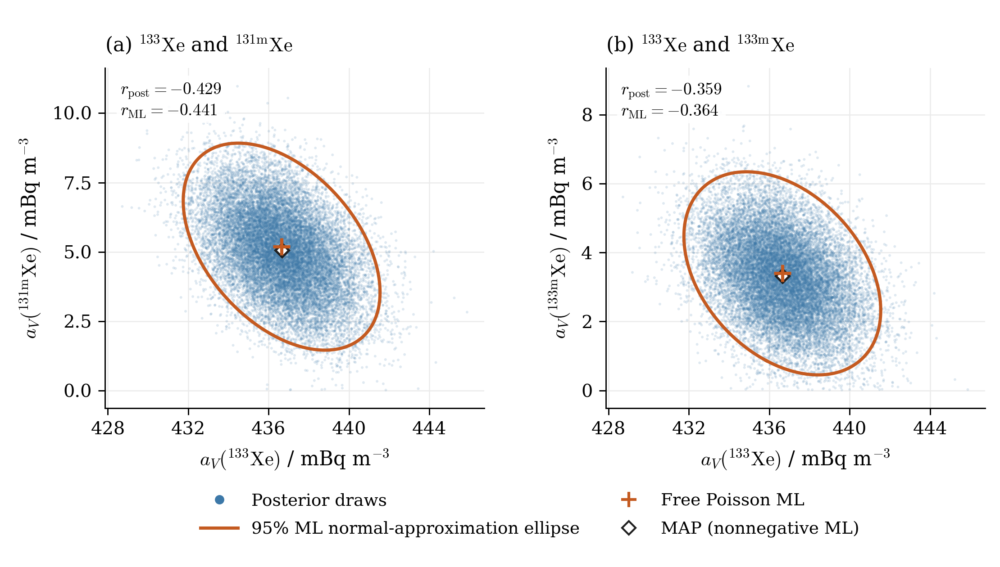
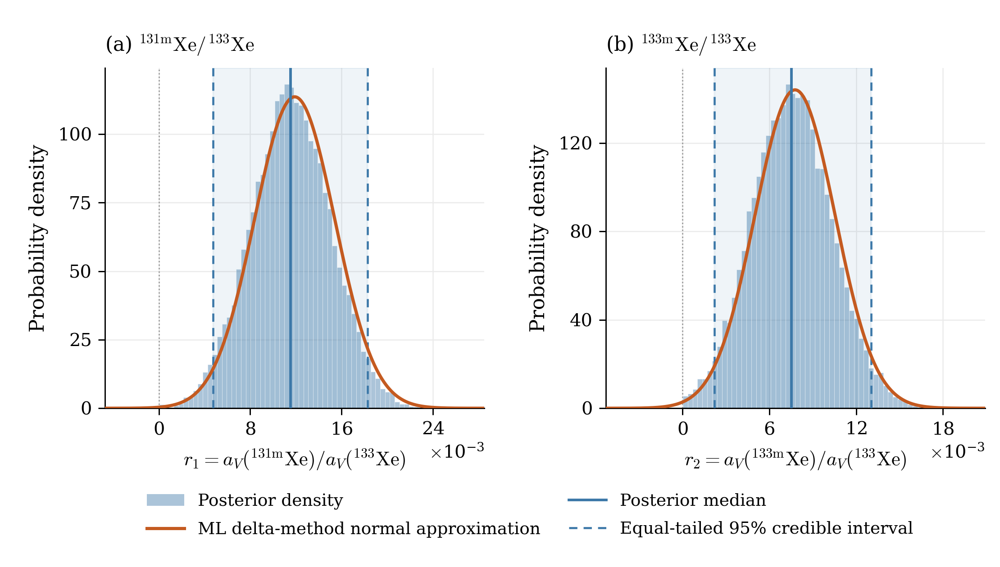

# XeMat: байесовские концентрации и отношения — детектор 222, проба 16 августа 2025 года

Расчёт от 26 октября 2026 года по трём PHD-файлам, предоставленным пользователем. Использованы исходные `Rs_222` и `Rg_222` из `constants.py`, фиксированные ROI и новые фиксированные эффективности пользователя. Кинетика пересчитана по временам этого комплекта. Сравнение относится к одной модели с фиксированными калибровками.

## Данные и модель

| Блок | Исходный файл | Начало измерения из PHD | Реальное время, с | Живое время, с |
|---|---|---|---:|---:|
| SAMPLE | SAMPLE20250816192330864.PHD | 2025-08-16T05:20:17.600000 | 50593.17 | 50400.0 |
| GASBK | GASBK20250816032815.phd | 2025-08-15T20:26:35.100000 | 25300.73 | 25200.0 |
| DETBK | DETBK2025061021311249.PHD | 2025-06-07T21:22:55.800000 | 259696.2 | 259200.0 |

Все файлы относятся к детектору **222**. Фиксированные ROI в порядке **1, 2, 3, 5, 6, 7, 8**; их границы и все матрицы сохранены в `source/scenario.json` и `source/measurement_arrays.npz`. Исходные отсчёты не вычитались и не заменялись модельными средними:

| Блок | ROI 1 | ROI 2 | ROI 3 | ROI 5 | ROI 6 | ROI 7 | ROI 8 |
|---|---:|---:|---:|---:|---:|---:|---:|
| SAMPLE | 91 | 146 | 37519 | 12772 | 6632 | 12975 | 2102 |
| GASBK | 54 | 64 | 98 | 17 | 13 | 21 | 14 |
| DETBK | 496 | 765 | 452 | 71 | 77 | 93 | 91 |

Время сбора 43173.0 с, ожидания 15618.6 с, интервал начала GASBK → SAMPLE 32022.5 с. Объём Xe 1.13655 см³; использованный эквивалентный объём воздуха V₀ = 13.0637931034 м³. Заголовочный объём воздуха сохранён как метаданные; применяется исходное преобразование XeMat.

| Изотоп | ε SAMPLE | ε GASBK | Branching |
|---|---:|---:|---:|
| Xe135 | 0.251173 | 0.251173 | 0.9020 |
| Xe133 | 0.385000 | 0.385000 | 0.3700 |
| Xe131m | 0.244096 | 0.244096 | 0.5400 |
| Xe133m | 0.244096 | 0.244096 | 0.5577 |

Для SAMPLE и GASBK применён один и тот же пользовательский массив ε = [0.251173, 0.3850, 0.244096, 0.244096], в порядке Xe135, Xe133, Xe131m, Xe133m. Он сохранён в `calibration_config.json` и передан в локальную копию реестра эффективностей при сборке матриц. Файлы ядра и матрицы из `constants.py` не изменялись. Для ROI 7 ← Xe133: Rs = 0.347, Rg = 0.18.

Чувствительность использует ε × branching. Радон: исходный режим `legacy`, ε = 0.3, branching = 0.37. Его первая координата после исходного пересчёта — вспомогательный параметр, не атмосферная концентрация радона.

$$x_j\mid z\sim\operatorname{Poisson}(\mu_j),\qquad \mu=S z=M Q^{-1}z,\quad Q=\operatorname{diag}(T_V,I_{12}).$$

Здесь $z=[a_V;\gamma;\zeta]$: пять компонент свежей пробы, пять компонент памяти и семь средних DETBK. Совместно варьируются все 17 параметров при всех 21 исходных наблюдениях. Свежий ксенон ограничен именно в атмосферных координатах после кинетического пересчёта. Входной аддитивный `b=0`: детекторный фон находится внутри `S @ z`, а не вычитается.

## Prior и алгоритм

$$p(z)\propto\mathbf{1}_{\{z\geq0\}},\qquad p(z\mid x)\propto\prod_{j=1}^{21}\frac{\mu_j^{x_j}e^{-\mu_j}}{x_j!}\,\mathbf{1}_{\{z\geq0\}}.$$

Prior постоянный без верхней границы; он несобственный, но posterior здесь нормируем. Матрица S неотрицательна, сумма каждого её столбца положительна, поэтому правдоподобие имеет экспоненциально убывающие хвосты, умноженные на полином.

Использован PyMC NUTS: `u ~ HalfFlat`, `z = scale * u`. Постоянные масштабы — статистические σ исходного ММП, они служат только для численной параметризации и не задают ширину prior. PyMC автоматически вводит `q=log(u)` и якобиан `+sum(q)`; вручную второй якобиан не добавлялся. Проверено совпадение программной лог-плотности с пуассоновским правдоподобием плюс один якобиан.

Для этого комплекта один раз рассчитаны свободный и неотрицательный пуассоновский ММП штатными решателями XeMat. Опорная MAP — это сохранённое неотрицательное решение в физических координатах; отдельная дополнительная оптимизация для MCMC не выполнялась. Начала четырёх цепей различны и строго положительны, сохранены в `initial_states.npz`.

Четыре цепи: по 2000 warmup и 5000 сохранённых итераций, всего 20000 совместных выборок. `target_accept=0.95`, `max_treedepth=12`, `init=adapt_diag`. Seed sampler = 2026102621, seed начальных состояний = 2026102622. Данные не моделировались заново; Lc, Ld, MDC не пересчитывались.

## Сходимость и точность Монте-Карло

Проверены все 17 физических параметров и оба отношения: max R̂ = **1.000887**; минимальные bulk-ESS / tail-ESS среди них — **14625 / 7162**. Для четырёх концентраций и двух отношений: **14625 / 7162**. Увеличение длительности по заданным критериям не потребовалось.

| Цепь | Divergences после warmup | Divergences в warmup | E-BFMI | Средняя вероятность принятия | Макс. глубина дерева |
|---:|---:|---:|---:|---:|---:|
| 0 | 0 | 3 | 0.964 | 0.937 | 5 |
| 1 | 0 | 3 | 0.899 | 0.951 | 5 |
| 2 | 0 | 3 | 0.919 | 0.953 | 5 |
| 3 | 0 | 3 | 0.928 | 0.953 | 5 |

Во время настройки было 12 divergences; после настройки — 0, достижений предельной глубины — 0. Warmup сохранён отдельно в NetCDF и исключён из сводных характеристик. Все 20000 последующих итераций сохранены и использованы; отбраковки нет. MCSE средних, SD, медиан и обеих границ интервала приведены в CSV. MCSE описывает точность MCMC, а posterior SD — неопределённость параметра.

## Концентрации

Все значения в **mBq m⁻³**. Интервалы posterior — равновероятностные по хвостам 95% **credible intervals**. σ ММП — исключительно статистическая; ошибки эффективностей/объёма не добавлялись и ковариация на приведённый девианс не умножалась.

| Изотоп | Свободный ММП | σ ММП | MAP | Posterior mean | Median | SD | 95% credible interval | MCSE mean |
|---|---:|---:|---:|---:|---:|---:|---|---:|
| Xe135 | 0.266144 | 0.36661 | 1.16331e-12 | 0.191177 | 0.149835 | 0.16133 | [0.00580101, 0.595524] | 0.00101 |
| Xe133 | 436.649 | 2.00117 | 436.66 | 436.645 | 436.634 | 1.99262 | [432.8, 440.606] | 0.0142 |
| Xe131m | 5.19165 | 1.52322 | 5.05955 | 5.03256 | 5.02708 | 1.5001 | [2.073, 7.95211] | 0.0112 |
| Xe133m | 3.39598 | 1.20365 | 3.32503 | 3.29186 | 3.28437 | 1.19455 | [0.97091, 5.6802] | 0.00955 |

## Отношения из совместных выборок

Каждая реализация даёт $r_1=a_V(^{131m}\mathrm{Xe})/a_V(^{133}\mathrm{Xe})$ и $r_2=a_V(^{133m}\mathrm{Xe})/a_V(^{133}\mathrm{Xe})$. Числитель и знаменатель взяты из одной итерации одной цепи; корреляции сохранены.

Для ММП использован дельта-метод: $K_r=G K_z^{\mathrm{stat}}G^T$, где $K_z$ — полная ковариация 17 совместных параметров. Для одного отношения градиент имеет компоненты `1/a_den` по числителю и `−a_num/a_den²` по знаменателю; перекрёстный ковариационный член сохранён.

| Отношение | ММП | σ delta | Posterior mean | Median | SD | 95% credible interval | MCSE mean |
|---|---:|---:|---:|---:|---:|---|---:|
| Xe131m/Xe133 | 0.01188975 | 0.003512802 | 0.01153249 | 0.01151414 | 0.003458233 | [0.004735941, 0.01827361] | 2.57e-05 |
| Xe133m/Xe133 | 0.007777369 | 0.002769736 | 0.007543633 | 0.007521678 | 0.00274858 | [0.00221758, 0.01305079] | 2.2e-05 |

## Что видно при сравнении

- Для Xe133 posterior близок к нормальному приближению ММП по центру и ширине. Среднее 436.645 против ММП 436.649 mBq m⁻³; SD отличается на -0.43%.
- Для Xe131m и Xe133m posterior SD отличаются от статистических σ ММП на -1.52% и -0.76% соответственно. Различия ширины небольшие; сдвиги средних и медиан приведены в таблицах вместе с MCSE. Это свойства распределений в данной модели, а не доказательство большей точности или лучшего покрытия.
- Для отношений Xe131m/Xe133 и Xe133m/Xe133 SD отличаются от дельта-метода на -1.55% и -0.76%. Относительная MCSE этих posterior SD составляет 0.79% и 0.80%; небольшие расхождения ширины следует оценивать с учётом этой точности. Обе формы распределений в основном близки к нормальным приближениям, при сохранённой неотрицательной области posterior.
- Для Xe135 свободный ММП положительный (0.266144 mBq m⁻³), а совместная MAP практически нулевая. Posterior положителен и асимметричен: среднее 0.191177, медиана 0.149835, SD 0.16133 mBq m⁻³. Неотрицательность накладывается одновременно на свежую пробу, память и фон; поэтому MAP не получается простым занулением отрицательных координат свободной оценки.
- Все 17 координат интегрируются совместно. Posterior нельзя понимать как независимое обрезание одномерных нормальных кривых ММП.

Корреляции (posterior / исходный статистический ММП): Xe133–Xe131m: -0.4293 / -0.4410; Xe133–Xe133m: -0.3593 / -0.3640.

Положительная нижняя граница равновероятностного credible interval **не используется как обнаружение**: при непрерывном prior на положительной полуоси вероятность строго положительного параметра равна единице по построению. Ни тест обнаружения, ни частотное покрытие этих интервалов в данной работе не оценивались. Выводы условны относительно исходной модели и фиксированных калибровок.

## Рисунки и файлы



Облака — все 20000 posterior draws. Эллипсы — исходное **нормальное приближение ММП**, с χ²₂,₀․₉₅ = 5.991464547; они не являются апостериорными областями. Отмечены свободный ММП и сохранённая MAP.



Гистограммы нормированы по всем выборкам. Линиями показаны медианы и равновероятностные credible intervals. Нормальное приближение дельта-метода не обрезано при нуле и не перенормировано; для r₂ его вероятность отрицательного хвоста 0.249%.

- `posterior.npz`: `z[chain,draw,parameter]` = 4×5000×17, четыре концентрации в mBq/m³, два отношения, названия, единицы и sampler statistics. Нативные первые пять координат `z` — Bq/m³; `gamma` — опорные отсчёты GASBK; `zeta` — средние DETBK.
- `posterior.nc`: те же posterior draws плюс warmup отдельно и полная диагностика NUTS. `parameters.json` описывает порядок и единицы.
- `concentrations.csv`, `ratios.csv`, `posterior_summary_all.csv`: среднее, медиана, SD, квантили и сравнение с исходным ММП.
- `diagnostics.csv`, `chain_diagnostics.csv`, `diagnostics.json`: R̂, ESS, MCSE и диагностика NUTS.
- `original_mle.npz`, `original_mle_parameters.csv`, `original_mle_covariance_*.csv`: исходные оценки, MAP и статистические ковариации; `posterior_covariances.npz` и соответствующие CSV — эмпирические posterior ковариации (делитель N−1) и корреляции.
- `source/`: точные пользовательские PHD, подготовленные матрицы, два сохранённых ММП-результата для этого комплекта и неизменённый снимок ядра. Lc, Ld и MDC отсутствуют в этом расчёте; поле `detection` в результатах равно `null`.
- `scenario.json`, `settings.json`, `initial_states.npz`, `versions.json`, `source_manifest.json`: параметры данных, prior, seeds, версии и контрольные суммы.
- `bayesian_joint_concentrations.{pdf,png}`, `bayesian_ratios.{pdf,png}`: два векторных PDF и PNG 300 dpi. `plot_bayesian.py` меняет оформление без MCMC; `figures.tex` содержит английские подписи и вставку PDF.
- `calibration_config.json` фиксирует пользовательские ε и branching; `prepare_model.py` воспроизводит матрицы и две исходные ММП-оценки без расчёта пределов обнаружения.
- `sample_posterior.py`, `summarize_posterior.py`, `build_report.py`, `verify_bayesian.py`, `package.py`: воспроизведение и проверка. `verification.json`, `checksums.json` — результаты проверки и SHA-256.

## Воспроизведение

Исходное ядро: `69ff5a62ccaaddeb6372f7f003109ce5ff6cf333`. Python 3.12.14; PyMC 5.25.1; ArviZ 0.22.0; NumPy 2.3.5; SciPy 1.17.0. Полные основные версии закреплены в `requirements.txt`.

```bash
python -m pip install -r requirements.txt
# Only change figures; no sampling:
python plot_bayesian.py
# Recompute summaries / checks from archived draws:
python summarize_posterior.py
python build_report.py
python verify_bayesian.py
# Optional: rebuild the original model and two ML fits:
python prepare_model.py
# Re-run MCMC only if needed (overwrites posterior files):
python sample_posterior.py
python summarize_posterior.py
python plot_bayesian.py
python build_report.py
python verify_bayesian.py
```

Seed и начальные состояния воспроизводимы; между платформами и версиями компилятора возможны численные различия траекторий MCMC. Сохранённые выборки позволяют воспроизводить все приведённые таблицы и рисунки без повторного расчёта цепей.

## English summary for the manuscript

The original detector-222 response matrices and the user-supplied fixed efficiencies were used for a joint Poisson analysis of all 21 SAMPLE, GASBK and DETBK counts. A constant prior was assigned on the nonnegative orthant of all 17 physical parameters. Four NUTS chains retained 20,000 joint draws after adaptation, with 0 post-warmup divergences, maximum rank-normalized R-hat 1.000887, and satisfactory effective sample sizes. Posterior uncertainty for 133Xe, 131mXe, 133mXe and both ratios was close to the original statistical ML normal approximation. For the 131mXe/133Xe and 133mXe/133Xe ratios, the posterior standard deviations differed from the delta-method values by -1.55% and -0.76%, respectively. The corresponding relative Monte Carlo standard errors of posterior SD were 0.79% and 0.80%, so these small width differences should not be overinterpreted. The weak 135Xe component showed a marked boundary effect: the joint nonnegative ML/MAP estimate was essentially zero despite a positive free ML estimate. The posterior was obtained by joint inference over the signal, memory and detector-background parameters, rather than by truncating separate Gaussian marginals. These model-conditional results do not establish superior frequentist coverage or detection performance. All calibration quantities were fixed, and the ML comparison used statistical covariance only.
