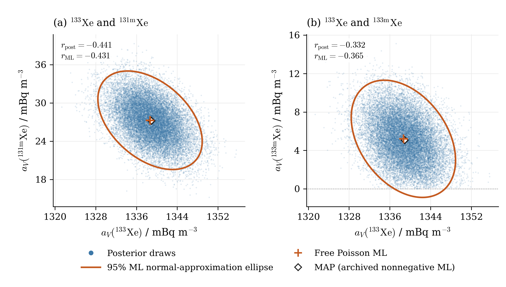
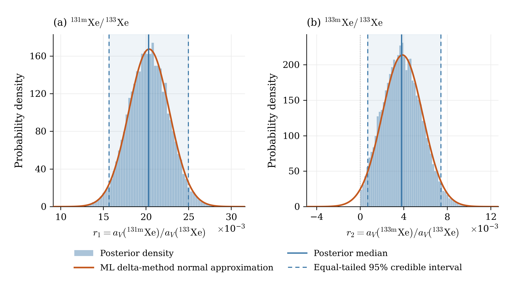

# XeMat: байесовские концентрации и отношения — исходная августовская проба

Расчёт от 25 октября 2026 года. Исходный архив: `XeMat_Aug17_Xe133_Xe131m_ellipse.zip`. Отклики, кинетика и калибровки сохранены. Сравнение относится к одной исходной модели с фиксированными калибровками.

## Данные и модель

| Блок | Исходный файл | Начало измерения из PHD | Реальное время, с | Живое время, с |
|---|---|---|---:|---:|
| SAMPLE | SAMPLE20250817072414190.PHD | 2025-08-16T17:20:58.100000 | 50596.17 | 50400.0 |
| GASBK | GASBK20250816152938777.PHD | 2025-08-16T08:27:58.500000 | 25300.72 | 25200.0 |
| DETBK | DETBK20250610213044796.PHD | 2025-06-07T21:22:30.500000 | 259694.2 | 259200.0 |

Все файлы относятся к детектору **221**. Фиксированные ROI в порядке **1, 2, 3, 5, 6, 7, 8**; их границы и все матрицы сохранены в `source/scenario.json` и `source/measurement_arrays.npz`. Исходные отсчёты не вычитались и не заменялись модельными средними:

| Блок | ROI 1 | ROI 2 | ROI 3 | ROI 5 | ROI 6 | ROI 7 | ROI 8 |
|---|---:|---:|---:|---:|---:|---:|---:|
| SAMPLE | 121 | 154 | 78936 | 27029 | 13886 | 28048 | 4441 |
| GASBK | 52 | 76 | 79 | 21 | 9 | 20 | 14 |
| DETBK | 522 | 854 | 494 | 66 | 64 | 89 | 97 |

Время сбора 43172.0 с, ожидания 15659.1 с, интервал начала GASBK → SAMPLE 31979.6 с. Объём Xe 0.82804 см³; использованный эквивалентный объём воздуха V₀ = 9.51770114943 м³. Заголовочный объём воздуха сохранён как метаданные; применяется исходное преобразование XeMat.

| Изотоп | ε SAMPLE | ε GASBK | Branching |
|---|---:|---:|---:|
| Xe135 | 0.241169 | 0.241169 | 0.9020 |
| Xe133 | 0.367784 | 0.367784 | 0.3700 |
| Xe131m | 0.233937 | 0.233937 | 0.5400 |
| Xe133m | 0.233937 | 0.233937 | 0.5577 |

Чувствительность использует ε × branching. Радон: исходный режим `legacy`, ε = 0.3, branching = 0.37. Его первая координата после исходного пересчёта — вспомогательный параметр, не атмосферная концентрация радона.

$$x_j\mid z\sim\operatorname{Poisson}(\mu_j),\qquad \mu=S z=M Q^{-1}z,\quad Q=\operatorname{diag}(T_V,I_{12}).$$

Здесь $z=[a_V;\gamma;\zeta]$: пять компонент свежей пробы, пять компонент памяти и семь средних DETBK. Совместно варьируются все 17 параметров при всех 21 исходных наблюдениях. Свежий ксенон ограничен именно в атмосферных координатах после кинетического пересчёта. Входной аддитивный `b=0`: детекторный фон находится внутри `S @ z`, а не вычитается.

## Prior и алгоритм

$$p(z)\propto\mathbf{1}_{\{z\geq0\}},\qquad p(z\mid x)\propto\prod_{j=1}^{21}\frac{\mu_j^{x_j}e^{-\mu_j}}{x_j!}\,\mathbf{1}_{\{z\geq0\}}.$$

Prior постоянный без верхней границы; он несобственный, но posterior здесь нормируем. Матрица S неотрицательна, сумма каждого её столбца положительна, поэтому правдоподобие имеет экспоненциально убывающие хвосты, умноженные на полином.

Использован PyMC NUTS: `u ~ HalfFlat`, `z = scale * u`. Постоянные масштабы — статистические σ исходного ММП, они служат только для численной параметризации и не задают ширину prior. PyMC автоматически вводит `q=log(u)` и якобиан `+sum(q)`; вручную второй якобиан не добавлялся. Проверено совпадение программной лог-плотности с пуассоновским правдоподобием плюс один якобиан.

Опорная MAP — сохранённое исходное неотрицательное пуассоновское решение в физических координатах. Новая оптимизация не выполнялась. Начала четырёх цепей различны и строго положительны, сохранены в `initial_states.npz`.

Четыре цепи: по 2000 warmup и 5000 сохранённых итераций, всего 20000 совместных выборок. `target_accept=0.95`, `max_treedepth=12`, `init=adapt_diag`. Seed sampler = 2026102501, seed начальных состояний = 2026102502. Данные не моделировались заново; Lc, Ld, MDC не пересчитывались.

## Сходимость и точность Монте-Карло

Проверены все 17 физических параметров и оба отношения: max R̂ = **1.000648**; минимальные bulk-ESS / tail-ESS среди них — **11458 / 6022**. Для четырёх концентраций и двух отношений: **12790 / 6022**. Увеличение длительности по заданным критериям не потребовалось.

| Цепь | Divergences после warmup | Divergences в warmup | E-BFMI | Средняя вероятность принятия | Макс. глубина дерева |
|---:|---:|---:|---:|---:|---:|
| 0 | 0 | 3 | 0.923 | 0.946 | 5 |
| 1 | 0 | 3 | 0.911 | 0.956 | 6 |
| 2 | 0 | 3 | 0.968 | 0.951 | 5 |
| 3 | 0 | 3 | 0.935 | 0.940 | 5 |

Во время настройки было 12 divergences; после настройки — 0, достижений предельной глубины — 0. Warmup сохранён отдельно в NetCDF и исключён из сводных характеристик. Все 20 000 последующих итераций сохранены и использованы; отбраковки нет. MCSE средних, SD, медиан и обеих границ интервала приведены в CSV. MCSE описывает точность MCMC, а posterior SD — неопределённость параметра.

## Концентрации

Все значения в **mBq m⁻³**. Интервалы posterior — равновероятностные по хвостам 95% **credible intervals**. σ ММП — исключительно статистическая; ошибки эффективностей/объёма не добавлялись и ковариация на приведённый девианс не умножалась.

| Изотоп | Свободный ММП | σ ММП | MAP | Posterior mean | Median | SD | 95% credible interval | MCSE mean |
|---|---:|---:|---:|---:|---:|---:|---|---:|
| Xe135 | -0.592784 | 0.553315 | 3.46157e-12 | 0.207728 | 0.155341 | 0.18893 | [0.00533826, 0.700897] | 0.00108 |
| Xe133 | 1338.67 | 4.18505 | 1338.92 | 1338.89 | 1338.87 | 4.14675 | [1330.85, 1347.08] | 0.0301 |
| Xe131m | 27.2778 | 3.15542 | 27.2154 | 27.1832 | 27.1931 | 3.15265 | [21.0253, 33.3629] | 0.0217 |
| Xe133m | 5.20943 | 2.49234 | 5.07567 | 5.16697 | 5.09514 | 2.33946 | [0.93421, 9.91543] | 0.019 |

## Отношения из совместных выборок

Каждая реализация даёт $r_1=a_V(^{131m}\mathrm{Xe})/a_V(^{133}\mathrm{Xe})$ и $r_2=a_V(^{133m}\mathrm{Xe})/a_V(^{133}\mathrm{Xe})$. Числитель и знаменатель взяты из одной итерации одной цепи; корреляции сохранены.

Для ММП использован дельта-метод: $K_r=G K_z^{\mathrm{stat}}G^T$, где $K_z$ — полная ковариация 17 совместных параметров. Для одного отношения градиент имеет компоненты `1/a_den` по числителю и `−a_num/a_den²` по знаменателю; перекрёстный ковариационный член сохранён.

| Отношение | ММП | σ delta | Posterior mean | Median | SD | 95% credible interval | MCSE mean |
|---|---:|---:|---:|---:|---:|---|---:|
| Xe131m/Xe133 | 0.02037679 | 0.002385256 | 0.02030628 | 0.02030742 | 0.00238303 | [0.01567, 0.02496606] | 1.65e-05 |
| Xe133m/Xe133 | 0.003891499 | 0.001866283 | 0.003860984 | 0.003806061 | 0.001751699 | [0.0006944543, 0.007420143] | 1.42e-05 |

## Что видно при сравнении

- Для Xe133 и Xe131m центры и ширины близки к исходному ММП. Отношение Xe131m/Xe133 также практически совпадает с нормальным приближением: SD различаются примерно на 0.1%, что меньше точности оценки этой SD по MCMC.
- Для Xe133m и Xe133m/Xe133 posterior имеет влияние границы нуля: SD примерно на 6.1% меньше, нижние границы credible intervals выше нормальных границ ММП. Это различие распределений при выбранном prior, а не доказательство большей точности или лучшего покрытия.
- Для Xe135 свободный ММП отрицательный, а MAP практически нулевой. Posterior положителен и асимметричен: среднее около 0.208 mBq m⁻³, медиана около 0.155. Это ожидаемое следствие ограничения и интегрирования по совместным неизвестным; сравниваются разные статистические конструкции.
- Неотрицательность задана для всех 17 координат, в том числе памяти и фона; поэтому Bayesian результат не следует понимать как простое обрезание отдельных одномерных нормальных кривых ММП.

Корреляции (posterior / исходный статистический ММП): Xe133–Xe131m: -0.4407 / -0.4306; Xe133–Xe133m: -0.3315 / -0.3654.

Положительная нижняя граница равновероятностного credible interval **не используется как обнаружение**: при непрерывном prior на положительной полуоси вероятность строго положительного параметра равна единице по построению. Ни тест обнаружения, ни частотное покрытие этих интервалов в данной работе не оценивались. Выводы условны относительно исходной модели и фиксированных калибровок.

## Рисунки и файлы



Облака — все 20 000 posterior draws. Эллипсы — исходное **нормальное приближение ММП**, с χ²₂,₀․₉₅ = 5.991464547; они не являются апостериорными областями. Отмечены свободный ММП и сохранённая MAP.



Гистограммы нормированы по всем выборкам. Линиями показаны медианы и равновероятностные credible intervals. Нормальное приближение дельта-метода не обрезано при нуле и не перенормировано; для r₂ его вероятность отрицательного хвоста 1.853%.

- `posterior.npz`: `z[chain,draw,parameter]` = 4×5000×17, четыре концентрации в mBq/m³, два отношения, названия, единицы и sampler statistics. Нативные первые пять координат `z` — Bq/m³; `gamma` — опорные отсчёты GASBK; `zeta` — средние DETBK.
- `posterior.nc`: те же posterior draws плюс warmup отдельно и полная диагностика NUTS. `parameters.json` описывает порядок и единицы.
- `concentrations.csv`, `ratios.csv`, `posterior_summary_all.csv`: среднее, медиана, SD, квантили и сравнение с исходным ММП.
- `diagnostics.csv`, `chain_diagnostics.csv`, `diagnostics.json`: R̂, ESS, MCSE и диагностика NUTS.
- `original_mle.npz`, `original_mle_parameters.csv`, `original_mle_covariance_*.csv`: исходные оценки, MAP и статистические ковариации; `posterior_covariances.npz` и соответствующие CSV — эмпирические posterior ковариации (делитель N−1) и корреляции.
- `source/`: точные файлы из исходного архива — PHD, подготовленные матрицы, два сохранённых ММП-результата и снимок ядра. В исходных JSON присутствуют прежние результаты Lc/MDC, но в этом исследовании они не пересчитывались и не использовались.
- `scenario.json`, `settings.json`, `initial_states.npz`, `versions.json`, `source_manifest.json`: параметры данных, prior, seeds, версии и контрольные суммы.
- `bayesian_joint_concentrations.{pdf,png}`, `bayesian_ratios.{pdf,png}`: два векторных PDF и PNG 300 dpi. `plot_bayesian.py` меняет оформление без MCMC; `figures.tex` содержит английские подписи и вставку PDF.
- `sample_posterior.py`, `summarize_posterior.py`, `build_report.py`, `verify_bayesian.py`, `package.py`: воспроизведение и проверка. `verification.json`, `checksums.json` — результаты проверки и SHA-256.

## Воспроизведение

Исходное ядро: `69ff5a62ccaaddeb6372f7f003109ce5ff6cf333`. Python 3.12.14; PyMC 5.25.1; ArviZ 0.22.0; NumPy 2.3.5; SciPy 1.17.0. Полные основные версии закреплены в `requirements.txt`.

```bash
python -m pip install -r requirements.txt
# Only change figures; no sampling:
python plot_bayesian.py
# Recompute summaries / checks from archived draws:
python summarize_posterior.py
python build_report.py
python verify_bayesian.py
# Re-run MCMC only if needed (overwrites posterior files):
python sample_posterior.py
python summarize_posterior.py
python plot_bayesian.py
python build_report.py
python verify_bayesian.py
```

Seed и начальные состояния воспроизводимы; между платформами и версиями компилятора возможны численные различия траекторий MCMC. Сохранённые выборки позволяют воспроизводить все приведённые таблицы и рисунки без повторного расчёта цепей.

## English summary for the manuscript

The original 21-count joint Poisson model was analysed with a constant prior on the nonnegative orthant of all 17 physical parameters. Four NUTS chains retained 20,000 joint draws after adaptation, with no post-warmup divergences and satisfactory rank-normalized R-hat and effective sample sizes. Posterior uncertainty for 133Xe, 131mXe and the 131mXe/133Xe ratio was close to the original statistical ML normal approximation. For 133mXe and its ratio to 133Xe, the posterior standard deviations were approximately 6% smaller and the lower equal-tailed credible limits differed more visibly. The weak 135Xe component showed a marked boundary effect. These are model-conditional differences, not evidence of superior coverage or detection performance. All calibration quantities were fixed, and the ML comparison used statistical covariance only.
