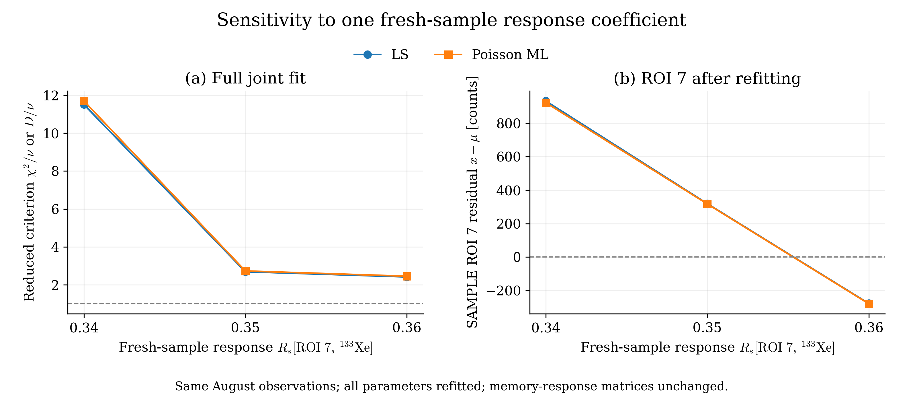

# Чувствительность августовского расчёта к Rs[ROI 7, Xe133]

Проверены ровно два изменения исходного коэффициента **0.34 → 0.35** и **0.34 → 0.36** (+0.01 и +0.02, то есть +2.94% и +5.88%).

**Матрица памяти Rg не менялась.** Неизменны также обе её временные формы R_g1/R_g2, перенос памяти F, времена, объём, эффективности, branching и исходные наблюдения SAMPLE/GASBK/DETBK. Параметры памяти и DETBK переоцениваются совместно с пробой обычным способом.

В каждом новом варианте выполнен обычный расчёт всеми четырьмя методами. Все восемь новых подгонок сошлись; исходные четыре результата при 0.34 взяты из сохранённого расчёта. Рабочий constants.py не редактировался: для сравнения используется временная копия реестра матриц в отдельном процессе.

## Девианс свободного пуассоновского ММП

В SAMPLE ROI 7 наблюдалось **28048 отсчётов** во всех вариантах. Ниже указана модель после полной повторной подгонки, а не результат подстановки старых активностей в новую матрицу.

| Коэффициент Rs | μ ROI 7 | x − μ | D ROI 7 | Общий D | D/ν, ν=4 |
|---:|---:|---:|---:|---:|---:|
| 0.34 | 27124.975 | +923.025 | 31.058895 | 46.779129 | 11.694782 |
| 0.35 | 27730.572 | +317.428 | 3.619768 | 10.918623 | 2.729656 |
| 0.36 | 28327.367 | -279.367 | 2.764244 | 9.812410 | 2.453103 |

Оба изменения резко уменьшают невязку. При 0.36 знак остатка ROI 7 уже меняется: модель предсказывает больше отсчётов, чем наблюдалось. Общий девианс у 0.36 немного ниже, чем у 0.35, но это сравнение трёх фиксированных вариантов, а не поиск оптимального коэффициента.

## Оценки четырёх концентраций

Свободный пуассоновский ММП, **mBq/m³**. Отрицательные оценки сохранены.

| Изотоп | Rs=0.34 | Rs=0.35 | Rs=0.36 |
|---|---:|---:|---:|
| Xe135 | -0.592784 | -0.628097 | -0.664006 |
| Xe133 | 1338.669835 | 1329.066178 | 1319.576967 |
| Xe131m | 27.277790 | 29.807335 | 32.329163 |
| Xe133m | 5.209432 | 7.082287 | 8.931924 |

При увеличении этой ячейки модель объясняет ROI 7 меньшим общим количеством свежего Xe133. Его вклад в других ROI также уменьшается, и совместная подгонка перераспределяет отсчёты между примесями. Поэтому меняется не только остаток ROI 7: оценки Xe131m и Xe133m заметно растут.

## Сопоставление всех методов

| Rs | LS χ²/ν | NNLS χ²/ν | Poisson ML D/ν | Nonnegative Poisson ML D/ν |
|---:|---:|---:|---:|---:|
| 0.34 | 11.510431 | 12.403498 | 11.694782 | 12.556333 |
| 0.35 | 2.688966 | 3.637970 | 2.729656 | 3.644593 |
| 0.36 | 2.414217 | 3.425323 | 2.453103 | 3.425645 |

Для ограниченных методов ν=4 — номинальное число степеней свободы. В каждом фиксированном варианте коэффициент Rs не включён в вектор подгоняемых параметров. Выбор калибровки по минимуму критерия на этой же пробе потребовал бы отдельного учёта такого подбора.

## Где остаются невязки

Вклады в девианс свободного ММП после подгонки:

| Область | Rs=0.34 | Rs=0.35 | Rs=0.36 |
|---|---:|---:|---:|
| SAMPLE ROI 3 | 6.792030 | 0.402328 | 1.749152 |
| SAMPLE ROI 7 | 31.058895 | 3.619768 | 2.764244 |
| SAMPLE ROI 8 | 6.654195 | 4.744923 | 3.169515 |

После изменения основной оставшийся вклад даёт SAMPLE ROI 8. Улучшение по одному комплекту показывает чувствительность результата к Rs, но не устанавливает новое калибровочное значение: его следует проверять на независимых измерениях.

## Условия и точное изменение модели

Детектор 221; SAMPLE20250817072414190.PHD, GASBK20250816152938777.PHD и прежний DETBK20250610213044796.PHD. Фиксированные ROI [1,2,3,5,6,7,8]. Эффективности SAMPLE/GASBK одинаковы: Xe135 0.241169, Xe133 0.367784, Xe131m 0.233937, Xe133m 0.233937; branching 0.9020, 0.3700, 0.5400, 0.5577 соответственно. Эффективности не содержат branching. Радон — прежняя модель ε=0.3, BR=0.37.

Заменена только базовая ячейка **Rs_221[5,2]** (индексы Python начинаются с нуля). Пересборка R_c=R_c0@C_s_c сохраняет врастание дочернего Xe133: поэтому в полной M меняются M[5,2] на δ и M[5,4] на δ×0.04051830888018503. Изменение второго элемента необходимо для согласованного столбца Xe133m. Все остальные элементы M и все матрицы памяти проверены на совпадение.

## Сохранённые материалы

- `summary.csv` — критерии и остаток ROI 7 для всех вариантов и методов.
- `roi_diagnostics.csv` — все 21 наблюдение, μ, остатки и вклады девианса для каждого расчёта.
- `concentrations.csv` — концентрации, σ, собственные LC/MDC и обнаружения каждого варианта.
- `original_034/`, `test_035/`, `test_036/` — полные сохранённые результаты; для новых вариантов также обычный TXT-экспорт.
- `baseline/`, `inputs/`, `kernel_snapshot/`, `scenario.json` — исходные данные и неизменённое ядро с происхождением.
- `run_sensitivity.py` — повторение ровно двух новых вариантов; `build_report.py` — оформление сохранённых таблиц без подгонки.
- `construction_checks.json`, `verification.json` — проверки неизменности памяти и согласованности результатов.

Версия ядра: `69ff5a62ccaaddeb6372f7f003109ce5ff6cf333`. Монте-Карло, автоматический поиск коэффициента и постоянная замена калибровки не выполнялись.
