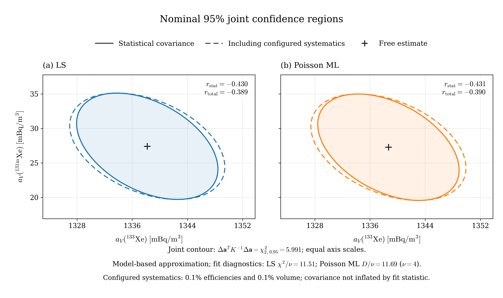

# XeMat: августовская проба и доверительные эллипсы Xe133–Xe131m

Обычная обработка трёх исходных спектров неизменённым XeMat, детектор **221**, фиксированные ROI и фиксированные эффективности. Использованы исходные различные Rs/Rg для пробы и памяти. SAMPLE, GASBK и DETBK подогнаны совместно: 21 наблюдение и 17 параметров. Все четыре метода сошлись; повторного моделирования наблюдений нет.

**Качество подгонки требует внимания:** χ²/ν = 11.5104 для свободного МНК и D/ν = 11.6948 для свободного ММП, ν = 4. Модель заметно расходится с наблюдениями относительно принятой статистической погрешности. Эллипсы ниже — номинальные 95%-е области в рамках этой модели; их фактическое 95%-е покрытие для реальных данных не проверено. Причина расхождения этим расчётом не установлена.

## Исходные данные и условия

| Роль | Файл | Начало измерения из #Acquisition | Реальное / живое время, s |
|---|---|---|---:|
| SAMPLE | SAMPLE20250817072414190.PHD | 2025-08-16T17:20:58.100000 | 50596.17 / 50400.0 |
| GASBK | GASBK20250816152938777.PHD | 2025-08-16T08:27:58.500000 | 25300.72 / 25200.0 |
| DETBK | DETBK20250610213044796.PHD | 2025-06-07T21:22:30.500000 | 259694.2 / 259200.0 |

Дата в имени SAMPLE — 17 августа; начало измерения в заголовке — **16 августа 2025 года, 17:20:58.1**. Временные поправки используют заголовок файла.

Объём ксенона: 0.82804 cm³. Использованный эффективный объём воздуха V₀ = V_Xe/0.087 = **9.51770114943 m³** — по обычной формуле программы. Поле air_volume в SAMPLE (18.4965 m³) сохранено в метаданных и не подменяет V₀.

Пробоотбор t_a=43172.0 s; ожидание t_p=15659.1 s; интервал начал GASBK→SAMPLE τ=31979.6 s. ROI: [1, 2, 3, 5, 6, 7, 8]; полные энергетические границы сохранены в scenario.json.

## Фиксированные эффективности и branching

Эффективности ε не включают branching; чувствительность I = ε × BR. Значения взяты из constants.py для детектора 221, а не из разделов #b-gEfficiency файлов.

| Изотоп | ε SAMPLE | ε GASBK | Branching BR | ε × BR |
|---|---:|---:|---:|---:|
| Xe135 | 0.241169 | 0.241169 | 0.9020 | 0.217534438 |
| Xe133 | 0.367784 | 0.367784 | 0.3700 | 0.136080080 |
| Xe131m | 0.233937 | 0.233937 | 0.5400 | 0.126325980 |
| Xe133m | 0.233937 | 0.233937 | 0.5577 | 0.130466665 |
| Rn222 | 0.300000 | 0.300000 | 0.3700 | 0.111000000 |

Для радона сохранён прежний режим legacy с обычной поправкой на распад. Его первая физическая координата вспомогательная; атмосферную концентрацию радона по ней не приводим.

Систематика в текущем обычном расчёте: δI = **0.001 = 0.1%** для каждого компонента и δV₀ = **0.001 = 0.1%**. Это фактические числа из constants.py. К полной ковариации добавлены принятые программой вклады чувствительностей и общего объёма. Неопределённость матриц R и возможные ошибки самой модели сюда не добавлялись.

## Результаты обычного расчёта

Все концентрации, σ, LC и MDC ниже — **mBq/m³**. σ означает одно стандартное отклонение, а не 95%-й интервал. Для ограниченных методов обычная ковариация не выдаётся: пропуск σ не означает нулевую погрешность. Решение об обнаружении в каждой семье методов основано на свободной оценке > LC, как в приложении.

| Метод | Изотоп | Концентрация | σ stat | σ total | LC | MDC | Обнаружение |
|---|---|---:|---:|---:|---:|---:|---|
| LS | Xe135 | -0.58725 | 0.5545478 | 0.5545484 | 0.9326318 | 1.954533 | нет |
| LS | Xe133 | 1338.186 | 4.185052 | 4.593138 | 0.7056927 | 1.451591 | да |
| LS | Xe131m | 27.41611 | 3.152386 | 3.152625 | 5.062505 | 10.17271 | да |
| LS | Xe133m | 5.285085 | 2.494635 | 2.494646 | 4.065444 | 8.186152 | да |
| NNLS | Xe135 | 0 | — | — | 0.9326318 | 1.954533 | нет |
| NNLS | Xe133 | 1338.459 | — | — | 0.7056927 | 1.451591 | да |
| NNLS | Xe131m | 27.34708 | — | — | 5.062505 | 10.17271 | да |
| NNLS | Xe133m | 5.157863 | — | — | 4.065444 | 8.186152 | да |
| Poisson ML | Xe135 | -0.5927841 | 0.5533154 | 0.553316 | 0.9345732 | 1.958416 | нет |
| Poisson ML | Xe133 | 1338.67 | 4.185047 | 4.593414 | 0.7090013 | 1.458348 | да |
| Poisson ML | Xe131m | 27.27779 | 3.155424 | 3.15566 | 5.063453 | 10.17461 | да |
| Poisson ML | Xe133m | 5.209432 | 2.49234 | 2.49235 | 4.066327 | 8.187919 | да |
| Nonnegative Poisson ML | Xe135 | 3.461573e-12 | — | — | 0.9345732 | 1.958416 | нет |
| Nonnegative Poisson ML | Xe133 | 1338.917 | — | — | 0.7090013 | 1.458348 | да |
| Nonnegative Poisson ML | Xe131m | 27.21537 | — | — | 5.063453 | 10.17461 | да |
| Nonnegative Poisson ML | Xe133m | 5.07567 | — | — | 4.066327 | 8.187919 | да |

## Эллипсы Xe133–Xe131m

Горизонтальная ось — концентрация Xe133, вертикальная — Xe131m. Крест показывает оценённую пару концентраций. Сплошная граница использует статистическую ковариацию, пунктирная — полную с указанной выше систематикой. Обе панели имеют одинаковый масштаб. Показан увеличенный участок около оценок; начало координат за пределами рисунка.

Пусть c=(a_V,Xe133, a_V,Xe131m). Область определяется условием

`(c − c_hat)^T @ inv(K_pair) @ (c − c_hat) ≤ χ²(2; 0.95) = 5.9914645471`.

K_pair — блок 2×2 ковариации концентраций, полученной из **полной** модели с памятью, радоном и DETBK. Остальные параметры оценивались совместно; их не считали известными при построении эллипса. Полуоси равны sqrt(5.99146 × собственное значение K_pair). Множитель 1.96 для одномерного интервала здесь не используется.

| Метод | Ковариация | Центр Xe133 | Центр Xe131m | r | Большая / малая полуось, mBq/m³ |
|---|---|---:|---:|---:|---:|
| LS | statistical | 1338.1857984 | 27.4161136 | -0.4302336 | 11.0962500 / 6.4305630 |
| LS | total | 1338.1857984 | 27.4161136 | -0.3894455 | 11.8534179 / 6.7414622 |
| Poisson ML | statistical | 1338.6698347 | 27.2777899 | -0.4305805 | 11.0996494 / 6.4336005 |
| Poisson ML | total | 1338.6698347 | 27.2777899 | -0.3897523 | 11.8565191 / 6.7456417 |

Отрицательный наклон показывает взаимную компенсацию оценок: при большем Xe133 модель допускает меньший Xe131m, и наоборот. Статистическая корреляция около −0.43 практически одинакова у МНК и ММП. Это корреляция погрешностей оценок в данной модели, а не корреляция истинных концентраций в атмосфере.

Для ММП использована обратная ожидаемая информация Фишера при fitted μ. Для МНК — ковариация существующего оценивателя с весами w=1/x при x>0, w=1 при x=0. Нормальная аппроксимация и веса по наблюдениям дают приближённые области. Ковариации не умножались на приведённый χ² или девианс. Эллипсы не использовались для изменения обычных LC/MDC и решений об обнаружении.

## Сходимость и качество подгонки

| Метод | Статистика | ν | Статистика / ν | Сходимость |
|---|---:|---:|---:|---|
| LS | χ² = 46.0417257 | 4 | 11.5104314 | да |
| NNLS | χ² = 49.6139939 | 4 | 12.4034985 | да |
| Poisson ML | D = 46.7791294 | 4 | 11.6947823 | да |
| Nonnegative Poisson ML | D = 50.2253329 | 4 | 12.5563332 | да |

Для ограниченных методов ν=4 — номинальная нормировка. Численная сходимость подтверждена во всех четырёх расчётах; высокие χ²/ν и D/ν относятся к согласованности модели с данными. Полные остатки по ROI и предупреждения сохранены в обычных TXT/JSON отчётах.

## Файлы и воспроизведение

Версия ядра XeMat: `69ff5a62ccaaddeb6372f7f003109ce5ff6cf333`. Контрольные суммы входных PHD и неизменённого ядра находятся в scenario.json. Монте-Карло не запускалось; seed не нужен.

- `result_wls.txt`, `result_nnls.txt`, `result_poisson.txt`, `result_poisson_nonnegative.txt` — обычный оформленный экспорт приложения; соответствующие JSON содержат полные результаты.
- `concentrations.csv`, `fit_quality.csv`, `ellipses.json`, `measurement_arrays.npz` — числа, ковариации, модели и исходные ROI-отсчёты.
- `xe133_xe131m_ellipse.pdf`, `xe133_xe131m_ellipse.png` — векторный PDF и PNG 300 dpi; `figures.tex` — английская подпись.
- `inputs/`, `kernel_snapshot/`, `analyze_measurement.py` — воспроизведение обычного расчёта.
- `plot_ellipse.py` и `build_report.py` — изменение оформления по сохранённым результатам без повторной подгонки.
- `verification.json`, `figure_verification.json`, `checksums.json` — проверки чисел и артефактов.

Для перестроения рисунка: `python plot_ellipse.py`. Для повторения обычного расчёта: `python analyze_measurement.py`. Зависимости указаны в requirements.txt.
