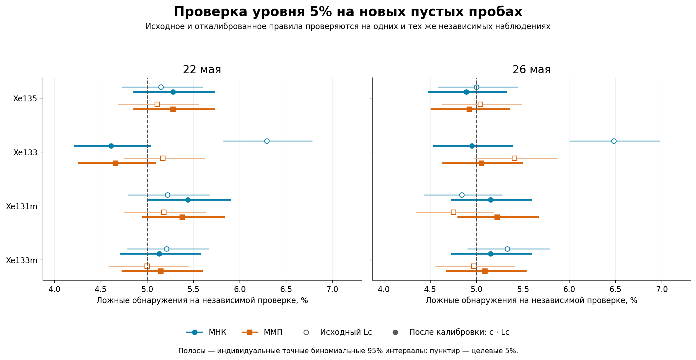
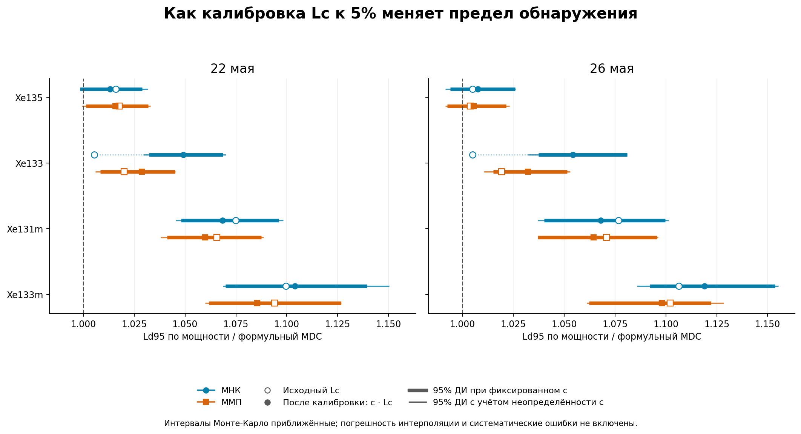
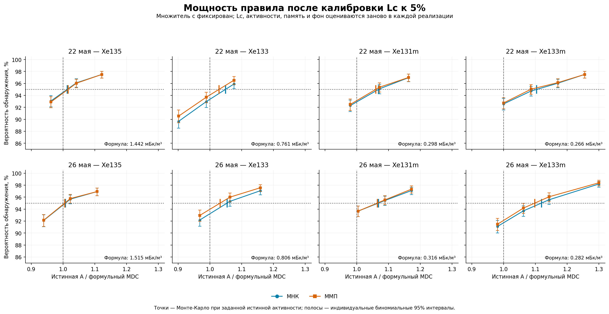

# Номинальный MDC после калибровки Lc к 5%

**После калибровки независимая проверка дала 4.61–5.44% ложных обнаружений.** Уровень приблизился к целевым 5%; конечная калибровочная серия не задаёт его точно.

Самое заметное изменение — Xe133 при МНК (22 мая: 6.29% → 4.61%, Ld95 +4.4%; 26 мая: 6.48% → 4.95%, Ld95 +4.9%). В остальных сочетаниях изотопа, метода и комплекта изменение Ld95 составило от -0.8% до +1.3%. Эти результаты относятся к заданному чистому фону и майским условиям измерения; для других смесей они не устанавливают уровень ошибки автоматически.

Для Xe133 исходное правило давало меньший Ld95 у МНК при большей частоте ложных обнаружений. После отдельной калибровки обоих методов в этих двух сценариях меньший Ld95 получен у ММП (разница 22 мая: 1.9%; 26 мая: 2.1%). Поэтому сравнение одного Ld95 без проверки уровня ошибки могло привести к обратному выводу о чувствительности. Неопределённость парной разности приведена ниже.

Цель — проверить предел обнаружения на чистом детекторном фоне при целевом уровне ложных обнаружений 5% для одного проверяемого изотопа. Это не вероятность хотя бы одного ложного обнаружения среди всех четырёх изотопов. Для каждого изотопа, метода и майского комплекта множитель порога определён на обучающей серии пустых проб, затем проверен на независимой нулевой серии. После фиксации множителя найден Ld95 — активность, при которой вероятность обнаружения достигает примерно 95%.

При генерации нет пробы, газовой памяти и радона. Для проверки мощности вводится только один свежий изотоп Xe. Все 21 наблюдение SAMPLE/GASBK/DETBK разыгрываются по Пуассону; все 17 параметров полной модели продолжают оцениваться. Истинные средние детекторного фона заданы по прежнему DETBK 221. Систематические ошибки не моделируются.

**Новые реализации: 63 000** — 40 000 для калибровки, 20 000 для независимой проверки нуля и 3 000 для дополнительных точек мощности. Повторно использовано 75 000 независимых от калибровки сигнальных реализаций предыдущего исследования. Поисковые точки прежнего исследования в формальную оценку Ld не входят.

## Что изменилось в правиле обнаружения

Исходное правило: $\widehat A>L_c$. После калибровки: $\widehat A>cL_c$. На обучающих пустых пробах строится распределение $R=\widehat A/L_c$; множитель $c$ выбирается как порядковая статистика ранга $k=\lceil(n+1)0.95\rceil$. При 20000 наблюдений это 19001-е значение по возрастанию. Равенство порогу не считается обнаружением. Такое правило задаёт примерно 5% в среднем по повторным калибровочным сериям; уровень конкретного зафиксированного c проверяется отдельно. Совпадения значений могут сделать правило консервативнее.

Множитель c фиксируется до независимой проверки и не меняется при введении сигнала. Сам Lc остаётся случайным: в каждой реализации он пересчитывается прежней процедурой с удалением целевого свежего изотопа из неотрицательной подгонки. Решение об обнаружении использует свободную оценку активности. МНК и ММП обрабатывают одни и те же наблюдения.

Поправка относится к конкретному чистому фону и условиям измерения. Это не универсальная поправка для произвольных смесей, памяти или других фоновых уровней.

## Независимая проверка уровня ложных обнаружений

Оба правила проверены на одних и тех же новых пустых пробах. Интервалы — индивидуальные точные биномиальные 95% ДИ. Наблюдаемая частота имеет погрешность Монте-Карло: калибровка не гарантирует ровно 5.000% в конечной проверочной серии.

| Комплект | Изотоп | Метод | Множитель c | Исходный Lc: частота и 95% ДИ | После калибровки: частота и 95% ДИ |
|---|---|---|---:|---|---|
| 22 мая | Xe135 | МНК | 0.9911 | 5.15% (4.72–5.60%) | 5.28% (4.85–5.74%) |
| 22 мая | Xe135 | ММП | 0.9914 | 5.11% (4.69–5.56%) | 5.28% (4.85–5.74%) |
| 22 мая | Xe133 | МНК | 1.0937 | 6.29% (5.82–6.78%) | 4.61% (4.21–5.04%) |
| 22 мая | Xe133 | ММП | 1.0258 | 5.17% (4.74–5.62%) | 4.66% (4.26–5.09%) |
| 22 мая | Xe131m | МНК | 0.9854 | 5.22% (4.79–5.67%) | 5.44% (5.00–5.90%) |
| 22 мая | Xe131m | ММП | 0.9870 | 5.18% (4.75–5.63%) | 5.38% (4.95–5.84%) |
| 22 мая | Xe133m | МНК | 1.0048 | 5.21% (4.78–5.66%) | 5.13% (4.71–5.58%) |
| 22 мая | Xe133m | ММП | 0.9890 | 5.00% (4.58–5.45%) | 5.15% (4.72–5.60%) |
| 26 мая | Xe135 | МНК | 1.0098 | 5.00% (4.58–5.45%) | 4.89% (4.48–5.33%) |
| 26 мая | Xe135 | ММП | 1.0077 | 5.04% (4.62–5.49%) | 4.92% (4.50–5.36%) |
| 26 мая | Xe133 | МНК | 1.1030 | 6.48% (6.01–6.98%) | 4.95% (4.53–5.39%) |
| 26 мая | Xe133 | ММП | 1.0272 | 5.41% (4.97–5.87%) | 5.05% (4.63–5.50%) |
| 26 мая | Xe131m | МНК | 0.9827 | 4.84% (4.43–5.28%) | 5.15% (4.72–5.60%) |
| 26 мая | Xe131m | ММП | 0.9805 | 4.75% (4.34–5.19%) | 5.22% (4.79–5.67%) |
| 26 мая | Xe133m | МНК | 1.0152 | 5.33% (4.90–5.79%) | 5.15% (4.72–5.60%) |
| 26 мая | Xe133m | ММП | 0.9923 | 4.97% (4.55–5.41%) | 5.09% (4.67–5.54%) |

У 15 из 16 отдельных 95% интервалов целевые 5% лежат внутри. Случаи вне интервала приведены с дополнительными знаками, чтобы округление не скрыло границу: 22 мая, МНК, Xe131m: 5.44%, 95% ДИ 5.004–5.903%. Это индивидуальные интервалы, без одновременной гарантии для всех 16 проверок. По этим проверочным результатам множители не перенастраивались.

## Формула, исходная процедура и откалиброванный порог

Все активности — **мБк/м³**. Формульный номинальный MDC рассчитан при заданной фоновой смеси по полной информации Фишера. Ld95 исходной и откалиброванной процедур найден из мощности обработки случайных наблюдений. Для каждого метода оба правила применяются к одной сигнальной серии; изменение Ld связано с изменением критического порога.

| Комплект | Изотоп | Метод | Формульный MDC | Ld95 с исходным Lc | Ld95 после калибровки | Изменение Ld95 |
|---|---|---|---:|---:|---:|---:|
| 22 мая | Xe135 | МНК | 1.4424 | 1.4654 | 1.4613 | -0.3% |
| 22 мая | Xe135 | ММП | 1.4424 | 1.4679 | 1.4651 | -0.2% |
| 22 мая | Xe133 | МНК | 0.7605 | 0.7646 | 0.7979 | +4.4% |
| 22 мая | Xe133 | ММП | 0.7605 | 0.7758 | 0.7823 | +0.8% |
| 22 мая | Xe131m | МНК | 0.2983 | 0.3207 | 0.3187 | -0.6% |
| 22 мая | Xe131m | ММП | 0.2983 | 0.3179 | 0.3162 | -0.5% |
| 22 мая | Xe133m | МНК | 0.2658 | 0.2923 | 0.2935 | +0.4% |
| 22 мая | Xe133m | ММП | 0.2658 | 0.2908 | 0.2886 | -0.8% |
| 26 мая | Xe135 | МНК | 1.5152 | 1.5228 | 1.5265 | +0.2% |
| 26 мая | Xe135 | ММП | 1.5152 | 1.5210 | 1.5234 | +0.2% |
| 26 мая | Xe133 | МНК | 0.8060 | 0.8100 | 0.8497 | +4.9% |
| 26 мая | Xe133 | ММП | 0.8060 | 0.8215 | 0.8320 | +1.3% |
| 26 мая | Xe131m | МНК | 0.3162 | 0.3405 | 0.3377 | -0.8% |
| 26 мая | Xe131m | ММП | 0.3162 | 0.3386 | 0.3366 | -0.6% |
| 26 мая | Xe133m | МНК | 0.2817 | 0.3116 | 0.3152 | +1.1% |
| 26 мая | Xe133m | ММП | 0.2817 | 0.3105 | 0.3093 | -0.4% |

Меньший Ld при одинаковом подтверждённом уровне ложных обнаружений означает более высокую чувствительность в выбранных условиях. При сравнении методов нужно учитывать неопределённость и Ld, и независимой оценки ложноположительной частоты.

## Неопределённость калибровки и Ld95

Два вида интервалов отвечают на разные вопросы. Условный интервал оценивает $Ld95(\widehat c)$ для фактически зафиксированного множителя и учитывает погрешность сигнальной серии Монте-Карло. Интервал с учётом неопределённости калибровки дополнительно разыгрывает обучающую серию: он оценивает неопределённость $Ld95(c_0)$, где $c_0$ — истинный 95-й квантиль нулевого распределения статистики. Это интервалы оценки предела обнаружения, а не распределения индивидуальных активностей или MDC будущих проб. Систематические ошибки и неопределённость принятого фонового среднего в них не входят.

Интерполяция кривой мощности между рассчитанными точками приближённая. Bootstrap-интервалы условны относительно итоговой сетки; ошибка формы кривой между узлами не включена. Отсутствующие интервалы обозначены явно и не заменяются другим видом интервала. Результаты независимой проверки приводятся без повторной настройки c по проверочным данным, даже если отдельный интервал частоты не включает 5%.

| Комплект | Изотоп | Метод | c: 95% ДИ | Ld95 | 95% ДИ при фиксированном c | 95% ДИ с учётом неопределённости c |
|---|---|---|---|---:|---|---|
| 22 мая | Xe135 | МНК | 0.9726–1.0120 | 1.4613 | 1.4401–1.4841 | 1.4399–1.4881 |
| 22 мая | Xe135 | ММП | 0.9735–1.0126 | 1.4651 | 1.4442–1.4885 | 1.4412–1.4899 |
| 22 мая | Xe133 | МНК | 1.0744–1.1136 | 0.7979 | 0.7851–0.8127 | 0.7829–0.8138 |
| 22 мая | Xe133 | ММП | 1.0093–1.0404 | 0.7823 | 0.7669–0.7947 | 0.7650–0.7949 |
| 22 мая | Xe131m | МНК | 0.9671–1.0039 | 0.3187 | 0.3126–0.3270 | 0.3119–0.3276 |
| 22 мая | Xe131m | ММП | 0.9686–1.0025 | 0.3162 | 0.3106–0.3244 | 0.3097–0.3247 |
| 22 мая | Xe133m | МНК | 0.9866–1.0271 | 0.2935 | 0.2844–0.3029 | 0.2841–0.3058 |
| 22 мая | Xe133m | ММП | 0.9724–1.0065 | 0.2886 | 0.2823–0.2995 | 0.2817–0.2996 |
| 26 мая | Xe135 | МНК | 0.9885–1.0282 | 1.5265 | 1.5061–1.5543 | 1.5025–1.5546 |
| 26 мая | Xe135 | ММП | 0.9870–1.0245 | 1.5234 | 1.5038–1.5477 | 1.5023–1.5503 |
| 26 мая | Xe133 | МНК | 1.0799–1.1217 | 0.8497 | 0.8362–0.8713 | 0.8320–0.8713 |
| 26 мая | Xe133 | ММП | 1.0086–1.0472 | 0.8320 | 0.8182–0.8476 | 0.8145–0.8487 |
| 26 мая | Xe131m | МНК | 0.9615–1.0012 | 0.3377 | 0.3289–0.3477 | 0.3279–0.3483 |
| 26 мая | Xe131m | ММП | 0.9642–0.9999 | 0.3366 | 0.3279–0.3464 | 0.3281–0.3466 |
| 26 мая | Xe133m | МНК | 0.9930–1.0373 | 0.3152 | 0.3076–0.3250 | 0.3059–0.3254 |
| 26 мая | Xe133m | ММП | 0.9754–1.0124 | 0.3093 | 0.2993–0.3161 | 0.2989–0.3179 |

### Консервативные сеточные границы

Эти границы получены из одновременных биномиальных интервалов на рассчитанных активностях при предположении монотонной истинной мощности. Для варианта с неопределённостью c дополнительно использован интервал коэффициента c. Сеточные границы консервативны и могут оставаться открытыми, если сетка недостаточно широка. Бюджеты вероятностей ошибок заданы в протоколе.

| Комплект | Изотоп | Метод | Границы 95% при фиксированном c | Границы 95% с учётом неопределённости c |
|---|---|---|---|---|
| 22 мая | Xe135 | МНК | 1.3877–1.5031 | 1.3877–1.6185 |
| 22 мая | Xe135 | ММП | 1.3877–1.6185 | 1.3877–1.6185 |
| 22 мая | Xe133 | МНК | от 0.7520, верхняя граница не определена | от 0.7520, верхняя граница не определена |
| 22 мая | Xe133 | ММП | 0.7520–0.8182 | 0.6858–0.8182 |
| 22 мая | Xe131m | МНК | 0.2924–0.3470 | 0.2924–0.3470 |
| 22 мая | Xe131m | ММП | 0.2924–0.3470 | 0.2924–0.3470 |
| 22 мая | Xe133m | МНК | 0.2658–0.3336 | 0.2658–0.3336 |
| 22 мая | Xe133m | ММП | 0.2658–0.3112 | 0.2658–0.3336 |
| 26 мая | Xe135 | МНК | 1.4227–1.6777 | 1.4227–1.6777 |
| 26 мая | Xe135 | ММП | 1.4227–1.6777 | 1.4227–1.6777 |
| 26 мая | Xe133 | МНК | 0.7802–0.9339 | 0.7802–0.9339 |
| 26 мая | Xe133 | ММП | 0.7802–0.9339 | 0.7802–0.9339 |
| 26 мая | Xe131m | МНК | 0.3176–0.3707 | 0.0000–0.3707 |
| 26 мая | Xe131m | ММП | 0.3176–0.3707 | 0.0000–0.3707 |
| 26 мая | Xe133m | МНК | 0.2993–0.3662 | 0.2763–0.3662 |
| 26 мая | Xe133m | ММП | 0.2763–0.3662 | 0.2763–0.3662 |

### Парное сравнение методов

Разность Δ = Ld95(МНК) − Ld95(ММП), мБк/м³. Положительная разность означает больший предел обнаружения у МНК. Парные интервалы учитывают, что оба метода анализируют одинаковые реализации.

| Комплект | Изотоп | Δ | 95% ДИ при фиксированных c | 95% ДИ с учётом неопределённости c |
|---|---|---:|---|---|
| 22 мая | Xe135 | -0.0038 | -0.0085–-0.0010 | -0.0064–0.0023 |
| 22 мая | Xe133 | 0.0155 | 0.0080–0.0278 | 0.0071–0.0303 |
| 22 мая | Xe131m | 0.0025 | 0.0005–0.0055 | 0.0000–0.0058 |
| 22 мая | Xe133m | 0.0049 | 0.0009–0.0084 | 0.0011–0.0125 |
| 26 мая | Xe135 | 0.0031 | -0.0002–0.0087 | -0.0039–0.0076 |
| 26 мая | Xe133 | 0.0177 | 0.0093–0.0314 | 0.0078–0.0318 |
| 26 мая | Xe131m | 0.0011 | -0.0013–0.0044 | -0.0022–0.0053 |
| 26 мая | Xe133m | 0.0059 | 0.0029–0.0137 | 0.0021–0.0129 |

## Кривые мощности после калибровки

Вертикальная отметка на уровне 95% показывает интерполированную оценку Ld95. Горизонтальная ось нормирована на прежний формульный MDC. Интервалы точек мощности условны относительно зафиксированных множителей c.

## Сохранённые условия измерения

| Параметр | 22 мая | 26 мая |
|---|---:|---:|
| SAMPLE: живое время, с | 50400.0 | 50400.0 |
| SAMPLE: реальное время, с | 50591.18 | 50591.17 |
| GASBK: живое время, с | 25200.0 | 25200.0 |
| GASBK: реальное время, с | 25301.71 | 25301.71 |
| DETBK: живое время, с | 259200.0 | 259200.0 |
| Сбор, с | 43173.0 | 43172.0 |
| Задержка после сбора, с | 16401.1 | 15779.7 |
| Разность начал SAMPLE/GASBK, с | 32970.0 | 31927.5 |
| Объём Xe, см³ | 1.251290 | 1.180360 |
| Эффективный объём воздуха, м³ | 14.382644 | 13.567356 |
| Поле air_volume исходного SAMPLE, м³ | 18.130979 | 18.592930 |

Сохранена конвенция объёма существующего ядра: объёмная активность рассчитывается через эффективный объём воздуха, полученный из объёма Xe. Использованы фиксированные ROI и эффективности, калибровки детектора 221 и прежняя модель радона. Полные матрицы и метаданные сохранены в manifest.json.

## Пропуски и воспроизводимость

Зарегистрированных ошибок подгонки/расчёта: 0. Отсутствующие решения не заменяются новыми реализациями; числа доступных решений и пропусков приведены в summary.json.

Калибровка, независимая проверка нуля и сигнальные серии разделены. При добавлении сигнальных точек Ld95 исходного правила пересчитывается на той же итоговой сетке, что и Ld95 откалиброванного правила. Исторические значения предыдущего исследования, если они отличаются, сохранены отдельно в summary.json. Для генерации принят фиксированный фон по исходному DETBK, а при каждой обработке его параметры оцениваются заново совместно с SAMPLE и GASBK. Поэтому статистическая погрешность нового измерения DETBK учтена. Неопределённость выбранного фонового среднего и калибровок не моделировалась.

## Файлы

- [Проверка уровня 5% — PDF](calibrated_alpha.pdf)
- [Изменение Ld95 — PDF](calibrated_ld.pdf)
- [Кривые мощности — PDF](calibrated_power.pdf)
- [Таблица CSV](results.csv)
- [Полная численная сводка](summary.json)
- [Протокол](protocol_ru.md)
- [Архив с данными и скриптами](XeMat_calibrated_nominal_MDC_May.zip)
