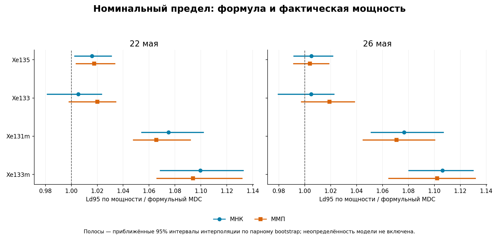
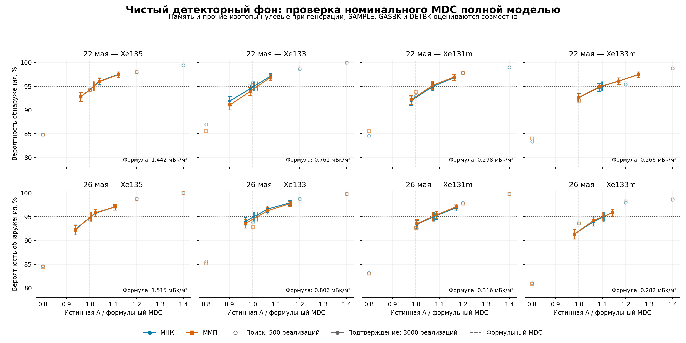

# Номинальный MDC: чистый детекторный фон и полная модель XeMat

Два майских комплекта задают времена, сбор, задержки, объёмы и калибровки. Проба, газовая память и радон в генерирующей смеси равны нулю; затем вводится один изотоп ксенона. Все 17 параметров продолжают оцениваться при обработке.

Средний фон задан по исходному DETBK детектора 221, без использования смеси из совместной подгонки реальных SAMPLE/GASBK. По ROI [1,2,3,5,6,7,8] zeta=[522,854,494,66,64,89,97] отсчётов за 259200 с. SAMPLE, GASBK и DETBK разыгрываются заново по Пуассону.

Всего **101,000 новых реализаций**: 10,000 на нуле, 16,000 для поиска, 72,000 для подтверждения и 3,000 для уточнения сетки. Технические 400 реализаций исключены. МНК и ММП обрабатывают одни и те же векторы. Пороги не калибровались к фактическим 5%; использована действующая процедура Lc с вычетом целевого изотопа из неотрицательной подгонки.

## Формульные номинальные значения

Единицы — мБк/м³. Эти значения вычислены итерационно при точно заданной фоновой смеси, с полной информационной матрицей всех 17 параметров. При таком задании они общие для МНК и ММП; различия способов оценивания проявляются в Монте-Карло.

В координатах $\eta=[a_V;\gamma;\zeta]$ положено $\eta_0=[0;0;\zeta_D]$, $\mu_i(A)=S_V(\eta_0+A e_i)+b$ и $K_i(A)=(S_V^T\operatorname{diag}(\mu_i(A))^{-1}S_V)^{-1}$. Использованы $L_C=z_{0.95}\sqrt{K_i(0)_{ii}}$ и положительный корень $MDC=L_C+z_{0.95}\sqrt{K_i(MDC)_{ii}}$. Обращение записано здесь как математическая формула; вычисления выполняются устойчивыми разложениями.

Формула использует нормальное приближение. Точное численное решение этого уравнения само по себе не гарантирует ровно 95% мощности при пуассоновских наблюдениях и случайном оценённом Lc. Для этого и выполнена отдельная проверка Монте-Карло.

| Изотоп | Lc, 22 мая | MDC, 22 мая | Lc, 26 мая | MDC, 26 мая |
|---|---:|---:|---:|---:|
| Xe135 | 0.68648 | 1.44240 | 0.72126 | 1.51515 |
| Xe133 | 0.34782 | 0.76051 | 0.36863 | 0.80603 |
| Xe131m | 0.13385 | 0.29832 | 0.14187 | 0.31619 |
| Xe133m | 0.11635 | 0.26584 | 0.12333 | 0.28170 |

## Активность для фактических 95% обнаружения

Ниже — приближённые Ld95, найденные по независимым подтверждающим точкам мощности. Это характеристика действующей процедуры, включая случайный Lc и повторное оценивание фона.

| Комплект | Изотоп | Формульный MDC | Ld95 МНК | Ld95 ММП | Отклонение ММП от формулы |
|---|---|---:|---:|---:|---:|
| 22 мая | Xe135 | 1.4424 | 1.4654 | 1.4679 | +1.8% |
| 22 мая | Xe133 | 0.7605 | 0.7646 | 0.7758 | +2.0% |
| 22 мая | Xe131m | 0.2983 | 0.3207 | 0.3179 | +6.6% |
| 22 мая | Xe133m | 0.2658 | 0.2923 | 0.2908 | +9.4% |
| 26 мая | Xe135 | 1.5152 | 1.5228 | 1.5210 | +0.4% |
| 26 мая | Xe133 | 0.8060 | 0.8100 | 0.8215 | +1.9% |
| 26 мая | Xe131m | 0.3162 | 0.3405 | 0.3386 | +7.1% |
| 26 мая | Xe133m | 0.2817 | 0.3116 | 0.3105 | +10.2% |

На этих двух комплектах формульный MDC и оценка Ld95 близки для Xe135/Xe133. Для Xe131m оценка Ld95 по ММП выше формулы примерно на 7%, для Xe133m — на 9–10%. МНК даёт близкие пределы, но у него выше частота ложных обнаружений Xe133; поэтому меньшее Ld само по себе не означает преимущество метода. Эти отклонения относятся к данному чистому фону и не являются универсальной поправкой к MDC.

## Ложные обнаружения на чистом фоне

В нулевой серии нет ни одного изотопа и нет памяти. Одна серия из 5000 векторов на комплект используется для всех четырёх проверок. Интервалы ниже — индивидуальные точные биномиальные 95% интервалы.

| Комплект | Изотоп | МНК: частота и 95% ДИ | ММП: частота и 95% ДИ |
|---|---|---|---|
| 22 мая | Xe135 | 5.14% (4.54–5.79%) | 5.14% (4.54–5.79%) |
| 22 мая | Xe133 | 6.40% (5.74–7.11%) | 5.46% (4.85–6.13%) |
| 22 мая | Xe131m | 5.02% (4.43–5.66%) | 5.12% (4.53–5.77%) |
| 22 мая | Xe133m | 5.02% (4.43–5.66%) | 4.92% (4.34–5.56%) |
| 26 мая | Xe135 | 4.90% (4.32–5.54%) | 4.94% (4.36–5.58%) |
| 26 мая | Xe133 | 6.36% (5.70–7.07%) | 5.24% (4.64–5.89%) |
| 26 мая | Xe131m | 4.32% (3.77–4.92%) | 4.30% (3.75–4.90%) |
| 26 мая | Xe133m | 5.28% (4.68–5.94%) | 4.98% (4.39–5.62%) |

## Неопределённость Ld95

Точечный Ld95 — локальная линейная интерполяция подтверждающих точек. Приближённый парный bootstrap (2000 повторов) учитывает случайность Монте-Карло, но не ошибку формы кривой между узлами. Пересечения, уходящие за сетку, учитываются в порядке квантилей как цензурированные слева/справа, а не исключаются. Если граница 95% интервала оказывается вне сетки, требуется новая независимая точка. Сеточные границы консервативнее: они получены инверсией одновременных биномиальных интервалов при предположении монотонной истинной мощности.

| Комплект | Изотоп | Метод | Ld95 | Приближённый 95% ДИ | Сеточные границы 95% | Bootstrap с пересечением |
|---|---|---|---:|---|---|---|
| 22 мая | Xe135 | МНК | 1.4654 | 1.4454–1.4874 | 1.3877–1.6185 | 2000/2000 |
| 22 мая | Xe135 | ММП | 1.4679 | 1.4472–1.4913 | 1.3877–1.6185 | 2000/2000 |
| 22 мая | Xe133 | МНК | 0.7646 | 0.7461–0.7785 | 0.6858–0.8182 | 2000/2000 |
| 22 мая | Xe133 | ММП | 0.7758 | 0.7589–0.7868 | 0.6858–0.8182 | 2000/2000 |
| 22 мая | Xe131m | МНК | 0.3207 | 0.3144–0.3288 | 0.2924–0.3470 | 2000/2000 |
| 22 мая | Xe131m | ММП | 0.3179 | 0.3125–0.3258 | 0.2924–0.3470 | 2000/2000 |
| 22 мая | Xe133m | МНК | 0.2923 | 0.2840–0.3012 | 0.2658–0.3112 | 2000/2000 |
| 22 мая | Xe133m | ММП | 0.2908 | 0.2833–0.3010 | 0.2658–0.3336 | 2000/2000 |
| 26 мая | Xe135 | МНК | 1.5228 | 1.5017–1.5484 | 1.4227–1.6777 | 2000/2000 |
| 26 мая | Xe135 | ММП | 1.5210 | 1.5013–1.5439 | 1.4227–1.6777 | 2000/2000 |
| 26 мая | Xe133 | МНК | 0.8100 | 0.7891–0.8244 | 0.0000–0.8571 | 1991/2000 |
| 26 мая | Xe133 | ММП | 0.8215 | 0.8036–0.8373 | 0.7802–0.8571 | 2000/2000 |
| 26 мая | Xe131m | МНК | 0.3405 | 0.3322–0.3501 | 0.3176–0.3707 | 2000/2000 |
| 26 мая | Xe131m | ММП | 0.3386 | 0.3303–0.3480 | 0.3176–0.3707 | 2000/2000 |
| 26 мая | Xe133m | МНК | 0.3116 | 0.3042–0.3184 | от 0.2763, верхняя граница не достигнута | 1990/2000 |
| 26 мая | Xe133m | ММП | 0.3105 | 0.2998–0.3189 | от 0.2763, верхняя граница не достигнута | 1982/2000 |

## Сохранённые параметры измерений

| Параметр | 22 мая | 26 мая |
|---|---:|---:|
| SAMPLE: живое время, с | 50400.0 | 50400.0 |
| SAMPLE: реальное время, с | 50591.18 | 50591.17 |
| GASBK: живое время, с | 25200.0 | 25200.0 |
| GASBK: реальное время, с | 25301.71 | 25301.71 |
| DETBK: живое время, с | 259200.0 | 259200.0 |
| Сбор, с | 43173.0 | 43172.0 |
| Задержка после сбора, с | 16401.1 | 15779.7 |
| Разность начал SAMPLE/GASBK, с | 32970.0 | 31927.5 |
| Объём Xe, см³ | 1.251290 | 1.180360 |
| Расчётный эффективный объём воздуха, м³ | 14.382644 | 13.567356 |
| Поле air_volume исходного SAMPLE, м³ | 18.130979 | 18.592930 |

Сохранена конвенция объёма существующего ядра: объёмные активности рассчитываются через effective_air_volume_m3, полученный из объёма Xe. Поле air_volume показано отдельно для прозрачности. Эффективности SAMPLE/GASBK [0.2057,0.314,0.258,0.258] и branching из constants.py сохранены. Матрицы R — для детектора 221. Все матрицы и метаданные находятся в manifest.json.

## Проверки и ограничения

Ошибок подгонки/расчёта Lc: 0. Недоступные решения, если возникают, сохраняются и учитываются отдельно; новые реализации взамен не генерируются.

Формульные MDC независимо проверены через проекцию мешающих столбцов и решение скалярного уравнения методом Брента. Проверено совпадение Lc в fixed/iterative, воспроизведение отсчётов по seed, сохранение полной модели, нулевая память генератора и отсутствие изменений математического ядра.

Чистый фон не означает известный без ошибки фон при анализе: zeta оценивается заново по каждому совместному комплекту. Фоновые средние для генерации фиксированы по одному исходному DETBK; неопределённость самих этих принятых средних и калибровок не включена. Систематические ошибки не моделировались. Следовательно, результаты условны относительно данного детектора, фонового уровня и майских параметров.

## Файлы

- [График сопоставления PDF](nominal_comparison.pdf)
- [Проверка мощности PDF](nominal_power.pdf)
- [Таблица CSV](results.csv)
- [Полная численная сводка](summary.json)
- [Протокол](protocol_ru.md)
- [Архив с данными](XeMat_nominal_MDC_May.zip)
