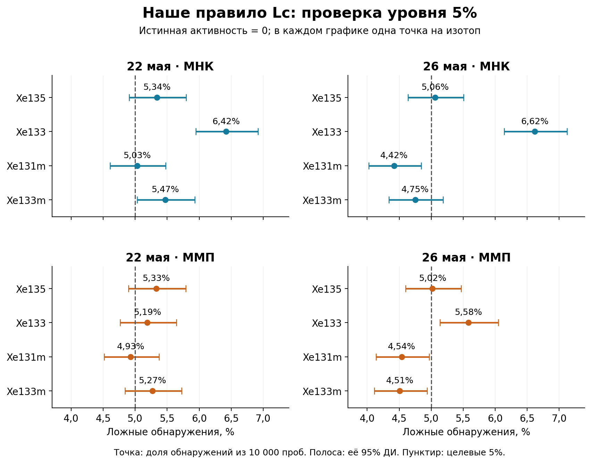
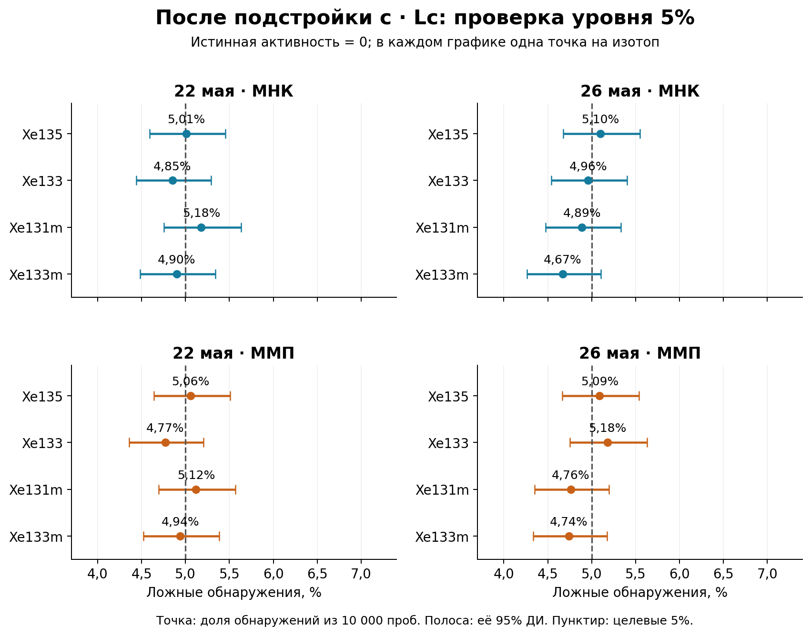
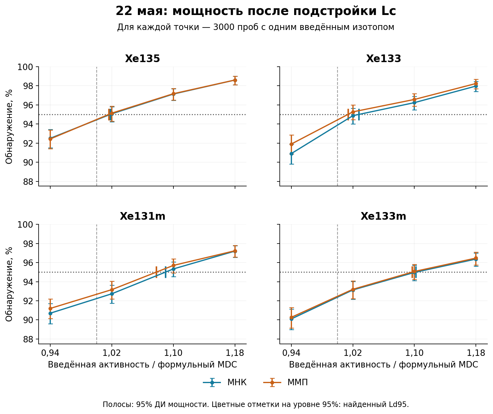
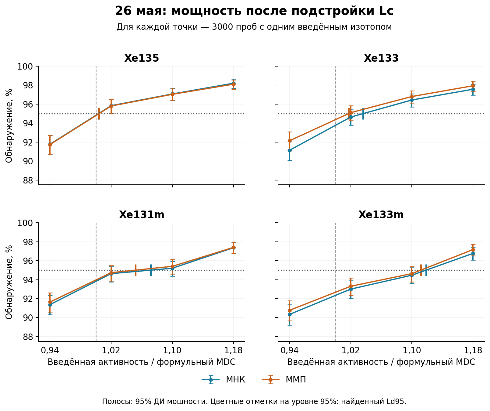

# XeMat: Lc и номинальный MDC при новых эффективностях 221

## 1. Что именно исследовали

Чистая проба: истинные активности всех компонентов пробы и газовой памяти равны нулю. Остаётся детекторный фон. Для исследования обнаружения вводим по одному свежему изотопу Xe. Рассмотрены условия комплектов «22 мая» и «26 мая»: времена, объёмы, фиксированные ROI и матрицы R детектора 221.

| Изотоп | ε SAMPLE | ε GASBK |
|---|---|---|
| Xe135 | 0,241169 | 0,241169 |
| Xe133 | 0,367784 | 0,367784 |
| Xe131m | 0,233937 | 0,233937 |
| Xe133m | 0,233937 | 0,233937 |

Эффективности ε — доли без branching; коэффициенты ветвления учитываются отдельно. Живое время SAMPLE / GASBK / DETBK: 14 / 7 / 72 часа. Эффективный объём воздуха: 14,3826 м³ для 22 мая и 13,5674 м³ для 26 мая.

В каждом повторе разыгрываем все 21 пуассоновский отсчёт SAMPLE/GASBK/DETBK и заново оцениваем все 17 параметров. Истинное среднее детекторного фона фиксировано по принятому DETBK; отсчёты нового измерения DETBK случайны, и фон заново подгоняется. Систематические ошибки не включены.

Всего использовано 156 000 реализаций: 40 000 для настройки порогов, 20 000 для независимой проверки пустой пробы и 96 000 для определения мощности. Это выжимка уже проверенного расчёта; повторное моделирование для этого документа не проводилось.

## 2. Наше исходное правило обнаружения

Обнаружение: Â > Lc. Â — свободная оценка активности по МНК или ММП. Lc в каждой реализации пересчитывается нашей процедурой: неотрицательная вспомогательная подгонка, удаление целевого свежего вклада из ожидаемого спектра и расчёт порога. Удаляется вклад из модели ожиданий; наблюдаемые отсчёты при этом не вычитаются.

При истинной активности A = 0 каждое срабатывание — ложное обнаружение. Цель 5% означает около 500 ложных обнаружений на 10 000 повторов для одного проверяемого изотопа.

## 3. Ложные обнаружения по исходному Lc

Рисунок 1. Только исходное правило Â > Lc; подстройки здесь нет.

Как читать рисунок: сверху показан МНК, снизу — ММП; слева условия 22 мая, справа — 26 мая. В каждом небольшом графике на каждый изотоп приходится ровно одна точка.

Точка — процент ложных обнаружений среди 10 000 пустых проб. Например, Xe133 / МНК / 22 мая: 642 срабатывания из 10 000, то есть 6,42%. Это частота решений, а не активность и не отдельный спектр.

Горизонтальная полоса — 95% доверительный интервал этой частоты, то есть погрешность самого Монте-Карло. Для примера 6,42% интервал равен 5,95–6,92%. Пунктир — целевые 5%. Весь интервал справа от пунктира указывает на превышение уровня; слева — на более консервативное правило. Пересечение с 5% означает совместимость с этим уровнем с учётом погрешности, но не доказывает точное равенство.

Методы применялись к одним и тем же наблюдениям. Точки разных методов и изотопов поэтому связаны; это не 16 независимых экспериментов. Интервалы индивидуальные, без поправки на одновременное рассмотрение всех точек.

## 4. Числа для исходного Lc

| Комплект | Изотоп | МНК: частота [95% ДИ] | ММП: частота [95% ДИ] |
|---|---|---|---|
| 22 мая | Xe135 | 5,34% [4,91–5,80%] | 5,33% [4,90–5,79%] |
| 22 мая | Xe133 | 6,42% [5,95–6,92%] | 5,19% [4,76–5,64%] |
| 22 мая | Xe131m | 5,03% [4,61–5,48%] | 4,93% [4,51–5,37%] |
| 22 мая | Xe133m | 5,47% [5,03–5,93%] | 5,27% [4,84–5,73%] |
| 26 мая | Xe135 | 5,06% [4,64–5,51%] | 5,02% [4,60–5,47%] |
| 26 мая | Xe133 | 6,62% [6,14–7,13%] | 5,58% [5,14–6,05%] |
| 26 мая | Xe131m | 4,42% [4,03–4,84%] | 4,54% [4,14–4,97%] |
| 26 мая | Xe133m | 4,75% [4,34–5,19%] | 4,51% [4,11–4,94%] |

Наиболее заметное превышение — Xe133 при МНК: 6,42% и 6,62%. При ММП для Xe133 26 мая получено 5,58%; при МНК для Xe133m 22 мая — 5,47%. Есть и значения достоверно ниже 5% по отдельным интервалам: Xe131m обоими методами 26 мая и Xe133m при ММП 26 мая.

## 5. Как выполняли подстройку к уровню 5%

На отдельной серии из 20 000 пустых проб для каждого комплекта строили R = Â / Lc. Для каждого изотопа и метода выбирали множитель c: 19 001-е значение R по возрастанию, то есть оценку верхнего 5%-го порога. После этого c фиксировали.

Новое правило: Â > c · Lc. При c > 1 порог повышается, при c < 1 — понижается. Сам Lc по-прежнему вычисляется заново для каждой реализации. Проверочные 10 000 пустых проб на комплект не использовались для выбора или повторной настройки c.

| Комплект | Изотоп | c для МНК | c для ММП |
|---|---|---|---|
| 22 мая | Xe135 | 1,0195 | 1,0166 |
| 22 мая | Xe133 | 1,0941 | 1,0281 |
| 22 мая | Xe131m | 0,9915 | 0,9910 |
| 22 мая | Xe133m | 1,0298 | 1,0158 |
| 26 мая | Xe135 | 0,9985 | 0,9976 |
| 26 мая | Xe133 | 1,0975 | 1,0254 |
| 26 мая | Xe131m | 0,9801 | 0,9890 |
| 26 мая | Xe133m | 1,0043 | 0,9888 |

Пример Xe133 / МНК / 22 мая: c = 1,0941, то есть каждый рассчитанный Lc повышаем примерно на 9,4%. Это множитель порога Lc, а не готового MDC: итоговый предел обнаружения нужно заново определить по мощности.

## 6. Независимая проверка после подстройки

Рисунок 2. Только откалиброванное правило Â > c · Lc. Оси и расположение панелей совпадают с рисунком 1.

Эти точки рассчитаны на тех же проверочных пробах, что и рисунок 1. Изменилось правило решения, а не наблюдения. Все 16 частот лежат в диапазоне 4,67–5,18%; все индивидуальные 95% интервалы включают 5%. Это подтверждает согласие с целевым уровнем в исследованных условиях с точностью данного Монте-Карло.

| Комплект | Изотоп | МНК: частота [95% ДИ] | ММП: частота [95% ДИ] |
|---|---|---|---|
| 22 мая | Xe135 | 5,01% [4,59–5,46%] | 5,06% [4,64–5,51%] |
| 22 мая | Xe133 | 4,85% [4,44–5,29%] | 4,77% [4,36–5,21%] |
| 22 мая | Xe131m | 5,18% [4,75–5,63%] | 5,12% [4,70–5,57%] |
| 22 мая | Xe133m | 4,90% [4,49–5,34%] | 4,94% [4,52–5,38%] |
| 26 мая | Xe135 | 5,10% [4,68–5,55%] | 5,09% [4,67–5,54%] |
| 26 мая | Xe133 | 4,96% [4,54–5,40%] | 5,18% [4,75–5,63%] |
| 26 мая | Xe131m | 4,89% [4,48–5,33%] | 4,76% [4,35–5,20%] |
| 26 мая | Xe133m | 4,67% [4,26–5,10%] | 4,74% [4,33–5,17%] |

## 7. Формульные Lc/MDC и MDC исходного правила

Все дальнейшие активности — мБк/м³. Формульные Lc и MDC рассчитываются по полной информации Фишера для заданного чистого фона. Формульный Lc ниже — ориентир для этих условий; в моделируемых пробах он не используется как неизменный порог.

Численный MDC обозначаем Ld95: вводим фиксированную истинную активность одного изотопа, много раз разыгрываем отсчёты и применяем правило обнаружения. По кривой мощности находим активность, при которой срабатывает около 95% проб. Это численная оценка с погрешностью, а не математически точная константа.

| Комплект | Изотоп | Формула Lc | Формула MDC | Ld95 МНК исходный Lc | Ld95 ММП исходный Lc |
|---|---|---|---|---|---|
| 22 мая | Xe135 | 0,5855 | 1,2303 | 1,2402 | 1,2419 |
| 22 мая | Xe133 | 0,2975 | 0,6507 | 0,6458 | 0,6529 |
| 22 мая | Xe131m | 0,1477 | 0,3291 | 0,3599 | 0,3557 |
| 22 мая | Xe133m | 0,1284 | 0,2935 | 0,3208 | 0,3210 |
| 26 мая | Xe135 | 0,6152 | 1,2923 | 1,2973 | 1,2994 |
| 26 мая | Xe133 | 0,3153 | 0,6896 | 0,6853 | 0,6958 |
| 26 мая | Xe131m | 0,1565 | 0,3488 | 0,3813 | 0,3744 |
| 26 мая | Xe133m | 0,1361 | 0,3110 | 0,3462 | 0,3464 |

Численные MDC исходного правила относятся к ложноположительным частотам рисунка 1, которые не всегда равны 5%. Поэтому для сравнения при согласованном уровне приводим ниже результаты после подстройки.

## 8. Итоговые MDC после подстройки Lc

В таблице — Ld95 для правила Â > c · Lc. В квадратных скобках — 95% интервалы Монте-Карло при фиксированном найденном c. У каждого метода собственная подстройка к 5%.

| Комплект | Изотоп | Формульный MDC | МНК: Ld95 [95% ДИ] | ММП: Ld95 [95% ДИ] |
|---|---|---|---|---|
| 22 мая | Xe135 | 1,2303 | 1,2523 [1,2286–1,2805] | 1,2500 [1,2272–1,2782] |
| 22 мая | Xe133 | 0,6507 | 0,6688 [0,6563–0,6886] | 0,6596 [0,6503–0,6767] |
| 22 мая | Xe131m | 0,3291 | 0,3586 [0,3527–0,3665] | 0,3547 [0,3484–0,3623] |
| 22 мая | Xe133m | 0,2935 | 0,3234 [0,3154–0,3326] | 0,3220 [0,3145–0,3312] |
| 26 мая | Xe135 | 1,2923 | 1,2970 [1,2829–1,3149] | 1,2978 [1,2837–1,3159] |
| 26 мая | Xe133 | 0,6896 | 0,7147 [0,6975–0,7310] | 0,7016 [0,6899–0,7189] |
| 26 мая | Xe131m | 0,3488 | 0,3738 [0,3530–0,3887] | 0,3669 [0,3522–0,3869] |
| 26 мая | Xe133m | 0,3110 | 0,3479 [0,3390–0,3538] | 0,3457 [0,3370–0,3515] |

МНК и ММП дают близкие пределы. Для Xe131m и Xe133m численные MDC после подстройки примерно на 5–12% выше формульных; для Xe135 и Xe133 разница составляет около 0,4–3,6%. Сравнение методов следует делать с учётом интервалов, а не только последних цифр.

## 9. Как получены окончательные MDC: кривые мощности

Здесь показано только откалиброванное правило. Одна точка соответствует 3000 пробам при одной заданной истинной активности. По вертикали — процент обнаружений, по горизонтали — введённая активность, делённая на формульный MDC. Значение 1 соответствует формуле. Цветные отметки на горизонтали 95% показывают найденный Ld95.

Рисунок 3. Условия 22 мая; синий — МНК, оранжевый — ММП. Полосы отражают погрешность оценки мощности при фиксированных c.

Рисунок 4. Условия 26 мая. Множитель c не меняется при увеличении введённой активности; сам Lc вычисляется в каждой реализации заново.

Например, Xe133 / МНК / 22 мая: формула даёт 0,6507 мБк/м³, исходное правило — 0,6458 мБк/м³ при 6,42% ложных обнаружений, а после подстройки — 0,6688 мБк/м³ при проверочной частоте 4,85%. Последнее число найдено по мощности, а не умножением формульного MDC на c.

## 10. Неопределённость и границы применимости

Интервалы итоговой таблицы относятся к фактически выбранным c. Если учитывать также случайность обучения порога по 20 000 пробам, получаются отдельные интервалы, приведённые ниже. Они характеризуют оценку Ld95 для идеального порога c₀ — истинного 95-го квантиля нулевой статистики. В обоих случаях использовано 2000 bootstrap-повторов; ошибка интерполяции между узлами и систематика не включены.

| Комплект | Изотоп | МНК: 95% ДИ с учётом c | ММП: 95% ДИ с учётом c |
|---|---|---|---|
| 22 мая | Xe135 | 1,2251–1,2824 | 1,2267–1,2808 |
| 22 мая | Xe133 | 0,6559–0,6911 | 0,6495–0,6774 |
| 22 мая | Xe131m | 0,3509–0,3666 | 0,3485–0,3624 |
| 22 мая | Xe133m | 0,3159–0,3346 | 0,3144–0,3320 |
| 26 мая | Xe135 | 1,2804–1,3182 | 1,2811–1,3214 |
| 26 мая | Xe133 | 0,6973–0,7335 | 0,6887–0,7201 |
| 26 мая | Xe131m | 0,3529–0,3896 | 0,3517–0,3876 |
| 26 мая | Xe133m | 0,3381–0,3543 | 0,3357–0,3512 |

Для Xe133m 22 мая у МНК 2 из 2000 bootstrap-пересечений оказались выше сетки. Они сохранены в анализе; 95% интервал остался конечным. Более консервативная верхняя сеточная граница с учётом неопределённости c для Xe133m 22 мая не определена у обоих методов. Дополнительные сигнальные точки для её замыкания не рассчитывались.

Подстройка относится к чистому фону и указанным условиям. Её перенос на произвольные смеси с памятью или другой фон отдельно не проверялся. Уровень 5% относится к одному изотопу, а не к вероятности хотя бы одного ложного обнаружения среди четырёх. Неопределённость выбранного истинного фонового среднего и калибровок не моделировалась.

Ошибок подгонки и расчёта Lc нет. В 577 из 156 000 реализаций обычная ковариация свободного ММП была недоступна на границе ожидаемых отсчётов, однако отдельный расчёт Lc был успешен; эти реализации не исключались. Вальд в данном исследовании не используется.
