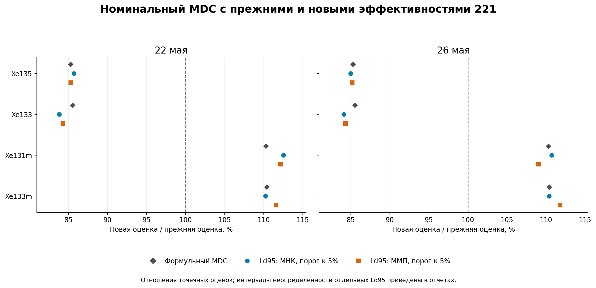
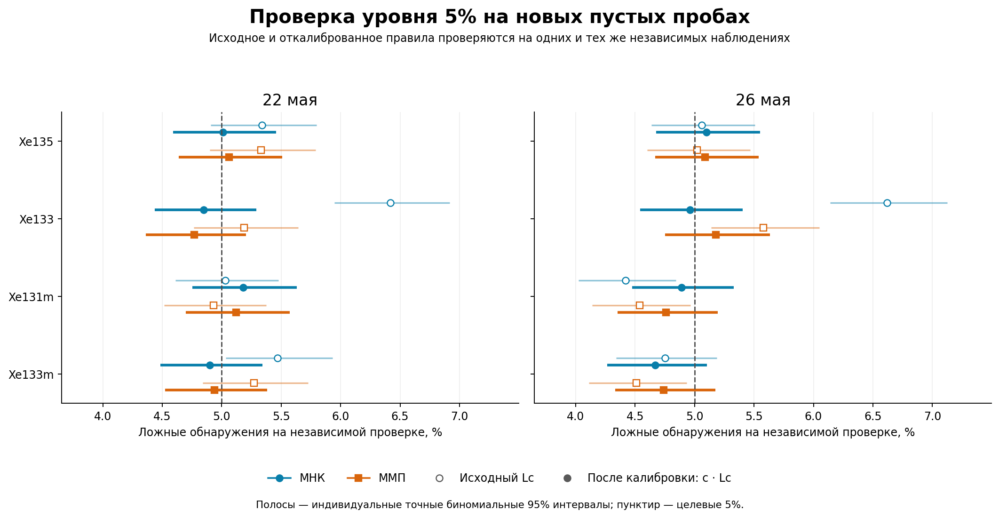
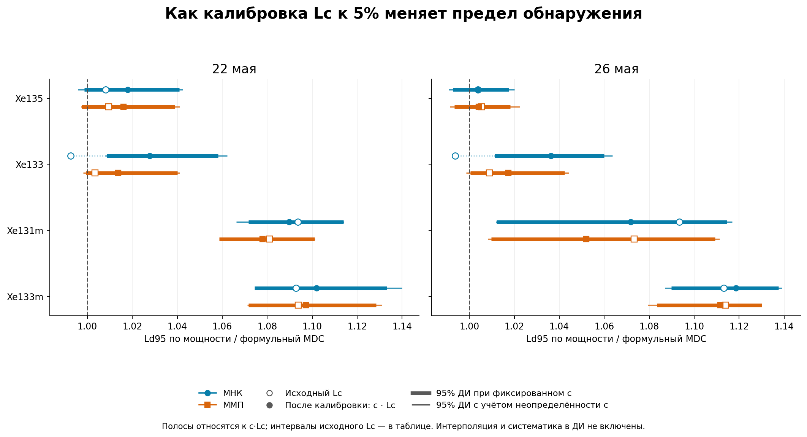
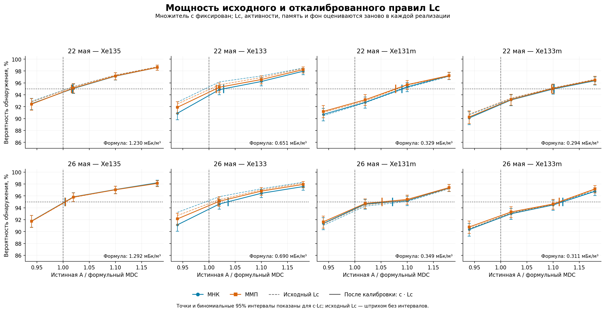

# Номинальный MDC с обновлёнными эффективностями 221

**Повторный расчёт выполнен с обновлёнными эффективностями детектора 221.** Сначала рассчитан формульный номинальный MDC; затем методом Монте-Карло найдена активность Ld95 для 95% обнаружений — с исходным Lc и после его отдельной калибровки к уровню 5%.

После калибровки независимая проверка дала **4.67–5.18%** ложных обнаружений. Это измеренные частоты с погрешностью Монте-Карло; ровно 5% для каждой конечной проверочной серии не гарантируется.

По сравнению с прежними эффективностями формульный MDC изменился от -14.7% до +10.4% по восьми сочетаниям изотопа и комплекта. Изменение формулы детерминировано новыми эффективностями. Различия между старыми и новыми оценками Монте-Карло дополнительно содержат случайность сигнальных серий и калибровки порога. Сравнение исходного Lc и откалиброванного c·Lc приведено отдельно на общей новой сигнальной серии.

**Ld95 по Монте-Карло — численная оценка, а не математически точное число.** Она получена интерполяцией вероятности обнаружения около 95%; интервалы отражают случайность моделирования и, отдельно, калибровки критического порога. Ошибка интерполяции между узлами и систематические ошибки не включены.

## Обновлённая эффективность и формульный предел

Эффективности ε указаны в долях, **без branching**. Значения SAMPLE и GASBK обновлены одинаково. Коэффициенты ветвления, матрицы R, фиксированные ROI, времена, объёмы и исходный DETBK сохранены. Физические матрицы перестроены, включая отношение чувствительностей Xe133/Xe133m в цепочечных поправках.

| Изотоп | ε SAMPLE: прежняя | ε SAMPLE: новая | ε GASBK: прежняя | ε GASBK: новая |
|---|---:|---:|---:|---:|
| Xe135 | 0.205700 | 0.241169 | 0.205700 | 0.241169 |
| Xe133 | 0.314000 | 0.367784 | 0.314000 | 0.367784 |
| Xe131m | 0.258000 | 0.233937 | 0.258000 | 0.233937 |
| Xe133m | 0.258000 | 0.233937 | 0.258000 | 0.233937 |

Формульные значения ниже относятся к заданному истинному чистому фону. Это детерминированный расчёт полной информации Фишера при нулевой активности и итерационного уравнения MDC при введении одного изотопа. Оцениваемые параметры памяти, других изотопов и фона из модели не исключаются. В Монте-Карло Lc из этой таблицы не используется как фиксированный порог: он заново рассчитывается по каждой реализации. Все активности — **мБк/м³**.

| Комплект | Изотоп | Формульный Lc: новый | Формульный MDC: прежний | Формульный MDC: новый | Изменение MDC |
|---|---|---:|---:|---:|---:|
| 22 мая | Xe135 | 0.5855 | 1.4424 | 1.2303 | -14.7% |
| 22 мая | Xe133 | 0.2975 | 0.7605 | 0.6507 | -14.4% |
| 22 мая | Xe131m | 0.1477 | 0.2983 | 0.3291 | +10.3% |
| 22 мая | Xe133m | 0.1284 | 0.2658 | 0.2935 | +10.4% |
| 26 мая | Xe135 | 0.6152 | 1.5152 | 1.2923 | -14.7% |
| 26 мая | Xe133 | 0.3153 | 0.8060 | 0.6896 | -14.4% |
| 26 мая | Xe131m | 0.1565 | 0.3162 | 0.3488 | +10.3% |
| 26 мая | Xe133m | 0.1361 | 0.2817 | 0.3110 | +10.4% |

## Ld95 с прежними и новыми эффективностями

В этой таблице обе версии используют собственную калибровку критического порога к целевому уровню 5%. Частоты ложных обнаружений проверяются независимо; они не обязаны совпадать точно. Старые и новые серии Монте-Карло независимы, поэтому процент изменения — описательное отношение двух точечных оценок. Он включает случайность сигнального Монте-Карло и оценки двух множителей c, поэтому не является точным измерением чистого эффекта ε. Доверительный интервал именно их отношения здесь не рассчитывается; интервал каждой оценки приведён в соответствующем отчёте.

| Комплект | Изотоп | Метод | Прежний Ld95, мБк/м³ | Новый Ld95, мБк/м³ | Изменение | Прежняя частота ложных обнаружений | Новая частота |
|---|---|---|---:|---:|---:|---:|---:|
| 22 мая | Xe135 | МНК | 1.4613 | 1.2523 | -14.3% | 5.28% | 5.01% |
| 22 мая | Xe135 | ММП | 1.4651 | 1.2500 | -14.7% | 5.28% | 5.06% |
| 22 мая | Xe133 | МНК | 0.7979 | 0.6688 | -16.2% | 4.61% | 4.85% |
| 22 мая | Xe133 | ММП | 0.7823 | 0.6596 | -15.7% | 4.66% | 4.77% |
| 22 мая | Xe131m | МНК | 0.3187 | 0.3586 | +12.5% | 5.44% | 5.18% |
| 22 мая | Xe131m | ММП | 0.3162 | 0.3547 | +12.2% | 5.38% | 5.12% |
| 22 мая | Xe133m | МНК | 0.2935 | 0.3234 | +10.2% | 5.13% | 4.90% |
| 22 мая | Xe133m | ММП | 0.2886 | 0.3220 | +11.6% | 5.15% | 4.94% |
| 26 мая | Xe135 | МНК | 1.5265 | 1.2970 | -15.0% | 4.89% | 5.10% |
| 26 мая | Xe135 | ММП | 1.5234 | 1.2978 | -14.8% | 4.92% | 5.09% |
| 26 мая | Xe133 | МНК | 0.8497 | 0.7147 | -15.9% | 4.95% | 4.96% |
| 26 мая | Xe133 | ММП | 0.8320 | 0.7016 | -15.7% | 5.05% | 5.18% |
| 26 мая | Xe131m | МНК | 0.3377 | 0.3738 | +10.7% | 5.15% | 4.89% |
| 26 мая | Xe131m | ММП | 0.3366 | 0.3669 | +9.0% | 5.22% | 4.76% |
| 26 мая | Xe133m | МНК | 0.3152 | 0.3479 | +10.4% | 5.15% | 4.67% |
| 26 мая | Xe133m | ММП | 0.3093 | 0.3457 | +11.8% | 5.09% | 4.74% |

Цель — проверить предел обнаружения на чистом детекторном фоне при целевом уровне ложных обнаружений 5% для одного проверяемого изотопа. Это не вероятность хотя бы одного ложного обнаружения среди всех четырёх изотопов. Для каждого изотопа, метода и майского комплекта множитель порога определён на обучающей серии пустых проб, затем проверен на независимой нулевой серии. После фиксации множителя найден Ld95 — активность, при которой вероятность обнаружения достигает примерно 95%.

При генерации нет пробы, газовой памяти и радона. Для проверки мощности вводится только один свежий изотоп Xe. Все 21 наблюдение SAMPLE/GASBK/DETBK разыгрываются по Пуассону; все 17 параметров полной модели продолжают оцениваться. Истинные средние детекторного фона заданы по прежнему DETBK 221. Систематические ошибки не моделируются.

**Новые реализации: 156 000** — 40 000 для калибровки порога, 20 000 для независимой проверки нуля, 96 000 для основной сетки мощности и 0 для её расширения. Все подгонки выполнены с новыми физическими матрицами. Прежние результаты используются только как историческое сравнение; старые оценки и решения не входят в новый Монте-Карло.

## Что изменилось в правиле обнаружения

Исходное правило: $\widehat A>L_c$. После калибровки: $\widehat A>cL_c$. На обучающих пустых пробах строится распределение $R=\widehat A/L_c$; множитель $c$ выбирается как порядковая статистика ранга $k=\lceil(n+1)0.95\rceil$. При 20000 наблюдений это 19001-е значение по возрастанию. Равенство порогу не считается обнаружением. Такое правило задаёт примерно 5% в среднем по повторным калибровочным сериям; уровень конкретного зафиксированного c проверяется отдельно. Совпадения значений могут сделать правило консервативнее.

Множитель c фиксируется до независимой проверки и не меняется при введении сигнала. Сам Lc остаётся случайным: в каждой реализации он пересчитывается прежней процедурой с удалением целевого свежего изотопа из неотрицательной подгонки. Решение об обнаружении использует свободную оценку активности. МНК и ММП обрабатывают одни и те же наблюдения.

Поправка относится к конкретному чистому фону и условиям измерения. Это не универсальная поправка для произвольных смесей, памяти или других фоновых уровней.

## Независимая проверка уровня ложных обнаружений

Оба правила проверены на одних и тех же новых пустых пробах. Интервалы — индивидуальные точные биномиальные 95% ДИ. Наблюдаемая частота имеет погрешность Монте-Карло: калибровка не гарантирует ровно 5.000% в конечной проверочной серии.

| Комплект | Изотоп | Метод | Множитель c | Исходный Lc: частота и 95% ДИ | После калибровки: частота и 95% ДИ |
|---|---|---|---:|---|---|
| 22 мая | Xe135 | МНК | 1.0195 | 5.34% (4.91–5.80%) | 5.01% (4.59–5.46%) |
| 22 мая | Xe135 | ММП | 1.0166 | 5.33% (4.90–5.79%) | 5.06% (4.64–5.51%) |
| 22 мая | Xe133 | МНК | 1.0941 | 6.42% (5.95–6.92%) | 4.85% (4.44–5.29%) |
| 22 мая | Xe133 | ММП | 1.0281 | 5.19% (4.76–5.64%) | 4.77% (4.36–5.21%) |
| 22 мая | Xe131m | МНК | 0.9915 | 5.03% (4.61–5.48%) | 5.18% (4.75–5.63%) |
| 22 мая | Xe131m | ММП | 0.9910 | 4.93% (4.51–5.37%) | 5.12% (4.70–5.57%) |
| 22 мая | Xe133m | МНК | 1.0298 | 5.47% (5.03–5.93%) | 4.90% (4.49–5.34%) |
| 22 мая | Xe133m | ММП | 1.0158 | 5.27% (4.84–5.73%) | 4.94% (4.52–5.38%) |
| 26 мая | Xe135 | МНК | 0.9985 | 5.06% (4.64–5.51%) | 5.10% (4.68–5.55%) |
| 26 мая | Xe135 | ММП | 0.9976 | 5.02% (4.60–5.47%) | 5.09% (4.67–5.54%) |
| 26 мая | Xe133 | МНК | 1.0975 | 6.62% (6.14–7.13%) | 4.96% (4.54–5.40%) |
| 26 мая | Xe133 | ММП | 1.0254 | 5.58% (5.14–6.05%) | 5.18% (4.75–5.63%) |
| 26 мая | Xe131m | МНК | 0.9801 | 4.42% (4.03–4.84%) | 4.89% (4.48–5.33%) |
| 26 мая | Xe131m | ММП | 0.9890 | 4.54% (4.14–4.97%) | 4.76% (4.35–5.20%) |
| 26 мая | Xe133m | МНК | 1.0043 | 4.75% (4.34–5.19%) | 4.67% (4.26–5.10%) |
| 26 мая | Xe133m | ММП | 0.9888 | 4.51% (4.11–4.94%) | 4.74% (4.33–5.17%) |

## Формула, исходная процедура и откалиброванный порог

Все активности — **мБк/м³**. Формульный номинальный MDC рассчитан при заданной фоновой смеси по полной информации Фишера. Ld95 исходной и откалиброванной процедур найден из мощности обработки случайных наблюдений. Для каждого метода оба правила применяются к одной сигнальной серии; изменение Ld связано с изменением критического порога.

| Комплект | Изотоп | Метод | Формульный MDC | Ld95 с исходным Lc | Его 95% ДИ | Ld95 после калибровки | Изменение Ld95 |
|---|---|---|---:|---:|---|---:|---:|
| 22 мая | Xe135 | МНК | 1.2303 | 1.2402 | 1.2187–1.2701 | 1.2523 | +1.0% |
| 22 мая | Xe135 | ММП | 1.2303 | 1.2419 | 1.2206–1.2707 | 1.2500 | +0.7% |
| 22 мая | Xe133 | МНК | 0.6507 | 0.6458 | 0.6374–0.6554 | 0.6688 | +3.6% |
| 22 мая | Xe133 | ММП | 0.6507 | 0.6529 | 0.6441–0.6657 | 0.6596 | +1.0% |
| 22 мая | Xe131m | МНК | 0.3291 | 0.3599 | 0.3539–0.3679 | 0.3586 | -0.4% |
| 22 мая | Xe131m | ММП | 0.3291 | 0.3557 | 0.3502–0.3631 | 0.3547 | -0.3% |
| 22 мая | Xe133m | МНК | 0.2935 | 0.3208 | 0.3135–0.3301 | 0.3234 | +0.8% |
| 22 мая | Xe133m | ММП | 0.2935 | 0.3210 | 0.3133–0.3304 | 0.3220 | +0.3% |
| 26 мая | Xe135 | МНК | 1.2923 | 1.2973 | 1.2825–1.3153 | 1.2970 | -0.0% |
| 26 мая | Xe135 | ММП | 1.2923 | 1.2994 | 1.2841–1.3182 | 1.2978 | -0.1% |
| 26 мая | Xe133 | МНК | 0.6896 | 0.6853 | 0.6732–0.6995 | 0.7147 | +4.3% |
| 26 мая | Xe133 | ММП | 0.6896 | 0.6958 | 0.6840–0.7132 | 0.7016 | +0.8% |
| 26 мая | Xe131m | МНК | 0.3488 | 0.3813 | 0.3552–0.3908 | 0.3738 | -2.0% |
| 26 мая | Xe131m | ММП | 0.3488 | 0.3744 | 0.3537–0.3890 | 0.3669 | -2.0% |
| 26 мая | Xe133m | МНК | 0.3110 | 0.3462 | 0.3375–0.3525 | 0.3479 | +0.5% |
| 26 мая | Xe133m | ММП | 0.3110 | 0.3464 | 0.3381–0.3521 | 0.3457 | -0.2% |

Меньший Ld при одинаковом подтверждённом уровне ложных обнаружений означает более высокую чувствительность в выбранных условиях. При сравнении методов нужно учитывать неопределённость и Ld, и независимой оценки ложноположительной частоты.

## Неопределённость калибровки и Ld95

Для исходного правила Lc bootstrap-интервал выше учитывает погрешность сигнального Монте-Карло при множителе c=1. Для откалиброванного правила два вида интервалов отвечают на разные вопросы. Условный интервал оценивает $Ld95(\widehat c)$ для фактически зафиксированного множителя и учитывает погрешность сигнальной серии Монте-Карло. Интервал с учётом неопределённости калибровки дополнительно разыгрывает обучающую серию: он оценивает неопределённость $Ld95(c_0)$, где $c_0$ — истинный 95-й квантиль нулевого распределения статистики. Это интервалы оценки предела обнаружения, а не распределения индивидуальных активностей или MDC будущих проб. Систематические ошибки и неопределённость принятого фонового среднего в них не входят.

Интерполяция кривой мощности между рассчитанными точками приближённая. Bootstrap-интервалы условны относительно итоговой сетки; ошибка формы кривой между узлами не включена. Отсутствующие интервалы обозначены явно и не заменяются другим видом интервала. Результаты независимой проверки приводятся без повторной настройки c по проверочным данным, даже если отдельный интервал частоты не включает 5%.

| Комплект | Изотоп | Метод | c: 95% ДИ | Ld95 | 95% ДИ при фиксированном c | 95% ДИ с учётом неопределённости c |
|---|---|---|---|---:|---|---|
| 22 мая | Xe135 | МНК | 1.0013–1.0401 | 1.2523 | 1.2286–1.2805 | 1.2251–1.2824 |
| 22 мая | Xe135 | ММП | 0.9979–1.0353 | 1.2500 | 1.2272–1.2782 | 1.2267–1.2808 |
| 22 мая | Xe133 | МНК | 1.0763–1.1127 | 0.6688 | 0.6563–0.6886 | 0.6559–0.6911 |
| 22 мая | Xe133 | ММП | 1.0121–1.0496 | 0.6596 | 0.6503–0.6767 | 0.6495–0.6774 |
| 22 мая | Xe131m | МНК | 0.9717–1.0079 | 0.3586 | 0.3527–0.3665 | 0.3509–0.3666 |
| 22 мая | Xe131m | ММП | 0.9706–1.0067 | 0.3547 | 0.3484–0.3623 | 0.3485–0.3624 |
| 22 мая | Xe133m | МНК | 1.0132–1.0513 | 0.3234 | 0.3154–0.3326 | 0.3159–0.3346 |
| 22 мая | Xe133m | ММП | 1.0004–1.0336 | 0.3220 | 0.3145–0.3312 | 0.3144–0.3320 |
| 26 мая | Xe135 | МНК | 0.9826–1.0201 | 1.2970 | 1.2829–1.3149 | 1.2804–1.3182 |
| 26 мая | Xe135 | ММП | 0.9814–1.0175 | 1.2978 | 1.2837–1.3159 | 1.2811–1.3214 |
| 26 мая | Xe133 | МНК | 1.0809–1.1149 | 0.7147 | 0.6975–0.7310 | 0.6973–0.7335 |
| 26 мая | Xe133 | ММП | 1.0092–1.0406 | 0.7016 | 0.6899–0.7189 | 0.6887–0.7201 |
| 26 мая | Xe131m | МНК | 0.9626–1.0057 | 0.3738 | 0.3530–0.3887 | 0.3529–0.3896 |
| 26 мая | Xe131m | ММП | 0.9685–1.0113 | 0.3669 | 0.3522–0.3869 | 0.3517–0.3876 |
| 26 мая | Xe133m | МНК | 0.9851–1.0233 | 0.3479 | 0.3390–0.3538 | 0.3381–0.3543 |
| 26 мая | Xe133m | ММП | 0.9716–1.0047 | 0.3457 | 0.3370–0.3515 | 0.3357–0.3512 |

### Консервативные сеточные границы

Эти границы получены из одновременных биномиальных интервалов на рассчитанных активностях при предположении монотонной истинной мощности. Для варианта с неопределённостью c дополнительно использован интервал коэффициента c. Сеточные границы консервативны и могут оставаться открытыми, если сетка недостаточно широка. Бюджеты вероятностей ошибок заданы в протоколе.

| Комплект | Изотоп | Метод | Границы 95% исходного Lc | Границы 95% при фиксированном c | Границы 95% с учётом неопределённости c |
|---|---|---|---|---|---|
| 22 мая | Xe135 | МНК | 1.1564–1.3533 | 1.1564–1.3533 | 1.1564–1.3533 |
| 22 мая | Xe135 | ММП | 1.1564–1.3533 | 1.1564–1.3533 | 1.1564–1.3533 |
| 22 мая | Xe133 | МНК | 0.6116–0.6637 | 0.6116–0.7158 | 0.6116–0.7678 |
| 22 мая | Xe133 | ММП | 0.6116–0.7158 | 0.6116–0.7158 | 0.6116–0.7678 |
| 22 мая | Xe131m | МНК | 0.3357–0.3883 | 0.3357–0.3883 | 0.3357–0.3883 |
| 22 мая | Xe131m | ММП | 0.3357–0.3883 | 0.3357–0.3883 | 0.3357–0.3883 |
| 22 мая | Xe133m | МНК | 0.2994–0.3463 | 0.2994–0.3463 | от 0.2994, верхняя граница не определена |
| 22 мая | Xe133m | ММП | 0.2994–0.3463 | 0.2994–0.3463 | от 0.2994, верхняя граница не определена |
| 26 мая | Xe135 | МНК | 1.2148–1.4216 | 1.2148–1.4216 | 1.2148–1.4216 |
| 26 мая | Xe135 | ММП | 1.2148–1.4216 | 1.2148–1.4216 | 1.2148–1.4216 |
| 26 мая | Xe133 | МНК | 0.6482–0.7586 | 0.6482–0.7586 | 0.6482–0.8138 |
| 26 мая | Xe133 | ММП | 0.6482–0.7586 | 0.6482–0.7586 | 0.6482–0.7586 |
| 26 мая | Xe131m | МНК | 0.3279–0.4116 | 0.3279–0.4116 | 0.3279–0.4116 |
| 26 мая | Xe131m | ММП | 0.3279–0.4116 | 0.3279–0.4116 | 0.3279–0.4116 |
| 26 мая | Xe133m | МНК | 0.3172–0.3670 | 0.3172–0.3670 | 0.3172–0.3670 |
| 26 мая | Xe133m | ММП | 0.3172–0.3670 | 0.3172–0.3670 | 0.3172–0.3670 |

Верхняя консервативная сеточная граница с учётом неопределённости c не определена для: 22 мая, Xe133m, МНК; 22 мая, Xe133m, ММП. Это ограничение рассчитанной сетки сохраняется, хотя интерполированные 95% bootstrap-интервалы конечны. Сетку не расширяли специально для замыкания этой более консервативной границы.

### Bootstrap и пределы сетки

Конечные границы 95% интервала не означают, что все bootstrap-корни находятся внутри сетки:

- 22 мая, Xe133m, МНК, с неопределённостью c: из 2 000 повторов пересечение 95% внутри сетки найдено в 1 998; выше сетки — 2, ниже — 0, неоднозначных — 0.

Условие завершения расчёта выполнено по заранее выбранному критерию для точечных Ld95 и границ 95% bootstrap-интервалов. Оно не требует покрытия всех отдельных bootstrap-корней или замыкания всех консервативных сеточных границ.

### Парное сравнение методов

Разность Δ = Ld95(МНК) − Ld95(ММП), мБк/м³. Положительная разность означает больший предел обнаружения у МНК. Парные интервалы учитывают, что оба метода анализируют одинаковые реализации.

| Комплект | Изотоп | Δ | 95% ДИ при фиксированных c | 95% ДИ с учётом неопределённости c |
|---|---|---:|---|---|
| 22 мая | Xe135 | 0.0023 | -0.0018–0.0074 | -0.0062–0.0077 |
| 22 мая | Xe133 | 0.0092 | 0.0014–0.0209 | 0.0013–0.0238 |
| 22 мая | Xe131m | 0.0039 | 0.0018–0.0074 | 0.0006–0.0073 |
| 22 мая | Xe133m | 0.0014 | -0.0008–0.0042 | -0.0011–0.0054 |
| 26 мая | Xe135 | -0.0008 | -0.0034–0.0014 | -0.0059–0.0032 |
| 26 мая | Xe133 | 0.0131 | 0.0030–0.0216 | 0.0031–0.0258 |
| 26 мая | Xe131m | 0.0069 | -0.0017–0.0254 | -0.0028–0.0291 |
| 26 мая | Xe133m | 0.0022 | 0.0001–0.0045 | -0.0000–0.0061 |

## Кривые мощности исходного и откалиброванного правил

Сплошные линии с точками и интервалами показывают откалиброванное правило c·Lc; тонкие штриховые линии тех же цветов — исходное правило Lc без интервалов. Для каждого метода оба правила применены к одним реализациям. Вертикальная отметка на уровне 95% показывает интерполированный Ld95 для c·Lc. Горизонтальная ось нормирована на формульный MDC с новыми эффективностями. Интервалы точек мощности условны относительно зафиксированных множителей c.

## Сохранённые условия измерения

| Параметр | 22 мая | 26 мая |
|---|---:|---:|
| SAMPLE: живое время, с | 50400.0 | 50400.0 |
| SAMPLE: реальное время, с | 50591.18 | 50591.17 |
| GASBK: живое время, с | 25200.0 | 25200.0 |
| GASBK: реальное время, с | 25301.71 | 25301.71 |
| DETBK: живое время, с | 259200.0 | 259200.0 |
| Сбор, с | 43173.0 | 43172.0 |
| Задержка после сбора, с | 16401.1 | 15779.7 |
| Разность начал SAMPLE/GASBK, с | 32970.0 | 31927.5 |
| Объём Xe, см³ | 1.251290 | 1.180360 |
| Эффективный объём воздуха, м³ | 14.382644 | 13.567356 |
| Поле air_volume исходного SAMPLE, м³ | 18.130979 | 18.592930 |

Сохранена конвенция объёма существующего ядра: объёмная активность рассчитывается через эффективный объём воздуха, полученный из объёма Xe. Использованы фиксированные ROI и эффективности, калибровки детектора 221 и прежняя модель радона. Полные матрицы и метаданные сохранены в manifest.json.

## Пропуски и воспроизводимость

Зарегистрированных ошибок подгонки/расчёта: 0. Отсутствующие решения не заменяются новыми реализациями; числа доступных решений и пропусков приведены в summary.json.

### Доступность обычной свободной ковариации

Успешное вычисление Lc не означает, что обычная σ свободной ММП доступна во всех реализациях. При граничном подогнанном ожидании μ=0 ядро не выдаёт обычную асимптотическую ковариацию. Для Lc неопределённость рассчитывается отдельно по построенному нулевому спектру; отсутствие свободной ковариации само по себе не исключает реализацию из этого исследования. Вальд здесь не рассчитывается. Эти случаи учитываются отдельно от ошибок подгонки и Lc.

| Комплект | Серия | Реализаций | МНК без обычной ковариации | ММП без обычной ковариации |
|---|---|---:|---:|---:|
| 22 мая | Калибровка | 20 000 | 0 | 75 |
| 22 мая | Мощность | 48 000 | 0 | 174 |
| 22 мая | Проверка нуля | 10 000 | 0 | 35 |
| 26 мая | Калибровка | 20 000 | 0 | 77 |
| 26 мая | Мощность | 48 000 | 0 | 178 |
| 26 мая | Проверка нуля | 10 000 | 0 | 38 |

Калибровка, независимая проверка нуля и сигнальные серии разделены. При добавлении сигнальных точек Ld95 исходного правила пересчитывается на той же итоговой сетке, что и Ld95 откалиброванного правила. Исторические сводки со старыми эффективностями сохранены отдельно в prior_formula_summary.json и prior_calibrated_summary.json. Для генерации принят фиксированный фон по исходному DETBK, а при каждой обработке его параметры оцениваются заново совместно с SAMPLE и GASBK. Поэтому статистическая погрешность нового измерения DETBK учтена. Неопределённость выбранного фонового среднего и калибровок не моделировалась.

## Файлы

- [Проверка уровня 5% — PDF](calibrated_alpha.pdf)
- [Изменение Ld95 — PDF](calibrated_ld.pdf)
- [Кривые мощности — PDF](calibrated_power.pdf)
- [Сравнение старых и новых эффективностей — PDF](efficiency_comparison.pdf)
- [Таблица CSV](results.csv)
- [Сравнение старой и новой калибровки — CSV](efficiency_comparison.csv)
- [Полная численная сводка](summary.json)
- [Протокол](protocol_ru.md)
- [Статистический план и ограничения](statistical_design.md)
- [Небольшой архив отчёта, графиков и таблиц](XeMat_MDC_report_eff221_20261022.zip)
- [Полный архив с данными и скриптами](XeMat_nominal_MDC_eff221_20261022.zip)
