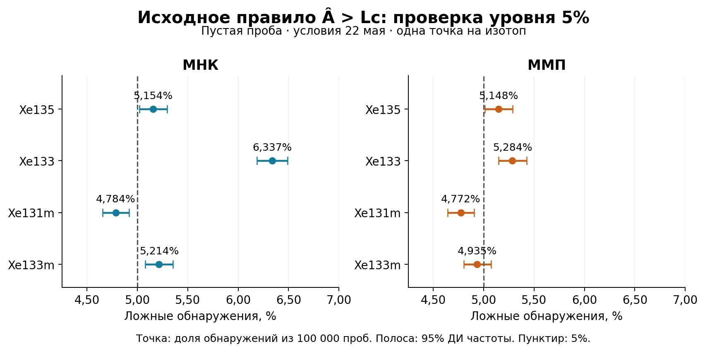
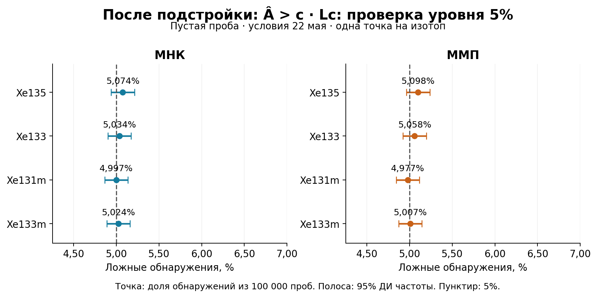
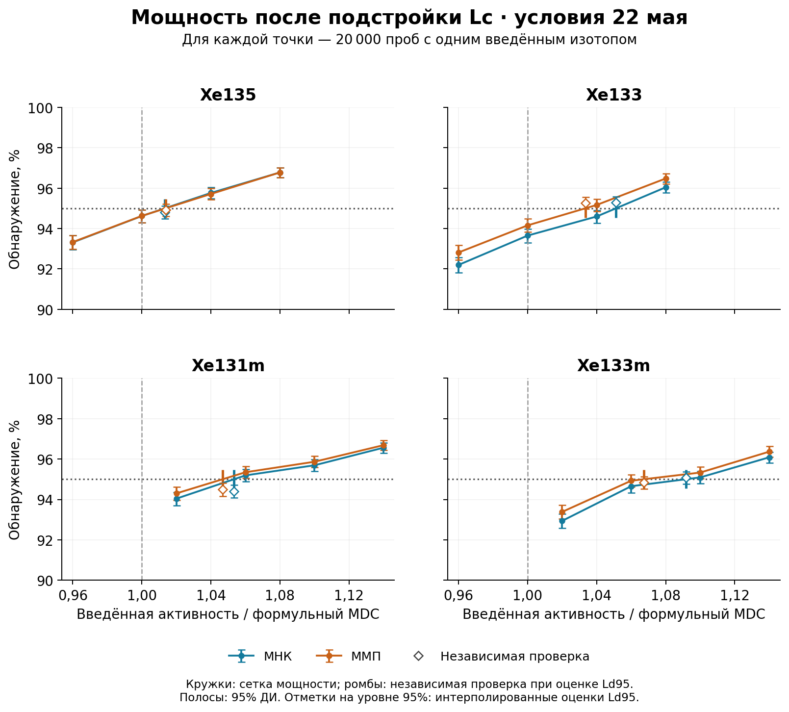
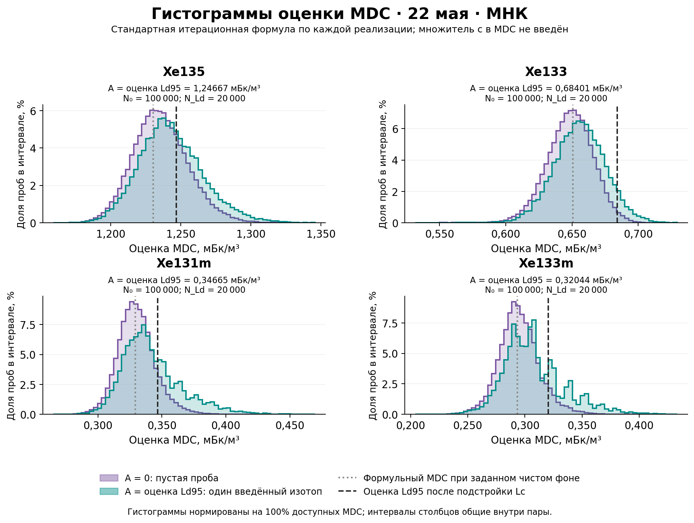
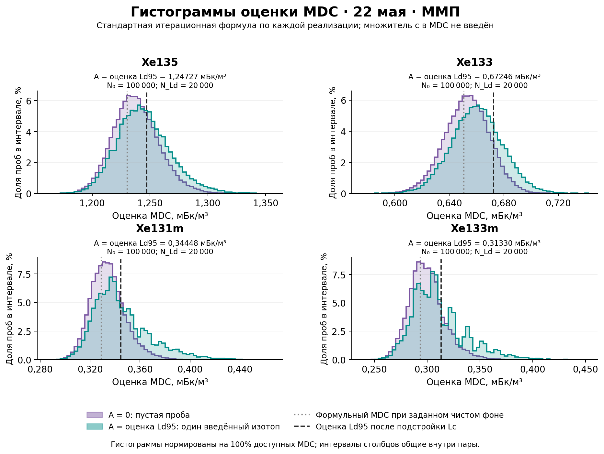

# XeMat: чистая проба и проверка Lc на 100 000 реализаций

## 1. Условия и объём исследования

Рассмотрен один набор условий — комплект 22 мая, детектор 221, фиксированные ROI и матрицы R. В чистой пробе истинные активности всех компонентов пробы и газовой памяти, включая радон, равны нулю. Остаётся детекторный фон. Для исследования обнаружения вводим по одному свежему изотопу Xe.

| Изотоп | ε SAMPLE | ε GASBK |
|---|---|---|
| Xe135 | 0,241169 | 0,241169 |
| Xe133 | 0,367784 | 0,367784 |
| Xe131m | 0,233937 | 0,233937 |
| Xe133m | 0,233937 | 0,233937 |

Эффективности ε указаны без branching; коэффициенты ветвления учитываются отдельно. Живое время SAMPLE / GASBK / DETBK: 14,00 / 7,00 / 72,00 часа. Эффективный объём воздуха: 14,3826 м³.

В каждом повторе генерируем все 21 пуассоновский отсчёт SAMPLE/GASBK/DETBK и заново оцениваем все 17 параметров. Истинное среднее детекторного фона фиксировано для данного сценария; новые отсчёты DETBK случайны, фон оценивается совместно с пробой и памятью. Систематика не разыгрывается.

| Этап | Число векторов наблюдений |
|---|---|
| Подстройка порога | 100 000 |
| Независимая проверка пустой пробы | 100 000 |
| Кривые мощности | 320 000 |
| Гистограммы при A = Ld95 | 160 000 |

Гистограммы при A = 0 используют проверочные пустые пробы повторно; они не добавляют новых наблюдений. МНК и ММП в основной серии применяются к одним и тем же отсчётам. Вальд не используется.

## 2. Исходное правило обнаружения

Обнаружение: Â > Lc. Â — свободная оценка активности МНК или ММП. В каждой реализации выполняется соответствующая неотрицательная вспомогательная подгонка, из её ожидаемого спектра удаляется оценённый вклад целевого свежего изотопа и рассчитывается Lc. Оценки памяти, других компонентов и детекторного фона сохраняются. Исходные наблюдаемые отсчёты не вычитаются.

При A = 0 каждое обнаружение ложное. Цель 5% соответствует примерно 5000 срабатываниям на 100 000 проверочных проб для одного изотопа. Порог Lc пересчитывается в каждом повторе.

## 3. Проверка ложноположительных по исходному Lc

Рисунок 1. Исходное правило Â > Lc на 100 000 независимых проверочных пробах.

Слева МНК, справа ММП. В каждой панели на каждый изотоп приходится одна точка: процент ложных обнаружений. Полоса — индивидуальный 95% биномиальный доверительный интервал этой частоты, то есть погрешность самого Монте-Карло. Пунктир показывает целевые 5%.

Если весь интервал справа от 5%, наблюдается превышение уровня; если слева — более консервативное правило. Пересечение с 5% означает совместимость с уровнем с учётом погрешности, но не доказывает точного равенства. Интервалы не скорректированы на одновременную проверку всех изотопов и методов.

| Изотоп | МНК: частота [95% ДИ] | ММП: частота [95% ДИ] |
|---|---|---|
| Xe135 | 5,154% [5,018–5,293%] | 5,148% [5,012–5,287%] |
| Xe133 | 6,337% [6,187–6,490%] | 5,284% [5,146–5,424%] |
| Xe131m | 4,784% [4,653–4,918%] | 4,772% [4,641–4,906%] |
| Xe133m | 5,214% [5,077–5,354%] | 4,935% [4,802–5,071%] |

## 4. Подстройка Lc к уровню 5%

На отдельной серии из 100 000 пустых проб построена статистика R = Â/Lc. Для каждого метода и изотопа множитель c выбран как 95 001-е значение R по возрастанию. После этого c фиксируется; проверочная серия для выбора c не используется.

Откалиброванное правило: Â > c · Lc. При c > 1 порог повышается, при c < 1 понижается. Сам Lc по-прежнему рассчитывается по каждой пробе. Множитель c относится к порогу решения, а не к готовому MDC; итоговый Ld95 определяется заново по мощности.

| Изотоп | c для МНК [95% ДИ] | c для ММП [95% ДИ] |
|---|---|---|
| Xe135 | 1,0042 [0,9956–1,0134] | 1,0030 [0,9955–1,0112] |
| Xe133 | 1,0792 [1,0715–1,0884] | 1,0134 [1,0052–1,0201] |
| Xe131m | 0,9870 [0,9785–0,9952] | 0,9870 [0,9789–0,9941] |
| Xe133m | 1,0121 [1,0033–1,0202] | 0,9947 [0,9871–1,0024] |

## 5. Независимая проверка после подстройки

Рисунок 2. Правило Â > c · Lc. Проверочные отсчёты те же, что на рисунке 1; изменилось правило решения.

| Изотоп | МНК: частота [95% ДИ] | ММП: частота [95% ДИ] |
|---|---|---|
| Xe135 | 5,074% [4,939–5,212%] | 5,098% [4,962–5,236%] |
| Xe133 | 5,034% [4,899–5,171%] | 5,058% [4,923–5,196%] |
| Xe131m | 4,997% [4,863–5,134%] | 4,977% [4,843–5,114%] |
| Xe133m | 5,024% [4,889–5,161%] | 5,007% [4,873–5,144%] |

Проверочные частоты после подстройки лежат в диапазоне 4,977–5,098%. Целевые 5% входят в 8 из 8 индивидуальных 95% интервалов. Конечная калибровочная выборка также вносит неопределённость; после проверки c не подстраивался повторно.

## 6. Формульные пределы и Ld95 исходного правила

Далее все активности указаны в мБк/м³. Формульные Lc и MDC вычислены по полной информации Фишера для заданного истинного чистого фона, включая статистическую неопределённость оценки DETBK. Формульный Lc — ориентир; в моделируемых пробах он не используется как постоянный порог.

Численный предел Ld95 получен по кривой мощности: истинная активность фиксируется, наблюдения многократно разыгрываются, Lc пересчитывается и измеряется доля обнаружений. Ld95 соответствует мощности 95%; это оценка с погрешностью Монте-Карло.

| Изотоп | Формула Lc | Формула MDC | МНК: Ld95 исходный Lc | ММП: Ld95 исходный Lc |
|---|---|---|---|---|
| Xe135 | 0,5855 | 1,2303 | 1,2447 | 1,2451 |
| Xe133 | 0,2975 | 0,6507 | 0,6540 | 0,6661 |
| Xe131m | 0,1477 | 0,3291 | 0,3488 | 0,3469 |
| Xe133m | 0,1284 | 0,2935 | 0,3158 | 0,3162 |

| Изотоп | МНК: 95% ДИ исходного Ld95 | ММП: 95% ДИ исходного Ld95 |
|---|---|---|
| Xe135 | 1,2309–1,2536 | 1,2309–1,2541 |
| Xe133 | 0,6474–0,6608 | 0,6599–0,6733 |
| Xe131m | 0,3459–0,3544 | 0,3439–0,3511 |
| Xe133m | 0,3104–0,3232 | 0,3105–0,3231 |

Исходные Ld95 соответствуют ложноположительным частотам рисунка 1. Сравнивать их без учёта фактического уровня ошибок нельзя: более низкий предел может сопровождаться большим числом ложных обнаружений.

## 7. Оценки Ld95 после подстройки Lc

| Изотоп | Формульный MDC | МНК: Ld95 [95% ДИ] | ММП: Ld95 [95% ДИ] |
|---|---|---|---|
| Xe135 | 1,2303 | 1,2467 [1,2345–1,2557] | 1,2473 [1,2343–1,2565] |
| Xe133 | 0,6507 | 0,6840 [0,6791–0,6879] | 0,6725 [0,6666–0,6791] |
| Xe131m | 0,3291 | 0,3466 [0,3441–0,3506] | 0,3445 [0,3416–0,3478] |
| Xe133m | 0,2935 | 0,3204 [0,3143–0,3248] | 0,3133 [0,3098–0,3194] |

Интервалы этой таблицы условны на фактически найденных c. При сигнальном моделировании c не меняется; Lc пересчитывается по каждому наблюдению. Ld95 не получен умножением формульного MDC на c. Независимая проверка мощности при этих активностях приведена в разделе 10.1.

## 8. Кривые мощности после подстройки

Рисунок 3. Мощность откалиброванного правила; каждый узел рассчитан на 20 000 наблюдениях. Синий — МНК, оранжевый — ММП.

По горизонтали — введённая активность, делённая на формульный MDC. Значение 1 соответствует формуле. По вертикали — доля обнаружений. Полосы отражают 95% интервалы мощности при фиксированных c. Кружки — исходная сетка мощности; цветные отметки на горизонтали 95% показывают интерполированные оценки Ld95. Ромбы — независимая проверка мощности при этих активностях, подробно разобранная в разделе 10.1.

## 9. Неопределённость и область применимости

Использовано 2 000 bootstrap-повторов. Помимо условных интервалов рассчитаны интервалы с учётом случайности калибровки c. Они характеризуют оценку Ld95 для идеального порога c₀ — истинного 95-го квантиля нулевой статистики. Ошибка интерполяции между узлами мощности и систематика в эти интервалы не включены.

| Изотоп | МНК: 95% ДИ с учётом c | ММП: 95% ДИ с учётом c |
|---|---|---|
| Xe135 | 1,2330–1,2584 | 1,2332–1,2585 |
| Xe133 | 0,6784–0,6883 | 0,6656–0,6788 |
| Xe131m | 0,3439–0,3511 | 0,3414–0,3487 |
| Xe133m | 0,3124–0,3249 | 0,3095–0,3213 |

Результаты относятся к чистому фону и указанной временной конфигурации. Перенос подстройки на смеси с памятью или другой фон отдельно не проверялся. Уровень 5% относится к одному изотопу. Неопределённость выбранного истинного среднего фона и калибровок не разыгрывалась.

Записей ошибок основной серии: 0, анализа гистограмм: 0. Это отдельные журналы, и ошибки переиспользованной проверочной серии могут входить в оба. Неуспешные реализации не заменялись новыми. Недоступность ковариации свободного ММП учитывается отдельно и сама по себе не означает неуспех отдельного расчёта Lc/MDC по неотрицательному пилоту. Тест Вальда не применяется.

## 10. Гистограммы MDC по отдельным наблюдениям

Каждая проба даёт собственную оценку MDC стандартной итерационной формулой с α = β = 0,05. Нулевая модель строится той же процедурой удаления целевого свежего вклада из неотрицательной подгонки. Множитель c в эту формулу MDC не вводится.

Рассмотрены A = 0 и A = Ld95. Во втором случае вводится один свежий изотоп, а истинная память и остальные компоненты равны нулю. Активность Ld95 берётся из новой итоговой таблицы после подстройки, отдельно для метода и изотопа, и остаётся фиксированной. Погрешность этого значения при генерации не разыгрывается.

Для A = 0 использованы все 100 000 независимых проверочных проб. Для A = Ld95 создано по 20 000 новых наблюдений на каждую пару метод/изотоп. Включены все доступные MDC, независимо от того, произошло ли обнаружение. Никакого отбора по результату теста нет.

Фиолетовый цвет — A = 0, бирюзовый — A = Ld95. По горизонтали показан MDC, по вертикали — доля проб в интервале столбца. Каждая гистограмма нормирована на 100%; интервалы столбцов общие внутри пары, хвосты не обрезаны. Серая линия — формульный MDC заданного чистого фона, чёрная — численный Ld95 после подстройки.

Это распределения случайной оценки MDC по одной пробе, а не повторных оценок Ld95 по кривой мощности. Центральные 95% значений в таблицах — квантили 2,5% и 97,5%; они не являются доверительным интервалом истинного Ld95. Отличие от чёрной линии само по себе не означает смещения оценки того же самого параметра.

Увеличение числа реализаций Монте-Карло уменьшает погрешность оценённых частот и Ld95. При прежних временах измерения и остальных условиях внутренний разброс MDC одной пробы сохраняется; большая выборка позволяет точнее оценить форму этого распределения и его квантили.

## 10.1. Независимый контроль мощности при A = Ld95

На новых наблюдениях, созданных для сигнальных гистограмм, дополнительно проверено правило Â > c · Lc. Эти пробы не участвовали в определении Ld95. В таблице — фактическая мощность при фиксированной ранее оценённой активности Ld95 и её 95% биномиальный интервал Клоппера–Пирсона. Ни c, ни Ld95 по этой проверке не менялись.

| Изотоп | Метод | A = Ld95, мБк/м³ | Обнаружено / N | Мощность [95% ДИ] |
|---|---|---|---|---|
| Xe135 | МНК | 1,24667 | 18962 / 20 000 | 94,810% [94,493–95,113%] |
| Xe133 | МНК | 0,68401 | 19059 / 20 000 | 95,295% [94,992–95,584%] |
| Xe131m | МНК | 0,34665 | 18881 / 20 000 | 94,405% [94,077–94,720%] |
| Xe133m | МНК | 0,32044 | 19017 / 20 000 | 95,085% [94,776–95,381%] |
| Xe135 | ММП | 1,24727 | 18985 / 20 000 | 94,925% [94,612–95,225%] |
| Xe133 | ММП | 0,67246 | 19054 / 20 000 | 95,270% [94,967–95,560%] |
| Xe131m | ММП | 0,34448 | 18898 / 20 000 | 94,490% [94,165–94,802%] |
| Xe133m | ММП | 0,31330 | 18966 / 20 000 | 94,830% [94,514–95,133%] |

Проверочная мощность может отличаться от 95% из-за случайности новой серии, погрешности ранее оценённого Ld95 и интерполяции кривой мощности. Интервал в таблице отражает только биномиальную погрешность новой проверки при фиксированных A и c.

В независимой проверке получено Xe131m (МНК): 94,405%; Xe131m (ММП): 94,490%. В этих случаях даже верхняя граница 95% интервала мощности ниже 95%. Таким образом, выбранные оценки Ld95 для этих сочетаний изотопа и метода не подтвердили целевую мощность; их точность требует уточнения. Коэффициенты c и активности по результатам этой проверки не менялись.

Аудит подтвердил правильность заданной активности, ожидаемого спектра, единиц и решений об обнаружении. Причина отклонения не установлена: результаты не позволяют отдельно оценить вклад погрешности найденного Ld95 и интерполяции кривой мощности.

## 10.2. Гистограммы MDC · МНК

Рисунок 4. Стандартный итерационный MDC по наблюдениям · МНК.

| Изотоп | A = 0: медиана [2,5–97,5%] | A = Ld95: медиана [2,5–97,5%] | Введённая A |
|---|---|---|---|
| Xe135 | 1,2348 [1,1997–1,2775] | 1,2414 [1,2022–1,2926] | 1,24667 |
| Xe133 | 0,6492 [0,6128–0,6812] | 0,6559 [0,6176–0,6937] | 0,68401 |
| Xe131m | 0,3293 [0,3032–0,3621] | 0,3376 [0,3066–0,3983] | 0,34665 |
| Xe133m | 0,2940 [0,2616–0,3337] | 0,3039 [0,2655–0,3709] | 0,32044 |

Все значения таблицы — мБк/м³. Скобки показывают центральные 95% отдельных оценок MDC. Недоступных MDC в этих распределениях: 0.

## 10.3. Гистограммы MDC · ММП

Рисунок 5. Стандартный итерационный MDC по наблюдениям · ММП.

| Изотоп | A = 0: медиана [2,5–97,5%] | A = Ld95: медиана [2,5–97,5%] | Введённая A |
|---|---|---|---|
| Xe135 | 1,2369 [1,2016–1,2797] | 1,2430 [1,2037–1,2943] | 1,24727 |
| Xe133 | 0,6533 [0,6194–0,6848] | 0,6602 [0,6239–0,6976] | 0,67246 |
| Xe131m | 0,3333 [0,3100–0,3661] | 0,3402 [0,3120–0,4006] | 0,34448 |
| Xe133m | 0,2981 [0,2700–0,3378] | 0,3061 [0,2722–0,3726] | 0,31330 |

Все значения таблицы — мБк/м³. Скобки показывают центральные 95% отдельных оценок MDC. Недоступных MDC в этих распределениях: 0.

## 11. Что показывают результаты

На независимой проверке исходное правило дало частоты от 4,772% до 6,337%; после подстройки — от 4,977% до 5,098%. Эти частоты и интервалы нужно рассматривать вместе с Ld95, чтобы сравнивать чувствительность правил при сопоставимом уровне ошибок.

Отдельный контроль при выбранных Ld95 выявил Xe131m (МНК): 94,405%; Xe131m (ММП): 94,490%. Их 95% интервалы целиком ниже 95%; поэтому достижение целевой мощности для всех изотопов этим исследованием не подтверждено. Это ограничение численных оценок Ld95 сохранено в результатах без повторной подстройки.

При переходе от A = 0 к A = Ld95 изменение медианы обычной оценки MDC составляет от 0,49% до 3,38%. MDC остаётся случайной характеристикой обработанной пробы: он зависит от оценённых фона, памяти и других компонентов. Полные средние, стандартные отклонения и квантили доступны в таблице histogram_statistics.csv.

Коэффициенты c и численные Ld95 относятся к этой чистой конфигурации с заданным истинным средним DETBK. Их применимость к произвольной радиоактивной смеси или другому фону требует отдельной проверки.
