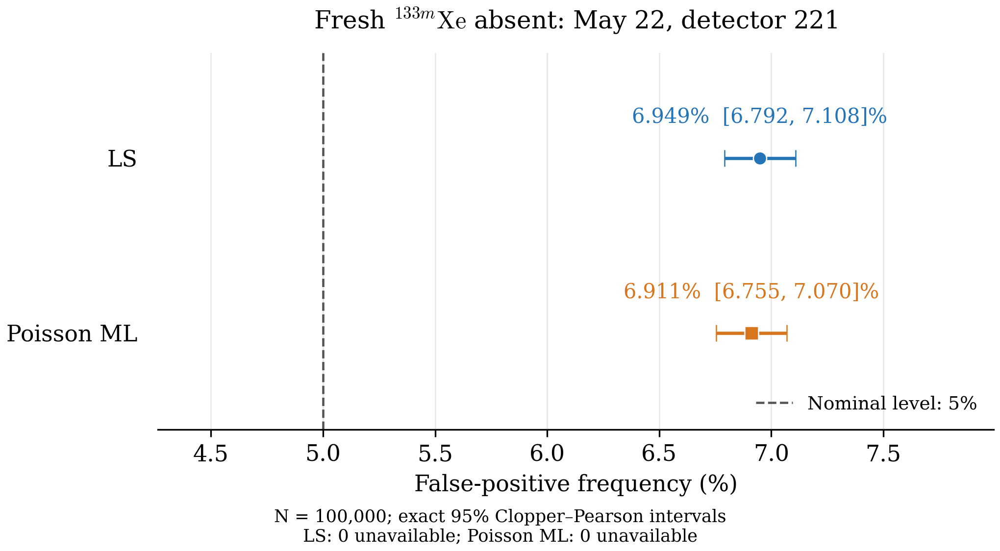

# XeMat: повторная проверка LC для майской пробы при новых эффективностях

Исследован комплект 22 мая 2026 года, детектор 221: **100 000 новых реализаций**, исходное правило LC для свежего **Xe133m**, методы МНК и свободного пуассоновского ММП. Целевой односторонний уровень — 5%. Ни LD/MDC, ни мощность, ни множители коррекции порога не рассчитывались.

## Что именно считалось истинным

Это **не пустая проба**. Исходные реальные SAMPLE, GASBK и DETBK один раз совместно подогнаны неотрицательным пуассоновским ММП с новыми эффективностями. В полном физическом векторе из 17 координат обнулена **только свежая Xe133m**. Остальные 16 координат, включая другие свежие изотопы, радон, память и детекторный фон, сохранены. Дополнительной подгонки под нулевой гипотезой нет.

После этого вектор истинных параметров фиксирован. В каждой реализации независимо разыграны все 21 отсчёт SAMPLE/GASBK/DETBK: `x* ~ Poisson(mu0)`. Один и тот же вектор наблюдений использован обоими методами. Все три спектра, включая DETBK, флуктуируют. Неопределённость опорной истины, эффективности, branching, объёма и матриц R не разыгрывалась. Выводы условны относительно этой фиксированной модели и смеси.

| Свежая координата | Опорная неотрицательная оценка, mBq/m³ | Генерирующая истина, mBq/m³ |
|---|---:|---:|
| Rn222 (вспом.) | 1.58908487e-14 | 1.58908487e-14 |
| Xe135 | 0.172900806 | 0.172900806 |
| Xe133 | 0.336829529 | 0.336829529 |
| Xe131m | 2.34936434e-14 | 2.34936434e-14 |
| Xe133m | 0.0545669051 | 0 |

Первая радоновая координата вспомогательная, не атмосферная концентрация Rn222. Полная память, фон и разложение mu0 сохранены в scenario_arrays.npz; в таблице выше показаны только первые пять координат.

## Исходные данные и калибровка

| Блок | Исходный файл | Начало измерения из файла | Реальное время, с | Живое время, с |
|---|---|---|---:|---:|
| SAMPLE | `SAMPLE20260522073631203.PHD` | 2026-05-21T17:33:20.100000 | 50591.18 | 50400 |
| GASBK | `GASBK20260521152531814.PHD` | 2026-05-21T08:23:50.100000 | 25301.71 | 25200 |
| DETBK | `DETBK20250610213044796.PHD` | 2025-06-07T21:22:30.500000 | 259694.2 | 259200 |

Фиксированные ROI: 1, 2, 3, 5, 6, 7, 8. Матрицы Rs221/Rg221 исходные, без правок. Эффективный объём V0 = **14.3826437 м³**; объём выделенного Xe = 1.25129 см³.
Времена: сбор t_a=43173 с, ожидание t_p=16401.1 с, интервал tau=32970 с. Все кинетические поправки сохранены.

Эффективности ниже не включают branching; чувствительность использует их произведение. Для SAMPLE и GASBK установлены одинаковые ε:

| Компонента | ε SAMPLE | ε GASBK | Branching |
|---|---:|---:|---:|
| Rn222 (legacy) | 0.3 | 0.3 | 0.37 |
| Xe135 | 0.241169 | 0.241169 | 0.9020 |
| Xe133 | 0.367784 | 0.367784 | 0.3700 |
| Xe131m | 0.233937 | 0.233937 | 0.5400 |
| Xe133m | 0.233937 | 0.233937 | 0.5577 |

## Неизменённая процедура оценки и LC

1. Для каждого набора x выполняется свободная оценка: МНК или пуассоновский ММП. Отрицательные оценки сохраняются.
2. Выполняется соответствующая вспомогательная подгонка: NNLS для МНК или неотрицательный пуассоновский ММП для ММП. Неотрицательность относится к физическим координатам.
3. В полученном вспомогательном векторе обнуляется только свежая Xe133m, сохраняя остальные оценки. По этому среднему mu_null и **всем 17 столбцам** модели вычисляется существующая статистическая ковариация K0=(Sᵀ diag(1/mu_null) S)⁻¹ посредством текущей реализации SVD. LC=1.64485362695 sqrt(K0[4,4]). Новая нулевая подгонка не выполняется.
4. Обнаружение: свободная оценка Xe133m > LC; обе величины переведены в mBq/m³. Поскольку истинная свежая Xe133m равна нулю, каждое такое событие ложно положительно.

Веса МНК/NNLS: W=diag(1/where(x==0,1,x)), заново по исходным отсчётам каждой реализации. Замена нуля единицей относится только к дисперсии для веса; нулевые наблюдения сохраняются. Пуассоновские методы используют исходные целочисленные отсчёты. Оптимизаторы, веса и допуски ядра не менялись (max_iter=2000, tol=10⁻¹⁰). LC вычисляется небольшим адаптером lc_only.py, который точно воспроизводит только часть LC существующей процедуры, не запуская ненужный расчёт MDC как побочный результат.

## Частота ложных обнаружений

Интервалы — **точные двусторонние 95% интервалы Clopper–Pearson**. Знаменатель частоты — число доступных решений. Сбой не считается отсутствием обнаружения.

| Метод | Ложные / доступные | Частота | 95% интервал | Недоступные решения | Возможная частота среди всех N |
|---|---:|---:|---:|---:|---:|
| LS | 6949 / 100000 | 6.949% | 6.792–7.108% | 0 | 6.949–6.949% |
| Poisson ML | 6911 / 100000 | 6.911% | 6.755–7.070% | 0 | 6.911–6.911% |

На рисунке **две точки**: одна для МНК, другая для ММП, каждая описывает весь прогон из 100 000 реализаций. Отрезки показывают погрешность оценки частоты Монте-Карло. Пунктир — номинальные 5%, а не наблюдённый результат. Это проверка уровня только для свежей Xe133m; другие изотопы в этой задаче не тестировались.

| Метод | Средняя свободная оценка | SD свободной оценки | Средний LC | Медиана LC | 2.5–97.5% LC | corr(оценка, LC) |
|---|---:|---:|---:|---:|---:|---:|
| LS | -0.000755382 | 0.110486 | 0.174659 | 0.173764 | 0.150466–0.203639 | -0.38052 |
| Poisson ML | -0.000342589 | 0.110668 | 0.176022 | 0.175233 | 0.151515–0.205098 | -0.46143 |

Все концентрации и LC в этой таблице — mBq/m³. SD рассчитано с делителем n−1. Статистика свободной оценки использует все успешные свободные решения; статистика LC — все доступные LC, даже если свободная подгонка не удалась. Корреляция Пирсона рассчитана по всем доступным парам оценки и LC, без отбора по обнаружению; их количества приведены в summary.csv.

Для LS полученный интервал выше номинального уровня 5%.
Для Poisson ML полученный интервал выше номинального уровня 5%.

## Сопоставление с прежними примерно 7%

В сохранённом прежнем майском опыте ММП дал **697/10 000 = 6.97%** при старых ε=(0.2057, 0.314, 0.258, 0.258). Исторические файлы включены в historical_reference/ только для справки; прежние калибровки здесь повторно не моделировались.
При новых ε текущий результат ММП — **6.911%**. Это сравнение двух конечных независимых экспериментов: старый N=10 000, новый N=100 000, другое случайное зерно, и опорная смесь заново оценена с новой калибровкой. Разность процентов поэтому нельзя целиком приписать изменению ε или считать парной оценкой её эффекта. Старый отдельный МНК-прогон использовал свою вспомогательную истину; его число не используется для парного сравнения с нынешним общим для двух методов генератором.

## Сходимость и недоступные величины

Сохранено 0 записей о сбоях, затрагивающих 0 уникальных реализаций. Все строки оставлены в replicates.npz; неудачные реализации не заменялись и не отбирались. Полные причины и коды — в diagnostics.json и встроенных каталогах replicates.npz.

| Метод | Успешная свободная оценка без ковариации | Из них доступное решение об обнаружении |
|---|---:|---:|
| LS | 0 | 0 |
| Poisson ML | 0 | 0 |

Недоступная ковариация свободного ММП не исключает реализацию, если сама оценка и LC доступны. LC использует ковариацию при среднем после удаления изотопа, а не ковариацию свободной подгонки. Предупреждение о том, что обратная информационная матрица не является ковариацией ограниченной оценки, ожидаемо и само по себе не является отказом.

Сообщения оптимизаторов (число реализаций; окончательный флаг success ядра сохранён отдельно):

- LS, free: 100000; success=True; «Решена взвешенная линейная задача».
- LS, auxiliary: 100000; success=True; «Решена взвешенная линейная задача».
- Poisson ML, free: 100000; success=True; «Optimization terminated successfully».
- Poisson ML, auxiliary: 94596; success=True; «CONVERGENCE: RELATIVE REDUCTION OF F <= FACTR*EPSMCH».
- Poisson ML, auxiliary: 5404; success=True; «`gtol` termination condition is satisfied.».

## Воспроизведение и файлы

Master seed: **2026102701**. Сто пакетов по 1000 строк. Для пакета j=0,…,99: `numpy.random.default_rng([2026102701, j]).poisson(mu0, size=(1000,21))`. Алгоритм генератора PCG64. Все исходные наблюдения, четыре свободные концентрации и полные свободные/вспомогательные оценки обоих методов сохранены.
Версия ядра: commit `69ff5a62ccaaddeb6372f7f003109ce5ff6cf333`. Python 3.12.14, NumPy 2.3.5, SciPy 1.17.0. Хеши исходных данных, модели и кода — scenario.json, scenario.lock.json и runner_lock.json. Снимок ядра включён в kernel_snapshot/.

- `scenario.json`, `scenario_arrays.npz`, `source_fit.json`: исходные условия, матрицы, опорная оценка, изменённая истина и mu0.
- `replicates.npz`, `replicates_schema.md`: все наблюдения и результаты, статусы, причины, порядок и единицы параметров.
- `summary.csv`, `summary.json`, `diagnostics.json`: частоты, точные интервалы, описательные характеристики и полная диагностика.
- `false_detections.pdf`, `false_detections.png`: векторный PDF и PNG 300 dpi.
- `study.py`, `lc_only.py`, `prepare_scenario.py`, `kernel_snapshot/`, `inputs/`: воспроизводимый расчёт.
- `analyze.py`, `plot_false_detections.py`: пересборка отчёта и изменение рисунка без нового Монте-Карло.
- `README.md`: инструкция запуска и чтения архива; `figure.tex`: вставка рисунка в статью с английской подписью.
- `verify_study.py`: независимая проверка сохранённых решений, частот, интервалов и порогов; результат полного аудита включается при упаковке архива.

Из каталога архива: `python analyze.py --from-replicates` пересоздаёт таблицы, отчёт и рисунок из сохранённых результатов. `python plot_false_detections.py` читает только summary.csv. Полное намеренное повторение MC: `python study.py --workers 4`, затем `python analyze.py`. В рабочем каталоге для возобновления сохранены пакеты points/; архив не дублирует их массивы. Переносимый replicates.npz содержит все строки и исходную метаинформацию, а batch_metadata/ — отдельные JSON каждого пакета. Основная статья и алгоритмы приложения этим экспериментом не изменялись.

**English figure caption.** False-positive frequencies for fresh ¹³³ᵐXe in the May 22 detector-221 scenario using updated fixed efficiencies. LS and unrestricted Poisson ML use the same 100,000 Poisson realizations of SAMPLE, GASBK and DETBK, with their respective nonnegative auxiliary fits and the original LC rule. Points and error bars denote observed frequencies and exact 95% Clopper–Pearson intervals among available decisions; the dashed line marks the nominal 5% level. Only the true fresh ¹³³ᵐXe concentration is zero; the fitted nuisance mixture is retained.
