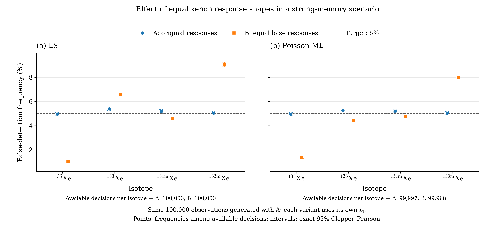

# XeMat: последствия одинаковых базовых откликов пробы и памяти

Парное сравнение обработки **одних и тех же 100 000 сохранённых наблюдений** сценария с сильной газовой памятью, детектор 221. Новые наблюдения не моделировались. Наблюдения были сгенерированы в предыдущем эксперименте моделью А с различными откликами пробы и памяти. Все четыре истинные свежие концентрации ксенона равны нулю.

**Главный результат для этого сценария:** при упрощении откликов частота ложных обнаружений Xe133m выросла с 5.039% до 9.065% для МНК и с 5.037% до 8.011% для ММП. Медиана собственного LC Xe133m при этом изменилась мало: 0.700511 → 0.699944 mBq/m³ для МНК и 0.700988 → 0.701791 mBq/m³ для ММП. Изменения зависят от изотопа и метода: например, для Xe135 частоты заметно снизились, а для Xe133 направление изменения различается у двух методов. Снижение ложных обнаружений само по себе не устанавливает улучшение обнаружения: мощность в этом эксперименте не рассчитывалась.

## Модели А и Б

**А:** исходные отклики. Свободные и вспомогательные оценки, LC, решения и статусы взяты из сохранённого предыдущего эксперимента без повторной подгонки.

**Б:** для четырёх ксеноновых столбцов базовой матрицы памяти выполнено `R_g0_B[:, 1:5] = R_c0[:, 1:5]`. Радоновый столбец сохранён. После замены снова собраны `R_g1_B = R_g0_B @ C_s_g` и `R_g2_B = R_g0_B @ C_g_g`. Оператор переноса памяти `F`, временные поправки, чувствительности, branching, матрица свежей пробы и преобразование к концентрациям сохранены.

В частности, столбец Xe133m после поправки содержит базовый материнский столбец плюс коэффициент врастания, умноженный на базовый столбец Xe133. Поэтому замена базы влияет и на дочерний вклад. Коэффициенты врастания для длительностей SAMPLE/GASBK и перенос дочери через F остаются прежними. Повторная нормировка столбцов после поправок не выполнялась.

В Б для каждого наблюдения заново выполнены свободная оценка и соответствующая вспомогательная неотрицательная подгонка. Одна вспомогательная оценка каждого метода использована для четырёх проверок. При расчёте собственного LC Б поочерёдно удалён только оцениваемый свежий вклад проверяемого изотопа; остальные оценённые координаты сохранены. Дополнительной подгонки под нулевой гипотезой нет. Обнаружение — строго `free concentration > LC`, без множителя c.

Веса МНК/NNLS: `W = diag(1 / where(x == 0, 1, x))`, заново из каждого наблюдения. Исходные нулевые отсчёты не меняются. Пуассоновский критерий использует все исходные отсчёты. Решатели и настройки `max_iter=2000`, `tol=1e-10` неизменны. LC получен существующей процедурой полной модели из 21 наблюдения и 17 параметров, включая память и DETBK.

## Точные изменения базовой матрицы памяти

| ROI | Столбец | А | Б |
|---:|---|---:|---:|
| 5 | Xe133 | 0.33 | 0.32 |
| 6 | Xe133 | 0.18 | 0.17 |
| 6 | Xe131m | 0.049 | 0.043 |
| 7 | Xe135 | 0.01 | 0.02 |
| 7 | Xe133 | 0.18 | 0.34 |

Остальные элементы базовой матрицы памяти совпадают. В этом детекторе базовый столбец Xe133m уже одинаков в Rs и Rg. Его эффективный столбец после поправок всё же меняется через изменённый дочерний столбец Xe133; сохранённые коэффициенты врастания равны 0.0405142900356 для памяти в SAMPLE и 0.0202203708475 для GASBK. Полные столбцы до и после поправок сохранены в сценарии.

## Сценарий и калибровка

Фиксированная истина, исходная неотрицательная оценка и генерирующее μ₀ унаследованы из А без изменения: только свежие Xe равны нулю, свежий радон, память и средние DETBK сохранены. Значение модели Б на этом векторе не используется для генерации. Систематические ошибки и неопределённость выбранной фиксированной истины не разыгрываются.

| Роль | Файл | Начало измерения | Реальное время, s | Живое время, s |
|---|---|---|---:|---:|
| SAMPLE | SPIKE20251127072232736.PHD | 2025-11-26T17:19:21.500000 | 50591.17 | 50400 |
| GASBK | GASBK20251126153029165.PHD | 2025-11-26T08:28:48.400000 | 25300.72 | 25200 |
| DETBK | DETBK20250610213044796.PHD | 2025-06-07T21:22:30.500000 | 259694.2 | 259200 |

Фиксированные ROI: `[1, 2, 3, 5, 6, 7, 8]`. Объём ксенона 1.30084 cm³; используемый объём воздуха **14.952183908 m³** (`V_Xe/0.087`). Пробоотбор 43167 s; ожидание после пробоотбора 15562.5 s; между началами GASBK и SAMPLE 31833.1 s. Полные границы ROI, интервалы и матрицы сохранены в файлах сценария.

| Изотоп | ε SAMPLE | ε GASBK | Branching BR | ε × BR |
|---|---:|---:|---:|---:|
| Rn222 | 0.300000 | 0.300000 | 0.3700 | 0.111000000 |
| Xe135 | 0.241169 | 0.241169 | 0.9020 | 0.217534438 |
| Xe133 | 0.367784 | 0.367784 | 0.3700 | 0.136080080 |
| Xe131m | 0.233937 | 0.233937 | 0.5400 | 0.126325980 |
| Xe133m | 0.233937 | 0.233937 | 0.5577 | 0.130466665 |

Эффективности указаны без branching. Для Rn222 сохраняется прежнее приближение `legacy` с ε=0.3 и периодом Rn222. Первая свежая координата радона вспомогательная, её не трактуем как атмосферную концентрацию.

## Частоты ложных обнаружений

Целевые 5% относятся к каждому изотопу отдельно. Точные 95%-е интервалы Clopper–Pearson маргинальные, не одновременные для всех строк. Частоты рассчитаны по доступным решениям, без замены отказов отсутствием обнаружения.

| Вариант | Метод | Изотоп | Доступно / 100000 | Ложных | Частота | 95% CI | Сбоев | Границы среди всех N |
|---|---|---|---:|---:|---:|---|---:|---|
| A | LS | Xe135 | 100000 | 4954 | 4.954% | 4.820% … 5.090% | 0 | 4.954% … 4.954% |
| A | LS | Xe133 | 100000 | 5378 | 5.378% | 5.239% … 5.520% | 0 | 5.378% … 5.378% |
| A | LS | Xe131m | 100000 | 5189 | 5.189% | 5.052% … 5.328% | 0 | 5.189% … 5.189% |
| A | LS | Xe133m | 100000 | 5039 | 5.039% | 4.904% … 5.176% | 0 | 5.039% … 5.039% |
| A | Poisson ML | Xe135 | 99997 | 4947 | 4.947% | 4.814% … 5.083% | 3 | 4.947% … 4.950% |
| A | Poisson ML | Xe133 | 99997 | 5247 | 5.247% | 5.110% … 5.387% | 3 | 5.247% … 5.250% |
| A | Poisson ML | Xe131m | 99997 | 5207 | 5.207% | 5.070% … 5.347% | 3 | 5.207% … 5.210% |
| A | Poisson ML | Xe133m | 99997 | 5037 | 5.037% | 4.902% … 5.175% | 3 | 5.037% … 5.040% |
| B | LS | Xe135 | 100000 | 1010 | 1.010% | 0.949% … 1.074% | 0 | 1.010% … 1.010% |
| B | LS | Xe133 | 100000 | 6598 | 6.598% | 6.445% … 6.754% | 0 | 6.598% … 6.598% |
| B | LS | Xe131m | 100000 | 4611 | 4.611% | 4.482% … 4.743% | 0 | 4.611% … 4.611% |
| B | LS | Xe133m | 100000 | 9065 | 9.065% | 8.888% … 9.245% | 0 | 9.065% … 9.065% |
| B | Poisson ML | Xe135 | 99968 | 1338 | 1.338% | 1.268% … 1.412% | 32 | 1.338% … 1.370% |
| B | Poisson ML | Xe133 | 99968 | 4454 | 4.455% | 4.328% … 4.585% | 32 | 4.454% … 4.486% |
| B | Poisson ML | Xe131m | 99968 | 4774 | 4.776% | 4.644% … 4.910% | 32 | 4.774% … 4.806% |
| B | Poisson ML | Xe133m | 99968 | 8008 | 8.011% | 7.843% … 8.181% | 32 | 8.008% … 8.040% |

Границы среди всех N равны `k/N` и `(k+n_fail)/N`; это диапазон из-за неизвестных исходов отказавших расчётов, а не доверительный интервал.

## Парное изменение решений

В таблице ниже оставлены только наблюдения с доступными решениями обоих вариантов для данного метода и изотопа. Поэтому её частоты могут слегка отличаться от отдельных частот выше. Обозначения 01 и 10 означают соответственно отсутствие обнаружения в А/обнаружение в Б и обратный переход. Δ = 100 × (kБ − kА) / Nобщ выражено в процентных пунктах.

| Метод | Изотоп | Nобщ | А, % | Б, % | Δ, п.п. | 00 | 01 | 10 | 11 |
|---|---|---:|---:|---:|---:|---:|---:|---:|---:|
| LS | Xe135 | 100000 | 4.954% | 1.010% | -3.944 | 95046 | 0 | 3944 | 1010 |
| LS | Xe133 | 100000 | 5.378% | 6.598% | 1.22 | 91767 | 2855 | 1635 | 3743 |
| LS | Xe131m | 100000 | 5.189% | 4.611% | -0.578 | 94262 | 549 | 1127 | 4062 |
| LS | Xe133m | 100000 | 5.039% | 9.065% | 4.026 | 90917 | 4044 | 18 | 5021 |
| Poisson ML | Xe135 | 99965 | 4.948% | 1.338% | -3.60926 | 95019 | 0 | 3608 | 1338 |
| Poisson ML | Xe133 | 99965 | 5.246% | 4.456% | -0.790277 | 93403 | 1318 | 2108 | 3136 |
| Poisson ML | Xe131m | 99965 | 5.207% | 4.776% | -0.431151 | 94205 | 555 | 986 | 4219 |
| Poisson ML | Xe133m | 99965 | 5.038% | 8.011% | 2.97304 | 91936 | 2993 | 21 | 5015 |

Все 100000 строк остаются в NPZ. Общая доступная подвыборка используется только для парного сравнения; количества решений, доступных только в А, только в Б и ни в одном варианте отдельно записаны в `paired_comparison.csv`.

## Оценки концентраций и собственные LC

Все значения — mBq/m³. Среднее и SD используют все успешные конечные свободные оценки, независимо от обнаружения и доступности LC. SD имеет делитель Nдоступных−1. Квантили LC используют все доступные LC и линейную интерполяцию NumPy. Никакие отрицательные оценки или выбросы не удалялись.

| Вариант | Метод | Изотоп | Средняя оценка | SD | Медиана LC | LC: 2.5% … 97.5% | n оценок / n LC |
|---|---|---|---:|---:|---:|---|---:|
| A | LS | Xe135 | -0.00194712 | 0.359223 | 0.594077 | 0.574999 … 0.618239 | 100000 / 100000 |
| A | LS | Xe133 | 0.00728439 | 0.658531 | 1.07728 | 1.05858 … 1.09259 | 100000 / 100000 |
| A | LS | Xe131m | 0.00155716 | 0.566448 | 0.929205 | 0.912934 … 0.952283 | 100000 / 100000 |
| A | LS | Xe133m | 0.000740016 | 0.426276 | 0.700511 | 0.688877 … 0.722428 | 100000 / 100000 |
| A | Poisson ML | Xe135 | -0.00166363 | 0.359229 | 0.594709 | 0.575571 … 0.61879 | 100000 / 99997 |
| A | Poisson ML | Xe133 | 0.00026409 | 0.658099 | 1.07803 | 1.05942 … 1.09332 | 100000 / 99997 |
| A | Poisson ML | Xe131m | 0.00351064 | 0.566457 | 0.929682 | 0.913475 … 0.952694 | 100000 / 99997 |
| A | Poisson ML | Xe133m | 0.000483743 | 0.426441 | 0.700988 | 0.689368 … 0.723022 | 100000 / 99997 |
| B | LS | Xe135 | -0.264559 | 0.373825 | 0.614388 | 0.590101 … 0.638793 | 100000 / 100000 |
| B | LS | Xe133 | -0.0747316 | 0.819447 | 1.17322 | 1.1483 … 1.19433 | 100000 / 100000 |
| B | LS | Xe131m | -0.0514294 | 0.570323 | 0.926129 | 0.895291 … 0.950833 | 100000 / 100000 |
| B | LS | Xe133m | 0.100954 | 0.436673 | 0.699944 | 0.663044 … 0.728533 | 100000 / 100000 |
| B | Poisson ML | Xe135 | -0.223434 | 0.372804 | 0.611674 | 0.58783 … 0.636023 | 99968 / 100000 |
| B | Poisson ML | Xe133 | -0.079701 | 0.753106 | 1.20949 | 1.18809 … 1.22841 | 99968 / 100000 |
| B | Poisson ML | Xe131m | -0.0292313 | 0.566674 | 0.933909 | 0.902108 … 0.958657 | 99968 / 100000 |
| B | Poisson ML | Xe133m | 0.0794642 | 0.431964 | 0.701791 | 0.665195 … 0.730252 | 99968 / 100000 |

`paired_comparison.csv` дополнительно содержит средние и SD разностей оценок Б−А и LCБ−LCА на общих доступных строках с отдельными знаменателями.

## Диагностика

Исходная подгонка реальных спектров в предыдущем эксперименте: D=52.158704, номинальное ν=4, D/ν=13.039676. Значительное отклонение от единицы означает, что данный опыт не доказывает адекватность исходной модели реальным спектрам. Здесь изучается заданное упрощение обработки наблюдений, сгенерированных именно моделью А. Причины несогласия исходной подгонки с реальными спектрами не исследовались.

**A, LS:** успешных свободных оценок 100000, вспомогательных 100000. Успешных свободных оценок с недоступной ковариацией 0; из них с доступным хотя бы одним решением 0, со всеми четырьмя 0. По изотопам: `[0, 0, 0, 0]`. Отсутствие ковариации само по себе не исключает решение.

**A, Poisson ML:** успешных свободных оценок 100000, вспомогательных 99997. Успешных свободных оценок с недоступной ковариацией 0; из них с доступным хотя бы одним решением 0, со всеми четырьмя 0. По изотопам: `[0, 0, 0, 0]`. Отсутствие ковариации само по себе не исключает решение.

**B, LS:** успешных свободных оценок 100000, вспомогательных 100000. Успешных свободных оценок с недоступной ковариацией 0; из них с доступным хотя бы одним решением 0, со всеми четырьмя 0. По изотопам: `[0, 0, 0, 0]`. Отсутствие ковариации само по себе не исключает решение.

**B, Poisson ML:** успешных свободных оценок 99968, вспомогательных 100000. Успешных свободных оценок с недоступной ковариацией 0; из них с доступным хотя бы одним решением 0, со всеми четырьмя 0. По изотопам: `[0, 0, 0, 0]`. Отсутствие ковариации само по себе не исключает решение.

Сообщения оптимизаторов учитываются отдельно от итогового статуса XeMat: исходный текст CONVERGENCE не отменяет отказ проверки допустимости/ККТ, а сообщение об исчерпании числа вычислений не отменяет успешную последующую проверку XeMat. Правила принятия результата не менялись.

| Вариант | Метод | Подгонка | Сообщение | Число |
|---|---|---|---|---:|
| A | LS | free | Решена взвешенная линейная задача | 100000 |
| A | LS | auxiliary | Решена взвешенная линейная задача | 100000 |
| A | Poisson ML | free | Optimization terminated successfully | 100000 |
| A | Poisson ML | auxiliary | `gtol` termination condition is satisfied. | 61921 |
| A | Poisson ML | auxiliary | CONVERGENCE: RELATIVE REDUCTION OF F <= FACTR*EPSMCH | 37151 |
| A | Poisson ML | auxiliary | `xtol` termination condition is satisfied. | 926 |
| A | Poisson ML | auxiliary | The maximum number of function evaluations is exceeded. | 2 |
| B | LS | free | Решена взвешенная линейная задача | 100000 |
| B | LS | auxiliary | Решена взвешенная линейная задача | 100000 |
| B | Poisson ML | free | Optimization terminated successfully | 99691 |
| B | Poisson ML | free | `xtol` termination condition is satisfied. | 175 |
| B | Poisson ML | free | `gtol` termination condition is satisfied. | 103 |
| B | Poisson ML | free | The maximum number of function evaluations is exceeded. | 31 |
| B | Poisson ML | auxiliary | CONVERGENCE: RELATIVE REDUCTION OF F <= FACTR*EPSMCH | 94666 |
| B | Poisson ML | auxiliary | `gtol` termination condition is satisfied. | 5285 |
| B | Poisson ML | auxiliary | `xtol` termination condition is satisfied. | 49 |

Предупреждения и отказы сохранены в `diagnostics.json`, а статусы/коды сообщений каждой строки — в NPZ. Стандартное предупреждение о неприменимости обычной ковариации ограниченной оценки не является отказом.

### Вариант A: записи ошибок и особые сообщения

Записей ошибок: **3**. Отказавшие наблюдения не заменялись; численные векторы, если они были возвращены, сохранены.

| ID | Метод | Подгонка | Статус | Причина/сообщение |
|---:|---|---|---:|---|
| 40586 | Poisson ML | auxiliary | 1 | The maximum number of function evaluations is exceeded. |
| 41833 | Poisson ML | auxiliary | 1 | The maximum number of function evaluations is exceeded. |
| 46012 | Poisson ML | auxiliary | 0 | Условия оптимальности ККТ не подтверждены: невязка 9.44e-06 |
| 46549 | Poisson ML | auxiliary | 0 | Условия оптимальности ККТ не подтверждены: невязка 4.03e-06 |
| 82763 | Poisson ML | auxiliary | 0 | Условия оптимальности ККТ не подтверждены: невязка 2.89e-05 |

- LS, auxiliary, warnings: Ограниченная оценка: обычная обратная информационная матрица не является её ковариацией — 100000.
- Poisson ML, auxiliary, warnings: Ограниченная оценка: обычная обратная информационная матрица не является её ковариацией — 100000.
- Poisson ML, auxiliary, warnings: Условия оптимальности ККТ не подтверждены: невязка 9.44e-06 — 1.
- Poisson ML, auxiliary, warnings: Условия оптимальности ККТ не подтверждены: невязка 4.03e-06 — 1.
- Poisson ML, auxiliary, warnings: Условия оптимальности ККТ не подтверждены: невязка 2.89e-05 — 1.

### Вариант B: записи ошибок и особые сообщения

Записей ошибок: **32**. Отказавшие наблюдения не заменялись; численные векторы, если они были возвращены, сохранены.

| ID | Метод | Подгонка | Статус | Причина/сообщение |
|---:|---|---|---:|---|
| 339 | Poisson ML | free | 0 | Условия оптимальности ККТ не подтверждены: невязка 2.14 |
| 67837 | Poisson ML | free | 0 | Условия оптимальности ККТ не подтверждены: невязка 2.14 |
| 1679 | Poisson ML | free | 0 | Условия оптимальности ККТ не подтверждены: невязка 2.07 |
| 10586 | Poisson ML | free | 0 | Условия оптимальности ККТ не подтверждены: невязка 2.07 |
| 3074 | Poisson ML | free | 0 | Условия оптимальности ККТ не подтверждены: невязка 1.98 |
| 4743 | Poisson ML | free | 0 | Условия оптимальности ККТ не подтверждены: невязка 1.91 |
| 13152 | Poisson ML | free | 0 | Условия оптимальности ККТ не подтверждены: невязка 1.91 |
| 15229 | Poisson ML | free | 0 | Условия оптимальности ККТ не подтверждены: невязка 2.54 |
| 15460 | Poisson ML | free | 0 | Условия оптимальности ККТ не подтверждены: невязка 1.56 |
| 15777 | Poisson ML | free | 0 | Условия оптимальности ККТ не подтверждены: невязка 1.93 |
| 17986 | Poisson ML | free | 0 | Условия оптимальности ККТ не подтверждены: невязка 1.87 |
| 19373 | Poisson ML | free | 0 | Условия оптимальности ККТ не подтверждены: невязка 1.57 |
| 22561 | Poisson ML | free | 0 | Условия оптимальности ККТ не подтверждены: невязка 1.84 |
| 79501 | Poisson ML | free | 0 | Условия оптимальности ККТ не подтверждены: невязка 1.84 |
| 24664 | Poisson ML | free | 0 | Условия оптимальности ККТ не подтверждены: невязка 1.55 |
| 30591 | Poisson ML | free | 0 | Условия оптимальности ККТ не подтверждены: невязка 1.55 |
| 24758 | Poisson ML | free | 0 | Условия оптимальности ККТ не подтверждены: невязка 1.68 |
| 53697 | Poisson ML | free | 0 | Условия оптимальности ККТ не подтверждены: невязка 2.2 |
| 56037 | Poisson ML | free | 0 | Условия оптимальности ККТ не подтверждены: невязка 1.17 |
| 56855 | Poisson ML | free | 0 | Условия оптимальности ККТ не подтверждены: невязка 1.7 |
| 57330 | Poisson ML | free | 0 | Условия оптимальности ККТ не подтверждены: невязка 1.81 |
| 59995 | Poisson ML | free | 0 | Условия оптимальности ККТ не подтверждены: невязка 1.29 |
| 60474 | Poisson ML | free | 0 | Условия оптимальности ККТ не подтверждены: невязка 1.12 |
| 62359 | Poisson ML | free | 0 | Условия оптимальности ККТ не подтверждены: невязка 2.12 |
| 63550 | Poisson ML | free | 0 | Условия оптимальности ККТ не подтверждены: невязка 2.18 |
| 86581 | Poisson ML | free | 0 | Условия оптимальности ККТ не подтверждены: невязка 2.18 |
| 69396 | Poisson ML | free | 0 | Условия оптимальности ККТ не подтверждены: невязка 1.89 |
| 70958 | Poisson ML | free | 0 | Условия оптимальности ККТ не подтверждены: невязка 2.05 |
| 72257 | Poisson ML | free | 0 | Условия оптимальности ККТ не подтверждены: невязка 2.38 |
| 81964 | Poisson ML | free | 0 | Условия оптимальности ККТ не подтверждены: невязка 7.22e+06 |
| 83331 | Poisson ML | free | 0 | Условия оптимальности ККТ не подтверждены: невязка 1.98 |
| 91355 | Poisson ML | free | 0 | Условия оптимальности ККТ не подтверждены: невязка 1.27 |

- LS, auxiliary, warnings: Ограниченная оценка: обычная обратная информационная матрица не является её ковариацией — 100000.
- Poisson ML, free, warnings: Условия оптимальности ККТ не подтверждены: невязка 2.14 — 2.
- Poisson ML, free, warnings: Условия оптимальности ККТ не подтверждены: невязка 2.07 — 2.
- Poisson ML, free, warnings: Условия оптимальности ККТ не подтверждены: невязка 1.98 — 2.
- Poisson ML, free, warnings: Условия оптимальности ККТ не подтверждены: невязка 1.91 — 2.
- Poisson ML, free, warnings: Условия оптимальности ККТ не подтверждены: невязка 2.54 — 1.
- Poisson ML, free, warnings: Условия оптимальности ККТ не подтверждены: невязка 1.56 — 1.
- Poisson ML, free, warnings: Условия оптимальности ККТ не подтверждены: невязка 1.93 — 1.
- Poisson ML, free, warnings: Условия оптимальности ККТ не подтверждены: невязка 1.87 — 1.
- Poisson ML, free, warnings: Условия оптимальности ККТ не подтверждены: невязка 1.57 — 1.
- Poisson ML, free, warnings: Условия оптимальности ККТ не подтверждены: невязка 1.84 — 2.
- Poisson ML, free, warnings: Условия оптимальности ККТ не подтверждены: невязка 1.55 — 2.
- Poisson ML, free, warnings: Условия оптимальности ККТ не подтверждены: невязка 1.68 — 1.
- Poisson ML, free, warnings: Условия оптимальности ККТ не подтверждены: невязка 2.2 — 1.
- Poisson ML, free, warnings: Условия оптимальности ККТ не подтверждены: невязка 1.17 — 1.
- Poisson ML, free, warnings: Условия оптимальности ККТ не подтверждены: невязка 1.7 — 1.
- Poisson ML, free, warnings: Условия оптимальности ККТ не подтверждены: невязка 1.81 — 1.
- Poisson ML, free, warnings: Условия оптимальности ККТ не подтверждены: невязка 1.29 — 1.
- Poisson ML, free, warnings: Условия оптимальности ККТ не подтверждены: невязка 1.12 — 1.
- Poisson ML, free, warnings: Условия оптимальности ККТ не подтверждены: невязка 2.12 — 1.
- Poisson ML, free, warnings: Условия оптимальности ККТ не подтверждены: невязка 2.18 — 2.
- Poisson ML, free, warnings: Условия оптимальности ККТ не подтверждены: невязка 1.89 — 1.
- Poisson ML, free, warnings: Условия оптимальности ККТ не подтверждены: невязка 2.05 — 1.
- Poisson ML, free, warnings: Условия оптимальности ККТ не подтверждены: невязка 2.38 — 1.
- Poisson ML, free, warnings: Условия оптимальности ККТ не подтверждены: невязка 7.22e+06 — 1.
- Poisson ML, free, warnings: Граничный mu=0: обычная асимптотическая ковариация неприменима — 1.
- Poisson ML, free, warnings: Условия оптимальности ККТ не подтверждены: невязка 1.27 — 1.
- Poisson ML, auxiliary, warnings: Ограниченная оценка: обычная обратная информационная матрица не является её ковариацией — 100000.

## Воспроизводимость и состав данных

Версия неизменённого ядра XeMat: `69ff5a62ccaaddeb6372f7f003109ce5ff6cf333`. Python 3.12.14, NumPy 2.3.5, SciPy 1.17.0. Хеши ядра и экспериментальных скриптов сохранены.

Исходный seed наблюдений А: 2026102801; пачки `default_rng([master_seed, chunk])`, chunk=0…99, по 1000 строк. В данном сравнении генератор случайных наблюдений не запускался. Порядок строк сохранён: `replicate_id=1000*chunk+row_in_batch`.

- `scenario_A.json`, `scenario_B.json`, `scenario_arrays_A.npz`, `scenario_arrays_B.npz` — метаданные, модели, база откликов, исходная истина А и разложение μ₀.
- `observations.npz` — неизменённые наблюдения и идентификаторы для воспроизведения обработки Б.
- `replicates.npz` — общие наблюдения, четыре свободные концентрации, собственные LC, решения и статусы обоих вариантов; полные вспомогательные 17-мерные векторы сохранены. Это все численные данные, необходимые для запрошенного сравнения.
- `full_free_parameters.npz` — дополнительный отдельно скачиваемый файл с полными 17-мерными свободными векторами А и Б в исходных смешанных единицах. Он вынесен за пределы основного ZIP из-за ограничения размера файла при публикации. Ни значения, ни точность хранения не сокращались; все строки доступны. Единицы обоих файлов описаны в `replicates_schema.md`.
- `summary.csv` — 16 строк, варианты × методы × изотопы; `paired_comparison.csv` — 8 строк парных сравнений.
- `diagnostics.json`, `summary.json` — диагностические сообщения, ошибки и происхождение всех данных.
- `false_detection_comparison.pdf`, `false_detection_comparison.png` — итоговый рисунок с точными интервалами; PNG 300 dpi.
- `plot_comparison.py`, `figures.tex`, `results_table.tex` — независимое оформление из CSV, английская подпись и таблица для статьи.
- `prepare_scenario.py`, `study.py`, `analyze.py`, неизменённое ядро и контрольные суммы — воспроизводимость.

`python analyze.py --from-merged` пересобирает таблицы и отчёт из основного `replicates.npz` без моделирования и подгонок; дополнительный файл полных свободных векторов для этого не требуется. Рисунок перестраивается скриптом `plot_comparison.py` из CSV. LD/MDC, кривые мощности, подстройка порогов и тесты Вальда не исследовались; для Б рассчитаны только собственные LC. Побочный фиксированный MDC, внутренне создаваемый API LC, не сохранялся и не анализировался. Основная статья не редактировалась.
