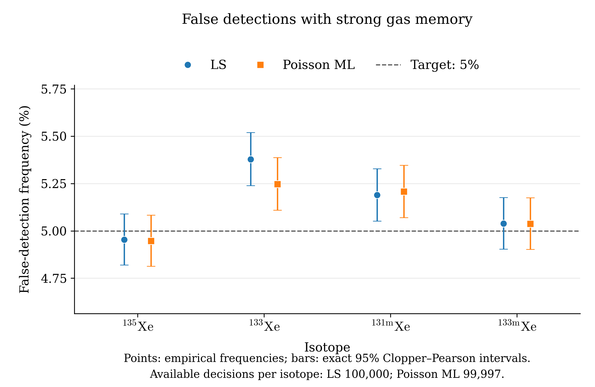

# XeMat: ложные обнаружения при сильной газовой памяти

Сценарий построен по SPIKE20251127072232736.PHD (роль SAMPLE), GASBK20251126153029165.PHD и прежнему DETBK детектора **221**. Для обоих методов использованы одни и те же **100 000** комплектов из 21 пуассоновского отсчёта: 7 ROI SAMPLE, 7 GASBK и 7 DETBK.

## Фиксированная истина и процедура

Один раз выполнена существующая совместная неотрицательная пуассоновская подгонка исходных трёх измерений. В её физическом векторе `[a_V; gamma; zeta]` обнулены только четыре свежие концентрации ксенона. Сохранены оценённые свежий радон, вся газовая память и семь средних DETBK. Никакой дополнительной подгонки при нулевой гипотезе не было. Фиксированный вектор и средний спектр `mu0 = S_V @ truth + b` находятся в `scenario_arrays.npz`.

В каждой реализации все 21 отсчёт разыграны заново независимо как `Poisson(mu0)`. Для МНК и свободного пуассоновского ММП выполнены свободная и соответствующая вспомогательная неотрицательная подгонки. Одна вспомогательная оценка каждого метода используется для всех четырёх проверок: поочерёдно убирается только свежий вклад проверяемого изотопа, прочие компоненты сохраняются, LC рассчитывается прежней формулой полной модели. Обнаружение — строго `free concentration > LC`. Оба числа переведены в **mBq/m³**, множитель порога равен 1. Отрицательные оценки и все строки сохранены.

Веса МНК и NNLS в каждой реализации: `W = diag(1 / where(x == 0, 1, x))`. Заменяется только дисперсия нулевого отсчёта; сам нулевой отсчёт остаётся нулём. Пуассоновский критерий использует исходные отсчёты. Настройки `fit`: `max_iter=2000`, `tol=1e-10`, без изменений. Систематические неопределённости и неопределённость выбора фиксированной истины здесь не разыгрываются. Кривые мощности, подстройка порога, LD/MDC и тест Вальда не исследовались. API LC в режиме `fixed` внутренне создаёт неиспользуемый формульный побочный результат MDC; он не сохранялся и не анализировался.

## Измерения и калибровки

| Роль | Файл | Начало измерения из файла | Реальное время, s | Живое время, s |
|---|---|---|---:|---:|
| SAMPLE | SPIKE20251127072232736.PHD | 2025-11-26T17:19:21.500000 | 50591.17 | 50400 |
| GASBK | GASBK20251126153029165.PHD | 2025-11-26T08:28:48.400000 | 25300.72 | 25200 |
| DETBK | DETBK20250610213044796.PHD | 2025-06-07T21:22:30.500000 | 259694.2 | 259200 |

ROI: **[1, 2, 3, 5, 6, 7, 8]**, фиксированные энергетические границы; точные границы в энергии и каналах для каждого измерения сохранены в `scenario.json`.

Пробоотбор: 43167 s; от конца пробоотбора до SAMPLE: 15562.5 s; между началами GASBK и SAMPLE: 31833.1 s; от конца GASBK до SAMPLE: 6532.38 s.

Объём извлечённого ксенона: **1.30084 cm³**. Используемый эквивалентный объём воздуха: **14.952183908 m³** по формуле `V0 = V_Xe / 0.087`. Это объём модели; записанный в исходном файле расходный объём воздуха сохранён отдельно в метаданных.

Эффективности фиксированные, без включённого branching. Чувствительность `I = epsilon × BR`.

| Изотоп | ε SAMPLE | ε GASBK | Branching (BR) | ε × BR |
|---|---:|---:|---:|---:|
| Rn222 | 0.300000 | 0.300000 | 0.3700 | 0.111000000 |
| Xe135 | 0.241169 | 0.241169 | 0.9020 | 0.217534438 |
| Xe133 | 0.367784 | 0.367784 | 0.3700 | 0.136080080 |
| Xe131m | 0.233937 | 0.233937 | 0.5400 | 0.126325980 |
| Xe133m | 0.233937 | 0.233937 | 0.5577 | 0.130466665 |

Для Rn222 сохранена прежняя модель `legacy`: ε=0.3 и поправка по периоду Rn222; это приближение радоновой цепочки. Первая координата `a_V:Rn222` служебная и не трактуется как атмосферная концентрация радона. Матрицы `R_c0`, `R_g0`, преобразования и времена неизменны и сохранены полностью.

Фиксированная память в координатах `gamma` (ожидаемые отсчёты опорных ROI GASBK до поправки на дочь), порядок Rn222, Xe135, Xe133, Xe131m, Xe133m: `1.53413084e-12, 4.084068855, 1163.785367, 5.736459991, 2.916795272e-12`.

Фиксированные средние DETBK в порядке ROI: `517.1612903, 854.2267028, 496.9573607, 66.06840183, 62.39055351, 88.69518644, 93.32975195`. Это совместно подогнанные средние по прежнему файлу DETBK, а не его неизменённые наблюдаемые отсчёты.

## Частоты ложных обнаружений

Все четыре истинные свежие концентрации равны нулю. Целевой уровень 5% относится **отдельно к каждому изотопу**. Интервалы точные Clopper–Pearson, 95%, маргинальные; одновременное накрытие всех восьми строк ими не заявляется.

| Метод | Изотоп | Доступно / N | Ложных | Частота | 95% CI | Сбоев решений | Границы среди всех N |
|---|---|---:|---:|---:|---|---:|---|
| LS | Xe135 | 100000 / 100000 | 4954 | 4.954% | 4.820% … 5.090% | 0 | 4.954% … 4.954% |
| LS | Xe133 | 100000 / 100000 | 5378 | 5.378% | 5.239% … 5.520% | 0 | 5.378% … 5.378% |
| LS | Xe131m | 100000 / 100000 | 5189 | 5.189% | 5.052% … 5.328% | 0 | 5.189% … 5.189% |
| LS | Xe133m | 100000 / 100000 | 5039 | 5.039% | 4.904% … 5.176% | 0 | 5.039% … 5.039% |
| Poisson ML | Xe135 | 99997 / 100000 | 4947 | 4.947% | 4.814% … 5.083% | 3 | 4.947% … 4.950% |
| Poisson ML | Xe133 | 99997 / 100000 | 5247 | 5.247% | 5.110% … 5.387% | 3 | 5.247% … 5.250% |
| Poisson ML | Xe131m | 99997 / 100000 | 5207 | 5.207% | 5.070% … 5.347% | 3 | 5.207% … 5.210% |
| Poisson ML | Xe133m | 99997 / 100000 | 5037 | 5.037% | 4.902% … 5.175% | 3 | 5.037% … 5.040% |

Частота и CI рассчитаны по доступным решениям: `k / n_valid`. Последний столбец — границы возможной частоты среди всех N: `k/N` и `(k+n_fail)/N`; это не доверительный интервал. Сбой не приравнивается к отсутствию обнаружения, и неудачные реализации не заменялись.

## Оценки концентраций и LC

Все величины ниже — **mBq/m³**. Среднее и SD используют все успешные конечные свободные оценки данного изотопа, независимо от обнаружения и доступности LC. SD имеет делитель `n_available_estimate−1`. Квантили LC используют все доступные LC; линейная интерполяция NumPy. В `summary.csv` отдельно указаны оба размера выборки.

| Метод | Изотоп | Средняя оценка | SD оценки | Медиана LC | LC: 2.5% … 97.5% | n оценок / n LC |
|---|---|---:|---:|---:|---|---:|
| LS | Xe135 | -0.00194712 | 0.359223 | 0.594077 | 0.574999 … 0.618239 | 100000 / 100000 |
| LS | Xe133 | 0.00728439 | 0.658531 | 1.07728 | 1.05858 … 1.09259 | 100000 / 100000 |
| LS | Xe131m | 0.00155716 | 0.566448 | 0.929205 | 0.912934 … 0.952283 | 100000 / 100000 |
| LS | Xe133m | 0.000740016 | 0.426276 | 0.700511 | 0.688877 … 0.722428 | 100000 / 100000 |
| Poisson ML | Xe135 | -0.00166363 | 0.359229 | 0.594709 | 0.575571 … 0.61879 | 100000 / 99997 |
| Poisson ML | Xe133 | 0.00026409 | 0.658099 | 1.07803 | 1.05942 … 1.09332 | 100000 / 99997 |
| Poisson ML | Xe131m | 0.00351064 | 0.566457 | 0.929682 | 0.913475 … 0.952694 | 100000 / 99997 |
| Poisson ML | Xe133m | 0.000483743 | 0.426441 | 0.700988 | 0.689368 … 0.723022 | 100000 / 99997 |

## Диагностика и границы интерпретации

Исходная неотрицательная пуассоновская подгонка: success=True, итераций 40, ранг 17, сообщение «`gtol` termination condition is satisfied.».

Для исходных измерений девианс **D=52.158704**, номинальное ν=4, **D/ν=13.039676**. Это заметно выше 1: данная совместная модель описывает реальные спектры не полностью. Для ограниченной подгонки ν номинальное. Представленное Монте-Карло проверяет статистическое правило **внутри фиксированной подогнанной модели**, а не правильность её калибровок для реальных данных. Причины расхождения в этой задаче не исследовались.

**LS:** успешных свободных оценок 100000; успешных вспомогательных 100000. У 0 успешных свободных оценок обычная ковариация недоступна. Из них имеют хотя бы одно доступное решение **0**, все четыре решения — **0**. По отдельным изотопам (в порядке Xe135, Xe133, Xe131m, Xe133m): `[0, 0, 0, 0]`. Эти решения остаются в статистике.

**Poisson ML:** успешных свободных оценок 100000; успешных вспомогательных 99997. У 0 успешных свободных оценок обычная ковариация недоступна. Из них имеют хотя бы одно доступное решение **0**, все четыре решения — **0**. По отдельным изотопам (в порядке Xe135, Xe133, Xe131m, Xe133m): `[0, 0, 0, 0]`. Эти решения остаются в статистике.

**Отказы внутренней проверки оптимальности XeMat: 3 подгонок.** Они завершились с `success=False`, потому что существующая проверка условий ККТ не подтвердила оптимальность. При этом исходный оптимизатор мог вернуть текст `CONVERGENCE: RELATIVE REDUCTION ...`: этот текст означает выполнение его критерия остановки и не отменяет последующий отказ проверки XeMat. Поэтому такая вспомогательная оценка не используется для LC; отсутствие LC и решения сохраняется как сбой. Дополнительные повторные подгонки или замены реализаций не выполнялись, настройки и алгоритмы не менялись.

| ID реализации | Метод | Подгонка | Причина XeMat | Недоступно LC / решений |
|---:|---|---|---|---:|
| 46012 | Poisson ML | вспомогательная | Условия оптимальности ККТ не подтверждены: невязка 9.44e-06 | 4 / 4 |
| 46549 | Poisson ML | вспомогательная | Условия оптимальности ККТ не подтверждены: невязка 4.03e-06 | 4 / 4 |
| 82763 | Poisson ML | вспомогательная | Условия оптимальности ККТ не подтверждены: невязка 2.89e-05 | 4 / 4 |

Обычная ковариация вспомогательной ограниченной оценки не используется для решения об обнаружении. Соответствующее стандартное предупреждение о её неприменимости само по себе не является сбоем.

Сообщения оптимизаторов (число реализаций):

| Метод | Подгонка | Сообщение | Число |
|---|---|---|---:|
| LS | свободная | Решена взвешенная линейная задача | 100000 |
| LS | вспомогательная | Решена взвешенная линейная задача | 100000 |
| Poisson ML | свободная | Optimization terminated successfully | 100000 |
| Poisson ML | вспомогательная | `gtol` termination condition is satisfied. | 61921 |
| Poisson ML | вспомогательная | CONVERGENCE: RELATIVE REDUCTION OF F <= FACTR*EPSMCH | 37151 |
| Poisson ML | вспомогательная | `xtol` termination condition is satisfied. | 926 |
| Poisson ML | вспомогательная | The maximum number of function evaluations is exceeded. | 2 |

Poisson ML, вспомогательная: в 2 случаях оптимизатор сообщил о достижении лимита вычислений функции, однако последующая существующая проверка допустимости и ККТ в XeMat прошла (`success=True`). Эти решения сохранены как доступные; ID: `[40586, 41833]`. Критерии принятия результата не менялись.

Предупреждения возвращаемого результата и Python:

- LS, вспомогательная, warnings: Ограниченная оценка: обычная обратная информационная матрица не является её ковариацией — 100000.
- Poisson ML, вспомогательная, warnings: Ограниченная оценка: обычная обратная информационная матрица не является её ковариацией — 100000.
- Poisson ML, вспомогательная, warnings: Условия оптимальности ККТ не подтверждены: невязка 9.44e-06 — 1.
- Poisson ML, вспомогательная, warnings: Условия оптимальности ККТ не подтверждены: невязка 4.03e-06 — 1.
- Poisson ML, вспомогательная, warnings: Условия оптимальности ККТ не подтверждены: невязка 2.89e-05 — 1.

Записей об ошибках/восстановлении отдельных LC: **3**. Их точные причины и идентификаторы сохранены в `diagnostics.json`; статусы и коды диагностик каждого расчёта находятся в `replicates.npz`. Статус success и доступность решения учитываются явно; текст сообщения оптимизатора отдельно от этих статусов не трактуется как отказ.

| Метод | Этап | Причина | Записей |
|---|---|---|---:|
| Poisson ML | auxiliary | CONVERGENCE: RELATIVE REDUCTION OF F <= FACTR*EPSMCH | 3 |

Наблюдаемые особенности этой серии:

- Маргинальный 95% интервал целиком выше 5%: LS Xe133 (5.378%); LS Xe131m (5.189%); Poisson ML Xe133 (5.247%); Poisson ML Xe131m (5.207%).
- Это описание данного фиксированного сценария; обобщение на иные составы памяти и проверка причин различий не выполнялись.

## Воспроизведение и состав архива

Версия ядра XeMat: `69ff5a62ccaaddeb6372f7f003109ce5ff6cf333`. Python 3.12.14, NumPy 2.3.5, SciPy 1.17.0. Исходники неизменённого ядра и их SHA-256 сохранены в `kernel_snapshot/` и `scenario.json`.

Master seed: **2026102801**. Для пачки `chunk=0,…,99` используется `numpy.random.default_rng([master_seed, chunk])`, затем `rng.poisson(mu0, size=(1000,21))`. Каждая строка имеет постоянный `replicate_id=1000*chunk+row_in_batch`. Порядок выполнения пачек не влияет на их генерацию. Все 100 пачек вошли в результат; технических отбрасываемых серий не было.

SHA-256 сценария: `dc9a36b02585731a8cc1d1e6144e25201421d8e9b9199b9bc1ae6a64cbe2a669`.

Основные файлы:

- `scenario.json`, `scenario_arrays.npz` — идентификаторы, времена, ROI, объём, калибровки, правила, исходные спектры/матрицы, исходная неотрицательная оценка, нулевой свежий Xe и разложение `mu0`.
- `replicates.npz` — все 100 000 строк, наблюдения, свободные и полные вспомогательные оценки, LC, решения, статусы, диагностика; `replicates_schema.md` описывает ключи и единицы.
- `summary.csv` — восемь строк численных результатов; `summary.json` содержит те же итоги, размеры выборок и происхождение пачек.
- `report.md`, `false_detections.pdf`, `false_detections.png` — отчёт и единственный итоговый рисунок; PNG 300 dpi.
- `plot_false_detections.py` — отдельное построение рисунка из CSV без моделирования.
- `diagnostics.json` — сообщения и предупреждения оптимизаторов, ошибки с идентификаторами и сводные статусы.
- `batch_metadata/` — все 100 исходных JSON пачек с seed, сообщениями, ошибками и контрольными суммами. Дублирующие отдельные NPZ пачек не включены: все их строки сохранены в общем `replicates.npz`.
- `inputs/`, `kernel_snapshot/`, `prepare_scenario.py`, `study.py`, `analyze.py` и файлы фиксации SHA-256 — исходные измерения, код и воспроизводимость.
- `verify_study.py`, `verification.json` и контрольные суммы архива — независимая проверка согласованности сохранённых решений и сводной таблицы.

Для изменения оформления используйте только `plot_false_detections.py` с существующим `summary.csv` (аргументы перечислены при `--help`); повторное Монте-Карло не требуется. Команда `python analyze.py --from-merged` повторно строит таблицу, диагностику и текст отчёта из сохранённого `replicates.npz` без отдельных файлов пачек и без подгонок. Изменённые выходные файлы после такого запуска потребуют обновления контрольных сумм. `python verify_study.py` выполняет проверку архивных данных и воспроизводимости наблюдений по seed; повторной подгонки при этом нет. Полные ковариационные матрицы отдельных реализаций не сохранялись. Основная статья и производственное приложение не менялись.
