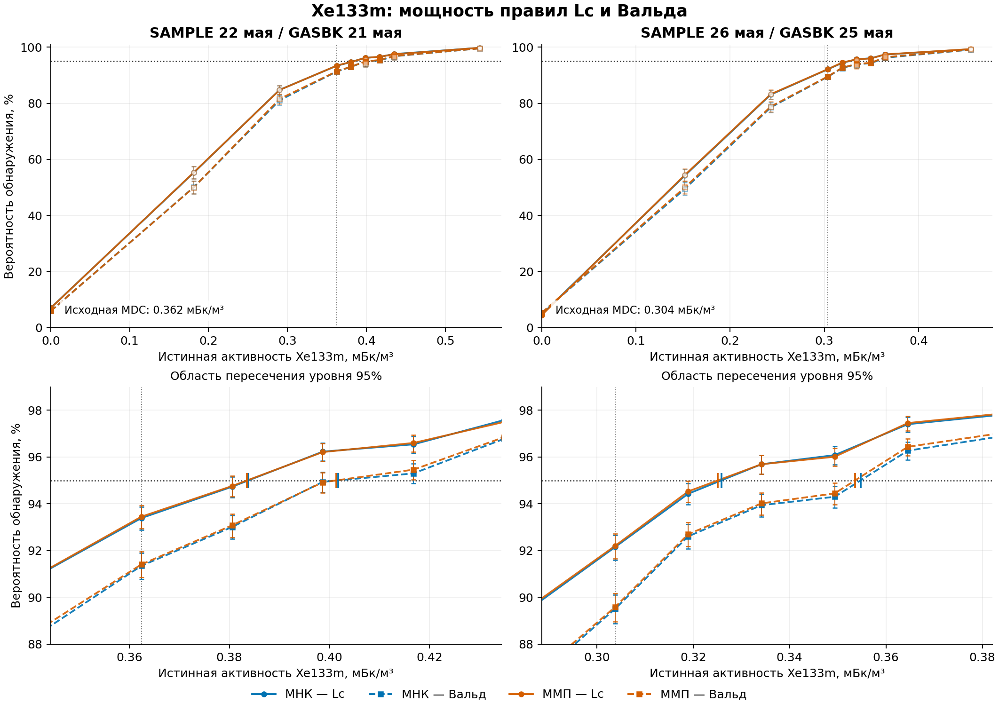

# Xe133m: вероятность обнаружения по Lc и Вальду

Комплекты SAMPLE от 22 и 26 мая 2026 года.

- [Графики в PDF](power_curves.pdf)
- [Графики в PNG](power_curves.png)

Чтобы скачать файл, откройте его на GitHub и нажмите **Download raw file** (значок загрузки справа над просмотром файла).

По горизонтали — истинная объёмная активность Xe133m, мБк/м³; по вертикали — вероятность обнаружения. Синие кривые — МНК, оранжевые — ММП; сплошные — Lc, пунктирные — Вальд. Нижние панели увеличивают область пересечения уровня 95%.

Моделирование использует фиксированную смесь для каждого комплекта и пуассоновские реализации SAMPLE, GASBK и DETBK; неопределённости калибровок не разыгрываются. Всего использовано 140 000 реализаций: 100 000 новых и 40 000 ранее рассчитанных.

Для Вальда–ММП центральные частоты рассчитаны по реализациям с доступной ковариацией: в 77 из 140 000 реализаций обычная ковариация была недоступна на границе модели. Это не отказы сходимости.

Ветка добавляет только материалы эксперимента и не меняет код приложения.
