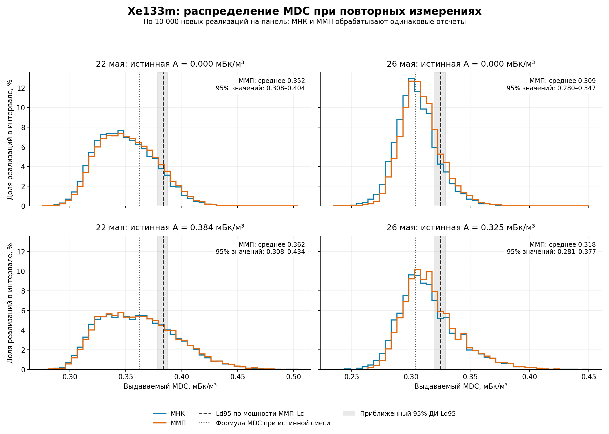
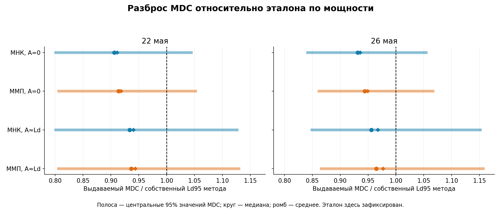

# Xe133m: насколько случаен выдаваемый программой MDC

Два майских комплекта, по 10 000 независимых новых реализаций при A=0 и при прежнем Ld95 ММП–Lc. Всего **40 000 векторов SAMPLE/GASBK/DETBK и 80 000 расчётов MDC** (МНК и ММП на одинаковых данных). Код приложения не менялся.

Рассчитывался именно **итерационный MDC действующей процедуры Lc с удалением вклада свежего Xe133m из неотрицательной оценки**. Вальд в этом исследовании не используется. Все объёмные активности ниже — мБк/м³.

## Что получилось

Средние выдаваемые MDC оказались ниже прежних точечных эталонов Ld95 во всех восьми сочетаниях. Для ММП разность составляет около −8,2% при A=0 и −5,6% при A≈Ld на 22 мая; около −5,1% и −2,3% соответственно на 26 мая. Это оценки смещения относительно приближённого эталона, а не универсальные поправочные коэффициенты.

При переходе от A=0 к A≈Ld среднее MDC ММП увеличивается примерно на 2,8–2,9%, и распределение становится шире. Значит, удаление целевого вклада из подгонки не обеспечивает инвариантности распределения MDC к истинной активности: сохраняемые мешающие параметры тоже оцениваются по случайным данным, свойства которых зависят от сигнала.

МНК и ММП дают близкие распределения, но MDC МНК в среднем немного ниже: на 0,0011–0,0036 мБк/м³ в этих сериях. Разница намного меньше разброса MDC от измерения к измерению.

Практический вывод: выдаваемый MDC следует рассматривать как случайную оценку чувствительности. Для статьи полезно отдельно приводить её смещение и разброс, фактическую мощность правила и его ложноположительную частоту. Эти результаты относятся к двум зафиксированным генерирующим смесям.

## Распределение выдаваемого MDC

Диапазон 2,5–97,5% описывает разброс результатов по повторным измерениям. Это не доверительный интервал среднего и не доверительный интервал истинного Ld.

| SAMPLE | Истинная A | Оценивание | Среднее MDC | Медиана | SD | 2,5–97,5% значений | Ld95 по мощности | Смещение среднего |
|---|---:|---|---:|---:|---:|---|---:|---:|
| 22 мая | 0.000 | МНК | 0.3498 | 0.3476 | 0.0256 | 0.3065–0.4017 | 0.3838 | -8.87% |
| 22 мая | 0.000 | ММП | 0.3522 | 0.3505 | 0.0258 | 0.3083–0.4044 | 0.3835 | -8.17% |
| 22 мая | 0.384 | МНК | 0.3610 | 0.3584 | 0.0339 | 0.3066–0.4332 | 0.3838 | -5.95% |
| 22 мая | 0.384 | ММП | 0.3620 | 0.3592 | 0.0337 | 0.3082–0.4341 | 0.3835 | -5.61% |
| 26 мая | 0.000 | МНК | 0.3050 | 0.3035 | 0.0176 | 0.2735–0.3444 | 0.3258 | -6.39% |
| 26 мая | 0.000 | ММП | 0.3087 | 0.3070 | 0.0170 | 0.2795–0.3475 | 0.3251 | -5.07% |
| 26 мая | 0.325 | МНК | 0.3153 | 0.3114 | 0.0252 | 0.2759–0.3760 | 0.3258 | -3.24% |
| 26 мая | 0.325 | ММП | 0.3176 | 0.3137 | 0.0242 | 0.2808–0.3768 | 0.3251 | -2.30% |

Ненулевой уровень генерации одинаков для МНК и ММП: 0,383547 для 22 мая и 0,325126 для 26 мая. Для МНК собственные эталоны немного отличаются (0,383810 и 0,325843); в смещениях и относительных графиках использован собственный эталон каждого метода.

## Насколько точно определено среднее

Следующие интервалы отражают только ошибку Монте-Карло среднего MDC. Неопределённость эталона Ld95 рассматривается отдельно.

| SAMPLE | Сценарий | Метод | 95% ДИ среднего MDC | MDC ниже точечного эталона | Корреляция свободной активности и MDC |
|---|---|---|---|---:|---:|
| 22 мая | A=0 | МНК | 0.34926–0.35026 | 89.48% | -0.369 |
| 22 мая | A=0 | ММП | 0.35170–0.35271 | 87.29% | -0.451 |
| 22 мая | A≈Ld95 | МНК | 0.36031–0.36164 | 74.89% | -0.603 |
| 22 мая | A≈Ld95 | ММП | 0.36139–0.36271 | 74.04% | -0.603 |
| 26 мая | A=0 | МНК | 0.30467–0.30537 | 88.27% | -0.261 |
| 26 мая | A=0 | ММП | 0.30832–0.30899 | 84.53% | -0.299 |
| 26 мая | A≈Ld95 | МНК | 0.31479–0.31578 | 71.85% | -0.535 |
| 26 мая | A≈Ld95 | ММП | 0.31716–0.31811 | 69.28% | -0.507 |

Доля MDC ниже эталона — описательная характеристика точечной оценки. От неё не требуется быть равной 5%: такое требование относилось бы к отдельно построенной верхней доверительной границе Ld.

## Меняется ли распределение при наличии сигнала

| SAMPLE | Метод | Разность средних MDC: A≈Ld минус A=0 | 95% ДИ разности | Изменение относительно среднего при A=0 |
|---|---|---:|---|---:|
| 22 мая | МНК | +0.01122 | +0.01039…+0.01205 | +3.21% |
| 22 мая | ММП | +0.00984 | +0.00901…+0.01067 | +2.79% |
| 26 мая | МНК | +0.01027 | +0.00967…+0.01087 | +3.37% |
| 26 мая | ММП | +0.00898 | +0.00840…+0.00956 | +2.91% |

## Парное сравнение способов оценивания

| SAMPLE | Сценарий | Среднее MDC(МНК) − MDC(ММП) | 95% ДИ разности | Корреляция MDC двух методов |
|---|---|---:|---|---:|
| 22 мая | A=0 | -0.00245 | -0.00252…-0.00238 | 0.9891 |
| 22 мая | A≈Ld95 | -0.00107 | -0.00111…-0.00104 | 0.9985 |
| 26 мая | A=0 | -0.00363 | -0.00372…-0.00355 | 0.9660 |
| 26 мая | A≈Ld95 | -0.00234 | -0.00242…-0.00226 | 0.9875 |

## Проверка обнаружения на новых реализациях

| SAMPLE | Истинная A | Метод | Обнаружений | Частота | 95% точный биномиальный ДИ |
|---|---:|---|---|---:|---|
| 22 мая | 0.0000 | МНК | 717/10000 | 7.17% | 6.67–7.69% |
| 22 мая | 0.0000 | ММП | 716/10000 | 7.16% | 6.66–7.68% |
| 22 мая | 0.3835 | МНК | 9462/10000 | 94.62% | 94.16–95.05% |
| 22 мая | 0.3835 | ММП | 9459/10000 | 94.59% | 94.13–95.03% |
| 26 мая | 0.0000 | МНК | 530/10000 | 5.30% | 4.87–5.76% |
| 26 мая | 0.0000 | ММП | 500/10000 | 5.00% | 4.58–5.45% |
| 26 мая | 0.3251 | МНК | 9462/10000 | 94.62% | 94.16–95.05% |
| 26 мая | 0.3251 | ММП | 9475/10000 | 94.75% | 94.29–95.18% |

В этих строках обнаружение проверяется при фиксированной истинной A, а не при случайном MDC данной реализации. Прежняя кривая мощности не пересчитывалась и с новыми данными не объединялась.

## Формула при известных мешающих параметрах

Если подставить в процедуру истинную генерирующую смесь, то после удаления свежего Xe133m формульный MDC одинаков при A=0 и при A≈Ld. Он равен:

- 22 мая: **0.362426**; прежний Ld95 ММП–Lc по мощности — **0.383547**.
- 26 мая: **0.303783**; прежний Ld95 ММП–Lc по мощности — **0.325126**.

Совпадение этого формульного значения с исходным MDC ММП обусловлено построением генерирующей смеси из первоначальной ML+ подгонки. Это не независимое подтверждение точности формулы. Разность со средним случайным MDC показывает эффект оценивания мешающих параметров; разность с Ld по мощности также включает отличие формульного приближения от реально работающей процедуры со случайным порогом.

## Неопределённость эталона и область выводов

- 22 мая, МНК: Ld95=0.383810; приближённый bootstrap 95% ДИ 0.378696–0.387635; консервативные сеточные границы 0.362426–0.398669.
- 22 мая, ММП: Ld95=0.383547; приближённый bootstrap 95% ДИ 0.378470–0.387467; консервативные сеточные границы 0.362426–0.398669.
- 26 мая, МНК: Ld95=0.325843; приближённый bootstrap 95% ДИ 0.321575–0.329839; консервативные сеточные границы 0.303783–0.334161.
- 26 мая, ММП: Ld95=0.325126; приближённый bootstrap 95% ДИ 0.319959–0.329300; консервативные сеточные границы 0.303783–0.334161.

Эталон получен интерполяцией прежней кривой мощности. Bootstrap отражает численную неопределённость этого приближения и не включает ошибку формы кривой между узлами. В JSON отдельно сохранена чувствительность смещения среднего к обоим видам границ эталона. Из небольших различий с точечным Ld нельзя делать вывод без этой оговорки.

Это условное параметрическое исследование двух фиксированных смесей, заданных подгонкой реальных спектров. Оно не проверяет правильность R и не включает неопределённость калибровок или генерирующей смеси. Исходные MDC отдельных реальных измерений не позволяют сами по себе судить о систематическом смещении во всей базе.

## Численная проверка

Журнал содержит 0 ошибок подгонки/расчёта MDC. Пропуски не заменялись новыми реализациями. Технические 400 реализаций исключены из таблиц.

Ковариация для MDC проверяется при построенном нулевом спектре. Отсутствие обычной свободной ковариации ММП на границе не означает отсутствия MDC: это разные расчёты. Проверки воспроизведения seed, непересечения блоков, решения уравнения MDC независимым методом и совпадения с полным вызовом приложения сохранены в verification.json.

## Файлы

- [Графики распределений, PDF](mdc_distributions.pdf)
- [Относительный разброс, PDF](mdc_relative_ranges.pdf)
- [Таблица результатов, CSV](summary.csv)
- [Полные численные сводки, JSON](summary.json)
- [Протокол](protocol_ru.md)
- [Компактные данные всех реализаций](trials_compact.npz)
